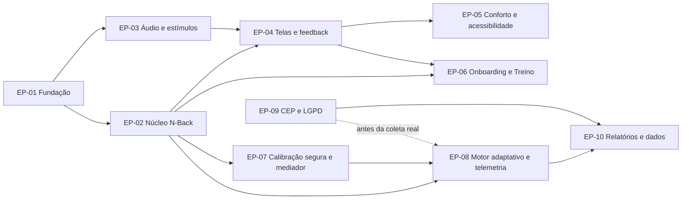
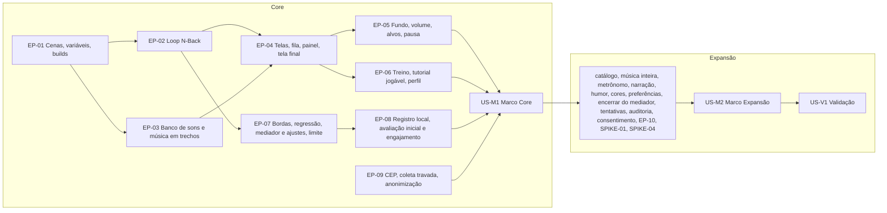
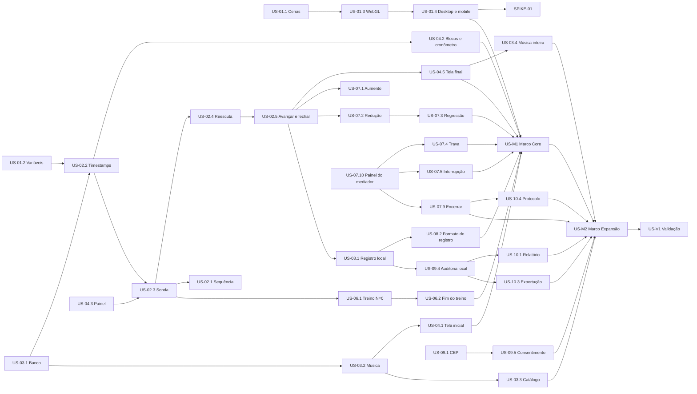

# ABD-1 — Ritmo (N-Back Beat)

> **Estado deste documento (v0.9, 26/11/2026).** Fase 1 (épicos) aprovada pelo orientador. Em 26/11/2026 o
> orientador decidiu três coisas, aplicadas aqui: (1) **o agente de IA do Lucas só escreve código** C# de runtime e
> testes EditMode e PlayMode, e diz quais testes rodar; **o Lucas os roda no Test Runner, com o Editor aberto** (não
> há Unity pela linha de comando); tudo o que se faz no Editor da Unity (cenas, Build
> Profiles, UI e Canvas, prefabs, assets e o valor dos campos, arte e som, ligações no Inspector, Player Settings e
> builds) é do Lucas. Cada task diz o dono no texto, **[agente]** ou **[aluno]**; a task do agente diz os campos
> `[SerializeField]` que o aluno liga, e o que se confere na tela é **[aluno] conferir no Play**. (2) As decisões
> do orientador sobre as lacunas do SGDD (escritas no SGDD v1.1) estão nas histórias e na seção 6. (3) O backlog tem **dois
> milestones sem data, Core e Expansão**, e a **conexão com a API saiu** para `ABD-1-Lucas-api.md`, ao lado deste ABD.
> As histórias que estavam marcadas **(Core?)** foram confirmadas no Core pelo orientador em 26/11/2026, menos a
> US-03.3 e a US-03.4, que foram para a Expansão. Nada foi criado no GitHub.

**Histórico.**

- v0.9 (26/11/2026): pelo protótipo validado pelo orientador, em S2 o N sobe com 3 fases a 100%, como em S1 (L-27 decidida); o controle "N de entrada" do mediador entrou no US-07.6 (TASK-282 e TASK-283); os três pares de histórias que dependiam uma da outra ficaram com uma dependência só, pela ordem de construção (TASK-220, TASK-234 e TASK-248).
- v0.8 (26/11/2026): revisão final — o agente escreve os testes e o aluno os roda no Test Runner (TASK-190 e TASK-264 viraram [aluno]); o script de build virou item de menu do Editor (TASK-040); a avaliação inicial (US-08.6) subiu para o Core, sem depender do humor; a 2ª partida de S2 vai direto ao jogo, e o tutorial fica no botão "❔ Como jogar" (TASK-278 a 280); o interruptor da avaliação no painel (TASK-281); a estrutura do repositório (seção 4); L-05, L-23 e L-32 em blocos e no SGDD v1.1; as decisões citadas pelas L-xx da seção 6.
- v0.7 (26/11/2026): (a) o playtest do protótipo web, já no SGDD: tutorial jogável em três degraus (US-06.3, US-06.4,
  US-06.5; TASK-270 nova, TASK-102 e TASK-103 refeitas, sem Timeline), o N à vista na pergunta (US-04.8, e o marcador
  "?" no bloco de N atrás, US-04.2, TASK-271 a 273), a fase contada em blocos, 6 por padrão e 4 a 12 no painel
  (US-01.2, US-02.2, US-07.6, US-07.7, US-08.10, US-08.6; LA-10 aberta), o placar "✓ n" e o ✓ verde no acerto
  (US-04.7, US-04.4) e a tela estreita (US-04.1, TASK-274); (b) as respostas do orientador às
  perguntas abertas do ABD: LA-01 a LA-09 decididas, com o protótipo valendo na LA-03 (com o terceiro acerto em
  N=0 a fase acaba), na LA-08 (o volume à mostra, sem tela de Configurações) e na avaliação inicial (abre cada
  partida); [Sair] só no Windows (TASK-275 a 277); as quatro decisões do protótipo aprovadas (nota da melodia como
  estímulo, avaliação que só baixa, [Mais fácil] apagado no piso, S3 em N=0 sem tempo); as (Core?) confirmadas no
  Core, menos US-03.3 e US-03.4, que foram para a Expansão (a US-04.1 passou a ler o banco, e o marco US-M2 joga o
  catálogo e a música inteira).
- v0.6 (26/11/2026): revisão da v0.5 aplicada — o Core deixou de depender da Expansão (US-07.6 subiu para o Core, a
  exportação saiu da US-09.2 e da US-09.3 para a US-10.3, o marco ganhou a TASK-269), o agente fecha só por teste, sem
  labels `fecha:*` nem coluna "Quem fecha", sem capturas, e a LA-09 foi aberta.
- v0.5 (26/11/2026): dono `[agente]`/`[aluno]` em cada task, com as tasks mistas divididas e a montagem no Editor
  passada ao aluno; decisões do orientador sobre as lacunas do SGDD aplicadas; milestones Core e Expansão sem data; API movida para
  `ABD-1-Lucas-api.md`.

**Lacunas desta revisão.** LA-01 a LA-09: decidida pelo orientador em 26/11/2026, com a condição dele de que nada
mude o que ele jogou e validou no protótipo web; onde a sugestão contradizia o protótipo, valeu o protótipo. LA-10: aberta.

- **LA-01** — A avaliação inicial *"só pode baixar"* a entrada (L-09), mas a entrada já é 60 BPM, o piso do
  BPM, e N=1 em S1 e S2, o piso do N. O que a avaliação baixa? (US-08.6, TASK-151) **Decidida pelo orientador em 26/11/2026:** como no protótipo, abaixo de 50% de acertos
  nas duas fases, a primeira fase da partida vira N=0 até três acertos.
- **LA-02** — Os ajustes do mediador e a trava passam para a partida seguinte, ou cada partida recomeça da entrada do
  perfil também para eles (L-36)? (US-07.4, US-07.6, US-07.7) **Decidida pelo orientador em 26/11/2026:** passam; valem até o fim da
  sessão.
- **LA-03** — No piso, as perguntas viram N=0 *"até três acertos"* (L-37): três seguidos ou três no total? E
  depois deles a pergunta volta a N=1 na mesma fase? (US-07.2, TASK-112) **Decidida pelo orientador em 26/11/2026:** três no total. Depois
  deles **vale o protótipo**, e não a sugestão (*"volta a N=1 na mesma fase"*): com o terceiro acerto a fase acaba, e a
  fase seguinte volta ao N de antes.
- **LA-04** — A ferramenta de Editor que fatiava e esticava a música saiu, porque o agente não escreve script de
  Editor: o código fatia a faixa em tempo de execução (TASK-050), e o aluno prepara as versões em 60, 80, 100 e
  120 BPM num editor de áudio fora da Unity (TASK-216). (US-03.2) **Decidida pelo orientador em 26/11/2026:** mantido.
- **LA-05** — O script de build (TASK-040) é código de Editor. Ficou com o agente porque só
  chama o pipeline de build, sem montar cena nem asset, e quem o roda é o aluno (TASK-191). (US-01.4) **Decidida pelo orientador em 26/11/2026:** mantido com o
  agente, como **item de menu do Editor** que o aluno roda com o Editor aberto (não há Unity pela linha de comando).
- **LA-06** — Sete testes do agente leem o que o aluno montou (as cenas no Build Settings, os assets, as telas):
  TASK-002, TASK-052, TASK-056, TASK-082, TASK-087, TASK-088 e TASK-092. O brief pede testes que montam o mínimo por código; estes ficaram
  assim porque o critério deles é sobre a montagem. Mantê-los, ou virarem conferência do aluno? **Decidida pelo orientador em 26/11/2026:**
  mantidos, e rodam só no marco (US-M1, ou US-M2 se a história é da Expansão), na suíte do marco, que o aluno roda no Test Runner.
- **LA-07** — As 79 tasks novas (montagem do aluno no Editor, os passos novos do marco, as 5 do playtest de 26/11, TASK-270 a 274, mais a TASK-102 refeita, as 3 do menu, TASK-275 a 277, e as 6 da revisão final, TASK-278 a 283) não têm estimativa em
  horas, porque o brief não deixa inventar. Os totais em horas e a capacidade (seções 8.5 e 11) contam só as tasks
  que já tinham horas; o trabalho do aluno no Editor não está medido. **Decidida pelo orientador em 26/11/2026:** continuam sem horas; o
  aluno estima cada uma quando a puxa. O roadmap fica com a ordem e os totais, sem projeção de ritmo.
- **LA-08** — O Core pede *"menu inicial funcional (jogar, sair, configuração mínima)"*, e o SGDD e este ABD não têm
  botão de sair nem configuração na tela inicial (o volume fica na tela de jogo, US-05.2). Entram? Em que história?
  **Decidida pelo orientador em 26/11/2026:** entram no US-04.1 (Core): [Sair] só na build Windows (some no WebGL, no Android e no
  Linux). A sugestão punha o volume numa tela [Configurações]; **vale o protótipo**: o volume fica à mostra no canto
  superior direito da tela inicial, como em toda tela, e é ele a configuração mínima (TASK-275 a TASK-277).
- **LA-09** — Tempo esgotado (L-12): *"a pergunta se repete"* quer dizer que a sonda toca de novo, ou que só o
  painel reabre com o tempo cheio? E *"sem som"* é só sem alarme e sem som de erro, ou nenhum som? (US-02.6, TASK-044,
  TASK-046) **Decidida pelo orientador em 26/11/2026:** a sonda toca de novo e o tempo recomeça; *"sem som"* é sem alarme nem som de
  erro.
- **LA-10** (aberta, 26/11/2026) — A expansão com engajamento (L-24) crescia a fase 5 s por vez, até 45 s (S1) ou
  30 s (S2). Com a fase contada em blocos (playtest do protótipo web), a conversão provisória é +1 bloco por vez, até
  9 (S1) ou 7 (S2); o protótipo não tem expansão, então nada jogado a confirma. Ficam esses tetos? (US-08.10,
  TASK-160)

## 1 Sumário

- **Dois milestones, sem data** (decisão do orientador, 26/11/2026). **Core:** 46 histórias, 0 spikes, 185 tasks (123 [agente], 62 [aluno]), 92 SP e 207 h, contando o marco US-M1;
  as (Core?) foram confirmadas pelo orientador. **Expansão:** 18 histórias, 2 spikes, 73 tasks (45 [agente], 28 [aluno]), 40 SP e 79 h, contando o marco US-M2 e a validação US-V1. Backlog inteiro: 10 épicos, 64 histórias, 2 spikes, 258 tasks (168 [agente], 90 [aluno]), 132 SP e 286 h. As tasks novas não têm horas; o aluno as estima quando as puxa (LA-07).
- **Core:** o essencial para jogar e entender o jogo, nas builds WebGL, Windows, Linux e Android: as cenas, as
  variáveis de fase, a sequência, os estímulos no compasso, a sonda e o painel Sim/Não, o tempo de resposta, a
  reescuta e o fim da partida; os 5 sons, a música em trechos, a tela inicial com a escolha do som, o volume e o [Sair]
  (Windows); a fila de blocos, o cronômetro, o acerto, a pontuação e o professor; fundo neutro,
  volume, jogar sentado, alvos de 48 dp e a pausa com [Voltar ao início] e [Mais fácil]; o treino N=0, o tutorial jogável
  (pulável em S1, obrigatório na primeira vez em S2, e no botão "❔ Como jogar"), a avaliação inicial que só baixa e o perfil; as regras de borda, a regressão, o painel do mediador com a trava e a interrupção branda,
  os ajustes do mediador, as faixas por perfil, o limite de sessão e o tamanho da fase com engajamento; o registro em arquivo local com o formato
  documentado; a situação do CEP, a coleta travada e a pseudonimização. O marco US-M1 joga o Core inteiro.
- **Expansão:** o que vem por cima do loop: o clique do metrônomo, a narração, o humor, as cores e as preferências,
  o encerrar do mediador, as tentativas ajustadas, o catálogo de gêneros e ruídos, a música inteira na tela final, a auditoria local, o
  consentimento e o assentimento, o relatório, os dados das hipóteses, a exportação, o aviso do protocolo, o contexto
  de uso, a medição num aparelho de entrada (SPIKE-01) e a proposta de multiplayer (SPIKE-04). O marco US-M2 joga o
  jogo inteiro, e a validação US-V1 percorre o SGDD (seção 10).
- **Conexão com a API:** saiu deste backlog (decisão do orientador, 26/11/2026) e está inteira, com as histórias, os
  critérios e as tasks, em `ABD-1-Lucas-api.md`: 6 histórias, 2 spikes e 25 tasks (51 h), para outro momento. Aqui a
  telemetria é só arquivo local.
- **Quem faz:** o agente de IA do Lucas escreve o C# de runtime e os testes e diz quais rodar; o Lucas os roda no
  Test Runner e monta no Editor tudo o que é de Editor, em tasks **[aluno]** que dizem onde, que componente e que campo ligar
  (seção 9).
- **Capacidade, risco registrado:** 286 h de tasks com estimativa, mais a montagem no Editor, que o aluno estima
  quando puxa cada task (LA-07). O roadmap dá a ordem e os totais, sem projeção de ritmo. O escopo não muda (seção 8.5).
- **Lacunas:** as decisões do orientador de 26/11/2026 sobre as lacunas do SGDD estão aplicadas nas histórias; a seção 6 marca cada
  lacuna como decidida, decidida em parte, ou provisória e pendência (o piloto). As lacunas que esta revisão abriu
  (LA-01 a LA-10) estão no topo, as nove primeiras já decididas.
- **Cobertura:** os 10 requisitos da §12 têm história (seção 5.4; o RT-10 está em `ABD-1-Lucas-api.md`), e cada linha
  normativa do SGDD tem história ou spike (seção 5.5). Fora do backlog, só o que o SGDD exclui: teoria musical (§3.3)
  e os instrumentos de validação (§13A, Doc 3) (seção 7).
- **Dependências externas** (CEP, LGPD, aparelho Android, piloto): cada história entrega o código até onde ele
  alcança, e a parte humana é um estado registrado na issue — feito, ou esperando X — que volta no marco (seção 8.2).
- **O jogo não integra a plataforma CIATEC** (seção 3): não há épico de integração, e o backend adaptativo é um
  FastAPI próprio (SGDD §7.4), em `ABD-1-Lucas-api.md`.
- **Estado do código:** o repositório tem o esqueleto (Unity 6000.5.7f1, pastas, 16 asmdefs, README) e **nenhuma
  linha de C# do jogo** (seção 4).

## 2 Fontes

| Fonte | Papel | Observação |
| --- | --- | --- |
| `SGDD-1-Lucas.md` (ciatec-ic, `arquivos_ic/Lucas/`) | **Fonte principal** | v1.1, 26/11/2026: a v1.0 do git (28/09/2026, commit `9bbcb9b`) com o playtest do protótipo web e as decisões do orientador de 26/11/2026. Formato v1: §12 = requisitos, §13 = lacunas |
| `Docs/SGDD-Ritmo-Lucas.md` (fork `fatorarpolinomio/ciatec-game-n-back-beat`, branch `develop`) | Cópia | Adicionado em 10/11/2026 (`efaff55`). Idêntico à v1.0 da ciatec-ic (diff vazio, só muda fim de linha CRLF/LF); não tem a v1.1. O da ciatec-ic segue como principal |
| `sugestoes-variaveis-lucas.md` | Apoio | Proposta de variáveis e eventos. **O que não está no SGDD não vira requisito aqui**: vira lacuna (L-06, L-19) ou candidato a confirmar |
| `Rascunho-1-Lucas.md` | Apoio | Ideias anteriores ao SGDD. Onde diverge do SGDD (opções múltiplas em vez de Sim/Não, multiplayer colaborativo), vale o SGDD |
| `assets/UI-Esboço-1 - Ritmo.png` | Apoio (figura) | Tela de jogo: botão voltar, cronômetro no topo, 3 corações, 4 cartões numerados 1–4 sobre onda sonora, fundo roxo escuro. Não é citada no texto do SGDD — ver L-15 |
| Fork `fatorarpolinomio/ciatec-game-n-back-beat` (`develop`) e `ciatec-org/ciatec-game-n-back-beat` | Estado do código | Lido só pelo `gh`. O `ciatec-org` recebeu o mesmo conteúdo pelo PR #2 (17/11/2026). Issues desabilitadas no fork; nenhuma issue nem milestone no `ciatec-org` |
| Método | — | `agile-pipeline`, `epic-generator`; `docs/specs/context-ciatec.md`, `stack-unity.md`, `spec-roadmap.md`, `spec-github-projects.md` do `ciatec-agile-pipeline` |

**Por que `agile-pipeline` e não `glide-pipeline`:** a `glide-pipeline` é para microjogo Unity **com o pacote
CIATEC**; este jogo não usa o pacote (seção 3).

**Numeração dos requisitos.** A §12 do SGDD não numera as linhas. Este ABD numera **RT-01 a RT-10 na ordem das
linhas da tabela da §12**, só para rastrear; vale propor ao Lucas que o SGDD adote os mesmos números.

## 3 Decisão: integração com a plataforma CIATEC

**O jogo não integra a plataforma CIATEC.** Evidência:

- **SGDD §7.4 (Technology):** Unity (C#) para o jogo e um **servidor próprio em Python/FastAPI** como motor
  adaptativo; publicação para WebGL, Desktop (Linux/Windows) e Mobile. Nenhuma menção a `com.ciatec.*`,
  ciatec-core, pose-server ou M3Kit em todo o SGDD (busca por `ciatec.`, `pose`, `m3kit`, `pacote`: zero
  ocorrências).
- **Repositório:** `Packages/manifest.json` do fork não tem nenhum pacote `com.ciatec.*`; só pacotes Unity.
- **Interação (§2.2):** clique de mouse ou toque — não há câmera nem pose, que é o que o pose-server e o M3Kit
  atendem.

**Consequências para o backlog:**

1. **Não há "segunda passada" sobre fichas de agente nem Épico de integração com a plataforma**: não há
   plataforma consumida.
2. O que a `stack-unity.md` diz que *"o pacote já entrega"* — menus, tela de resultados, overlay de ajustes,
   HTTP, exportador de telemetria, áudio — **aqui é trabalho do jogo** e está nos épicos EP-04, EP-05, EP-03 e EP-08.
3. O motor adaptativo FastAPI (§7.4) é um **sistema do próprio produto**, em outro repositório ainda sem lugar
   (README do fork: *"[definir onde ficará]"*) — é o EP-08, e o lugar dele é a lacuna L-07.
4. Se o orientador decidir integrar à plataforma depois, isso é mudança da §7.4 do SGDD, e o backlog se refaz a
   partir dela (com o épico de integração e a segunda passada).

## 4 O que já existe no repositório (modo incremental)

Lido em `fatorarpolinomio/ciatec-game-n-back-beat`, branch `develop`, último commit `ecde713` (10/11/2026).

| Item | Estado | Épico |
| --- | --- | --- |
| Unity **6000.5.7f1** (`ProjectSettings/ProjectVersion.txt`), URP 17.5.0, Input System 1.20.0, Test Framework 1.7.0, uGUI 2.5.0 | Feito | EP-01 |
| Estrutura `Assets/_Project/` (Scripts, ScriptableObjects, Scenes, Prefabs, Tests) | Feito (só pastas com `.gitkeep`) | EP-01 |
| 12 asmdefs de runtime (`Ritmo.Core`, `Audio`, `NBack`, `Adaptive`, `Telemetry`, `Profiles`, `Feedback`, `Training`, `Mediator`, `Session`, `Reports`, `UI`) + `Ritmo.Editor` + 3 de teste (EditMode, PlayMode, Performance) | Feito, vazios | EP-01 |
| Pastas de cena `00_Bootstrap`, `01_Profile`, `02_Training`, `03_Gameplay`, `04_SessionEnd`, `Debug` | **Só pastas**; nenhuma `.unity` criada | EP-01 |
| Build Settings | Só `Assets/Scenes/SampleScene.unity` (cena do template) | EP-01 |
| Pastas de ScriptableObjects (`Events`, `PhaseSettings`, `Profiles`, `SafetyLimits`, `Stimuli`, `Tracks`) | Só pastas | EP-01, EP-02, EP-03 |
| `Assets/ThirdParty/AudioLicenses/` | Pasta vazia | EP-03 (L-02) |
| Código C# do jogo | **Nenhum** (os únicos `.cs` são do template `TutorialInfo`) | — |
| `README.md` | Descreve fluxo, arquitetura e regras de dependência entre asmdefs | ver nota abaixo |

**Nota sobre o README do fork.** Ele registra decisões que **não estão no SGDD**: cronômetro e metrônomo locais por
`AudioSettings.dspTime`, rede usada só entre fases, `LocalRuleProvider` aplicando as regras de segurança sem rede,
reenvio da telemetria depois, parâmetros terapêuticos em ScriptableObjects, e LGPD. São decisões razoáveis, mas a
fonte do backlog é o SGDD: elas entram aqui como lacuna a fechar no SGDD (L-16, L-19), não como requisito.

**Estrutura do código: vale a do repositório, e não a sugerida no `AGENTS.md` do pacote de agentes** (`Assets/Scripts/`, asmdef `Jogo`): asmdefs `Ritmo.*`, código e testes em `Assets/_Project/`, entrada pelo Input System e os *timestamps* agendados por `AudioSettings.dspTime`. O agendador lê o relógio do áudio por uma interface que o teste troca por um relógio falso (como o `Agentes.Relogio` faz com o tempo do jogo), e o toque vem pelo Input System, simulado no teste com o `InputTestFixture`.

## 5 Épicos

### 5.1 Tabela resumo

| ID | Épico | Domínio | Prioridade | Estimativa | Depende de | Milestone |
| --- | --- | --- | --- | --- | --- | --- |
| EP-01 | Fundação do projeto Unity e builds | Infraestrutura | P1-Crítico | S (1–2 sem) — parcial | — | Core e Expansão |
| EP-02 | Núcleo N-Back: sequência, fase e questionamento | Frontend (Unity) | P1-Crítico | M (3–4 sem) | EP-01 | Core e Expansão |
| EP-03 | Áudio, estímulos e recompensa musical | UX/Conteúdo | P1-Crítico | M (3–4 sem) | EP-01 | Core e Expansão |
| EP-04 | Telas do jogo e feedback | Frontend + UX | P1-Crítico | M (3–4 sem) | EP-02, EP-03 | Core e Expansão |
| EP-05 | Conforto sensorial e acessibilidade | UX | P1-Crítico | M (3–4 sem) | EP-04 | Core e Expansão |
| EP-06 | Onboarding em três camadas e Treino Pré-Jogo | Frontend + UX | P1-Crítico | M (3–4 sem) | EP-02, EP-04 | Core |
| EP-07 | Calibração segura: regras de borda, regressão e controles do mediador | Frontend (Unity) | P1-Crítico | M (3–4 sem) | EP-02 | Core e Expansão |
| EP-08 | Motor adaptativo e telemetria (Unity ↔ FastAPI) | Backend + AI | P2-Alta | L (5–6 sem) | EP-02, EP-07 | Core e Expansão (a conexão com a API está em `ABD-1-Lucas-api.md`) |
| EP-09 | Conformidade ética (CEP) e LGPD | Pesquisa / Compliance | P1-Crítico | S (1–2 sem) | — (paralelo) | Core e Expansão |
| EP-10 | Relatórios de acompanhamento e dados para validação | Dados + Pesquisa | P3-Média | M (3–4 sem) | EP-08, EP-09 | Expansão |

**Sobre as prioridades.** A §12 marca 8 de 10 requisitos como *Alta*, e por isso 8 épicos são P1: a ordem real sai
das dependências (seção 5.2), não da prioridade. A prioridade ordena o trabalho dentro do milestone; não decide o que
entra. O EP-08 é P2 apesar de o RT-10 ser *Alta* (o RT-10 está em `ABD-1-Lucas-api.md`) porque o jogo é jogável e seguro sem o servidor (o EP-07 aplica as
regras de borda localmente). O EP-10 é P3 porque depende dos dados que os outros épicos gravam.

**Sobre as estimativas.** S/M/L seguem a régua do `epic-generator` (semanas de um time misto). As horas reais, por
task, estão na seção 9, e os milestones na seção 8.

**Labels.** `epic` + `domain:*` + `priority:p*` (`spec-github-projects.md` §1). A spec não tem `domain:gameplay`;
este ABD usa `domain:frontend` para o cliente Unity.

### 5.2 Mapa de dependências



### 5.3 Milestones

Dois milestones, **sem data** (decisão do orientador, 26/11/2026). O **Core** é o essencial: o menu inicial, o loop
N-Back completo, a progressão e a adaptação, o registro em arquivo local, e o que faz o loop ser jogável e entendido
(sair da fase pela pausa e a pausa; o tutorial jogável e os ajustes do mediador também). A **Expansão** é o resto do SGDD: polimento, acessibilidade além do
mínimo, o painel do mediador avançado, relatórios e afins. Toda história está num dos dois; nenhuma história do Core
depende de uma da Expansão (o gerador confere). As que ficaram em dúvida, marcadas (Core?), o orientador decidiu em
26/11/2026: no Core, menos o catálogo de gêneros (US-03.3) e a música inteira como recompensa (US-03.4). O
marco US-M1 joga o Core; o marco US-M2 joga o jogo inteiro; a validação US-V1 percorre o SGDD (seção 10). A conexão
com a API, que o orientador mandou para outro momento em 25/11/2026, está em `ABD-1-Lucas-api.md`.

### 5.4 Rastreabilidade — requisitos da §12 → épico e história

| RT | Requisito (§12) | Prioridade (§12) | Épico | História |
| --- | --- | --- | --- | --- |
| RT-01 | Feedback visual neutro para erros (sem punição sonora/visual) | Alta | EP-04 | US-04.4 |
| RT-02 | Fundo de tela branco/neutro como padrão inicial | Alta | EP-05 | US-05.1 |
| RT-03 | Controle mestre de volume (0–100%) acessível durante o jogo | Alta | EP-05 | US-05.2 |
| RT-04 | Botão de "regressão de fase" para manejo de frustração | Média | EP-07 | US-07.3 |
| RT-05 | Modo "Treino Pré-Jogo" sem cronômetro ou contagem de erro | Alta | EP-06 | US-06.1, US-06.2 |
| RT-06 | Tutorial rápido embutido com opção de "Pular" | Média | EP-06 | US-06.3 |
| RT-07 | Não exigir postura em pé; jogável sentado | Alta | EP-05 | US-05.5, e critério do marco US-M1 |
| RT-08 | Dashboard clínico ou atalhos de teclado para "Trava de Variável" (N-Back e BPM) | Alta | EP-07 | US-07.10, US-07.4 |
| RT-09 | "Interrupção Branda": transição imediata para o Treino Pré-Jogo (N=0) | Alta | EP-07 | US-07.5 |
| RT-10 | Cliente de telemetria no Unity, JSON via REST, comunicando com a API | Alta | EP-08 | US-08.3 e US-08.4, em `ABD-1-Lucas-api.md` (decisão do orientador: a conexão com a API vem em outro momento); aqui, o registro local US-08.1 e o formato US-08.2 |

### 5.5 Cobertura do SGDD → história

Percorrido seção por seção, linha normativa por linha normativa. Toda linha tem história, spike ou a nota de por que
não é requisito (metadado, justificativa, ou exclusão do próprio SGDD, seção 7). **(API)** marca as histórias que estão em
`ABD-1-Lucas-api.md` (a conexão com a API, de outro momento).

| SGDD | Linha normativa | História / spike |
| --- | --- | --- |
| §1 | Identificação, versão, responsável | — (metadado; a situação do CEP entra no §1 pela US-09.1) |
| §2 | Estímulos sonoros sequenciais **enumerados**, em ciclos de tempo | US-02.2, US-04.2 |
| §2 | Estímulos *"musicais ou não"* | US-03.1, US-03.2, US-03.3 |
| §2 | *Timestamps* *"delimitados por metrônomo"* | US-02.2, US-02.7 (L-21) |
| §2 | Diferentes gêneros musicais | US-03.3 |
| §2 | Ciclo cronometrado; ao fim, questionamento sobre estímulos anteriores; resposta Sim ou Não a *"N timestamps atrás"* | US-02.3, US-04.2, US-02.6 |
| §2 | *"Haverá mais ciclos até que a sequência se encerre completamente"* | US-02.5 |
| §2 | O sistema se adapta ao desempenho | EP-07, US-08.6, US-08.9, US-08.10; no servidor, US-08.5, US-08.8 (API) |
| §2 | Público jovem TEA; necessidades do PPI | EP-05, EP-06, EP-07 |
| §2.1 | Escuta ativa e *active recall* | US-02.2, US-02.3 |
| §2.2 | Plataforma web, desktop, mobile | US-01.3, US-01.4 (Android, L-30) |
| §2.2 | Majoritariamente single player; multiplayer *"eventualmente"* | todo o backlog é single player; SPIKE-04 (proposta de multiplayer) |
| §2.2 | Interação por clique de mouse ou *touchscreen* | US-02.3, US-01.4, US-05.5 |
| §2.3 item 1 | S1 e S2, menores de 18, com acompanhamento profissional | US-06.5, US-07.7, US-09.5 |
| §2.3 item 2 | S3 com mediação intensa; N reduzido a zero | US-06.1, US-07.5, US-07.7, US-07.10 |
| §2.3 item 3 | Relatórios gerados pelo jogo para responsáveis e profissionais | US-10.1 |
| §3.1 | Exercitar atenção e memória; identificar fragilidades | EP-02, US-08.6, US-10.1, US-10.3 |
| §3.2 | Ponto de conforto durante crises; sons que não sobrecarregam | US-05.1, US-05.2, US-05.7, US-07.5, US-03.3 |
| §3.2 | Coleta de dados para mapear necessidades | US-08.1, US-10.2, US-10.3, EP-09 |
| §3.3 | Fora do escopo: teoria musical e habilidade rítmica profissional | seção 7 (exclusão do SGDD) |
| §3A GP-01 | Multiplataforma; *touchscreen*, desktop e web | US-01.3, US-01.4, US-05.5 |
| §3A GP-02 | Coleta de atenção e memória por *backend*; adaptabilidade dos questionamentos e da dificuldade | coleta: US-08.1, US-08.2 (local) e US-08.3, US-08.4 (API); questionamentos: US-07.6 (sondas por fase), US-08.9; dificuldade: EP-07, US-08.6, US-08.10, US-08.5 (API) |
| §3A GP-03 | Escolha de gêneros ou tipos de som; questionário de preferências | US-03.3, US-04.1, US-05.4 |
| §3A GP-04 | Limite de duração e critérios de interrupção | US-07.8, US-07.9, US-10.4 |
| §3A GP-05 | Treino Pré-Jogo N=0, sem limite de tempo | US-06.1, US-06.2 |
| §4.1 | Exposição cronometrada a estímulos em *timestamps* | US-02.2, US-04.2 |
| §4.1 | Ao fim do tempo, um estímulo a mais; Sim ou Não para *"N passos atrás"* | US-02.3, US-02.1 |
| §4.1 | Painel por clique de mouse ou toque | US-04.3, US-02.3 |
| §4.1 | Exemplo com 6 *timestamps* de 1 s | US-02.3 (L-23) |
| §4.1 | Hipótese: eliminar feedback punitivo; superestimar só os acertos | US-04.4, US-04.7 |
| §4.2 | Acerto: animação contida e reforço sonoro integrado à música | US-04.4, US-03.2 |
| §4.2 | Pontuação na tela focada nos acertos acumulados | US-04.7, US-04.5 |
| §4.2 | Erro neutro: sem distorção, sem mudança de paleta, sem som de falha | US-04.4 (RT-01) |
| §4.2 | Erro resulta na ausência da recompensa e na não progressão da fase | US-04.4, US-02.5 |
| §4.2 | Controle de volume e opção de desativar os sons | US-05.2 |
| §4.3 | Cada conjunto de *timestamps* é uma fase; fases compõem a música escolhida | US-02.5, US-03.2 |
| §4.3 | *"Um ou mais questionamentos"* por fase | US-02.3, US-01.2 (L-05) |
| §4.3 | Contador de tentativas, começa em 3 | US-02.4, US-01.2 |
| §4.3 | Tentativas alteradas pelo sistema | US-08.9 |
| §4.3 | Tentativas alteradas pelo mediador | US-07.6 |
| §4.3 | Avança com o contador não zerado; zerado, reescuta idêntica e acerto | US-02.4, US-02.5 |
| §4.4 | S1: tutorial embutido e opcional | US-06.3 |
| §4.4 | S2: tutorial jogável obrigatório antes da primeira partida (era a demonstração animada; 26/11); depois, a partida vai direto ao jogo, e o tutorial fica no botão "❔ Como jogar" | US-06.4 |
| §4.4 | S3: Treino Pré-Jogo sem pontuação nem contagem regressiva, com o terapeuta | US-06.1, US-06.2 |
| §5 | Início com a avaliação do estado atual e a escolha do estímulo | US-04.6, US-04.1 |
| §5 | Fases de 6 blocos por padrão, ajustáveis conforme tolerância (eram 30 s; 26/11) | US-01.2, US-07.6, US-08.10 |
| §5 | A música pausa, o cronômetro entra, o desafio é apresentado | US-02.3, US-02.6 |
| §5 | Ao fim, pontuação dos acertos e a música inteira sem pausas | US-04.5, US-03.4 |
| §5.1 | O jogo avalia a memória de curto prazo | US-08.6 |
| §5.1 | Dificuldade sobe por N ou pela complexidade/velocidade do *timestamp* | US-07.1, US-07.6, US-02.1 (complexidade, L-34), US-08.5 (API) |
| §5.1 | Contador zerado: sem tela punitiva, reescuta | US-02.4 |
| §5.2 | N-Back como variável | US-01.2, US-07.1 |
| §5.2 | BPM de 60 a 120, no andamento da música ou do metrônomo | US-01.2, US-07.2, US-07.6, US-03.2 (L-29) |
| §5.2 | Tamanho base 6 blocos, expansão com engajamento | US-01.2, US-08.10 |
| §5.3.1 | Estado: tempo de resposta, acertos contínuos, tentativas gastas | US-08.1; US-08.5 (API) |
| §5.3.1 | Ação: subir N, subir BPM, manter, facilitar | EP-07 (regras locais: sobem o N e facilitam; o BPM nunca sobe sozinho, L-39); US-08.5 (API) |
| §5.3.1 | Recompensa: partidas duradouras sem falhas consecutivas | US-08.8, SPIKE-03 (API) |
| §5.3.2 | Aumento de carga só com 100% em 3 fases consecutivas | US-07.1 |
| §5.3.2 | Redução de carga com duas zeradas na mesma fase, imediata, mesmo com a trava | US-07.2, US-07.4 (L-13) |
| §5.3.3 | Dashboard clínico ou atalhos de teclado | US-07.10 |
| §5.3.3 | Trava de N e de BPM | US-07.4 |
| §5.3.3 | Interrupção branda para N=0 sem fechar o software | US-07.5 |
| §6 | Sensação e desafio calibrado; ponto de conforto; jogador no controle da dificuldade | EP-04, EP-05, US-07.3 |
| §7.1 | Execução musical pausada por ciclos; avança por pontuação ou tentativas | US-02.2, US-02.5 |
| §7.1 | Erros sem punição sensorial; regressão facilitada | US-04.4, US-07.3 |
| §7.2 | O jogador é um músico aprendiz; o professor narra e pergunta | US-04.8, US-03.5 |
| §7.3 | Blocos de ondas sonoras ou notas musicais enfileiradas | US-04.2 |
| §7.3 | Fundo branco/neutro como padrão | US-05.1 |
| §7.3 | Controle absoluto de volume, silenciar para focar no visual | US-05.2, US-04.2 (L-25: bloco aceso e sonda com identidade visual), US-03.2 |
| §7.3 | Cores dos blocos customizáveis | US-05.3 |
| §7.4 | Unity (C#) | EP-01 |
| §7.4 | Backend Python/FastAPI: telemetria, recompensas, próximo estado, parâmetros | US-08.4, US-08.5, US-08.8, US-08.11 (API) |
| §7.4 | Publicação WebGL, Desktop (Linux/Windows), Mobile | US-01.3, US-01.4 (Android, L-30) |
| §8 linha 1 | Memória de trabalho por *active recall* | EP-02 |
| §8 linha 2 | Feedback neutro e regressão facilitada | US-04.4, US-07.3 |
| §8 linha 3 | Customização sensorial: volume, gênero, interface neutra | US-05.2, US-03.3, US-05.1, US-05.3, US-05.4 |
| §9.1 | Tutorial pulável; regressão voluntária; fundo neutro; sessões autônomas, em casa ou na clínica | US-06.3, US-07.3, US-05.1, US-10.5 |
| §9.2 | Onboarding visual obrigatório na primeira vez; erro neutro; cores dos blocos de resposta | US-06.4, US-04.4, US-05.3 |
| §9.3 | Treino Pré-Jogo; ritmo reduzido e controlável pelo mediador; jogar sentado | US-06.1, US-07.6 (L-31), US-05.5 |
| §10.1 | Mínimo de ruído visual | US-04.2, US-04.4, US-05.1 |
| §10.1 | Opções de resposta grandes, padronizadas, de cores distintas | US-04.3, US-05.3 |
| §10.1 | Escurecimento breve do fundo | US-04.3 |
| §10.2 Visual | Cronômetro no topo; fundo neutro mandatório; disposição enfileirada da música | US-04.2, US-05.1 |
| §10.2 Auditivo | Narração dos *timestamps*; volume global de 0 a 100% | US-03.5, US-05.2 |
| §10.2 Motor | Alvos de no mínimo 48×48 dp | US-04.3, US-05.6 |
| §10.2 Motor | Tempo de resposta ao N-Back ajustável | US-02.6, US-07.6 |
| §10.2 Linguístico | Mínimo de texto, ícones universais (play, pause, volume, recarregar) | US-05.7 |
| §10.2 Cultural | Estímulos familiares ou agradáveis, sem imposição de gênero | US-03.3, US-04.1 |
| §10.3 item 1 | Tela Inicial/Perfil: humor, escolha do estímulo e o botão "❔ Como jogar" | US-04.1, US-04.6, US-06.5, US-06.4 |
| §10.3 item 2 | Modo Treino: tutorial jogável (S1, S2) ou Treino sem pontuação (S3) | US-06.3, US-06.4, US-06.1 |
| §10.3 item 3 | Tela de Jogo: cronômetro no topo, cascata de blocos, painel só nas pausas | US-04.2, US-04.3 |
| §10.3 item 4 | Sessão Finalizada: só acertos e botão da música completa | US-04.5, US-03.4 |
| §11.1 | N de 1 a 3, ou 0 para S3 | US-01.2, US-07.1, US-07.7 |
| §11.1 | Tamanho de 4 a 12 blocos, padrão 6 | US-01.2, US-07.6, US-08.10 |
| §11.1 | 2 blocos de resposta (Sim/Não) | US-04.3 |
| §11.2 | Avanço: acerto consistente no limite de tempo | US-02.5, US-02.6 |
| §11.2 | Regressão: erros sequenciais ou pedido da criança | US-07.2, US-07.3 |
| §11.2 | Interrupção de sessão por sinais de desregulação | US-07.9 |
| §11.2 | Interrupção do protocolo após 3 sessões consecutivas | US-10.4 |
| §11.3 | S1: N=1, 6 blocos; até N=3 se engajado | US-07.7, US-07.1, US-08.10 |
| §11.3 | S2: N=1, 6 blocos; repetição antes de subir N | US-07.7 (L-33), US-07.1 (L-27) |
| §11.3 | S3: N=0 sem tempo; fecha com 3 acertos consecutivos | US-07.7, US-06.1, US-06.2 |
| §12 | RT-01 a RT-10 | seção 5.4 |
| §13 linha 1 | Uso domiciliar sem supervisão para S2 | US-10.5 (L-01) |
| §13 linha 2 | Direitos autorais das músicas | US-03.2, US-03.3 (L-02) |
| §13 linha 3 | Desempenho em aparelhos de entrada | SPIKE-01, US-01.4 (L-03) |
| §13 linha 4 | Latência Unity–FastAPI, JSON leve, REST ou WebSocket | US-08.3, US-08.4, SPIKE-02 (API, L-04) |
| §13A H-01 | Feedback neutro evita abandono | US-04.4, US-10.2 |
| §13A H-02 | Toque aumenta adesão frente ao desktop | US-01.4, US-10.2 |
| §13A H-03 | Música inteira como reforçador | US-03.4, US-10.2 |
| §13A H-04 | Treino N=0 permite a S3 compreender o toque | US-06.1, US-06.2, US-10.2 |
| §13A nota | Instrumentos e métodos de validação pertencem ao Doc 3 | seção 7 (exclusão do SGDD) |
| figura | Esboço de UI | US-04.2, US-04.7 (L-15) |

---

## Epic: FUNDAÇÃO DO PROJETO UNITY E BUILDS

**ID sugerido:** EP-01
**Domínio:** Infraestrutura
**Prioridade:** P1-Crítico
**Estimativa:** S (1–2 semanas) — **parcialmente feito** (seção 4)
**Dependências:** Nenhuma
**Milestone GitHub:** Core (US-01.1, US-01.2, US-01.3, US-01.4) e Expansão (SPIKE-01)
**Seções do SGDD:** §2.2, §7.4, §10.3, §11.1, §5.2, §13 (L-03); GP-01

### Descrição
Fechar o esqueleto que o Lucas já montou: criar as cenas do fluxo da §10.3 e tirar a `SampleScene` do Build
Settings, deixar as variáveis de fase da §11.1 (e o BPM da §5.2) como dados editáveis, fazer os testes rodarem e
gerar as builds das três plataformas da §7.4.

### Valor de negócio / pesquisa
GP-01 pede o jogo em celular, computador e web. Sem as três builds abrindo cedo, um problema de plataforma (áudio
no WebGL, toque no mobile) aparece só no fim — e no mobile de entrada ele vira confusão de dificuldade (L-03).

### Critérios de conclusão (DoD)
- [ ] As cenas do fluxo da §10.3 existem como `.unity` e estão no Build Settings, sem a `SampleScene` do template
- [ ] Builds WebGL e Desktop (Windows/Linux) abrem, e a build mobile instala e abre num aparelho (§7.4)
- [ ] EditMode e PlayMode **executam** pelo menos um teste cada, verde (DoD Unity da `stack-unity.md`)
- [ ] N, blocos por fase, tentativas e BPM (§11.1, §4.3, §5.2) ficam num asset editável, sem número no código
- [ ] Framerate e latência de toque medidos num tablet/celular de entrada e registrados (ação da L-03)

### Labels GitHub sugeridas
`epic` `domain:infra` `priority:p1`

### User Stories (detalhe e tasks na seção 9.1)
- US-01.1 — Cenas do jogo e navegação · Core
- US-01.2 — Variáveis de fase num asset · Core
- US-01.3 — Build WebGL · Core
- US-01.4 — Builds Desktop e mobile · Core
- SPIKE-01 — Desempenho em aparelho de entrada (L-03) · Expansão

---

## Epic: NÚCLEO N-BACK — SEQUÊNCIA, FASE E QUESTIONAMENTO

**ID sugerido:** EP-02
**Domínio:** Frontend (Unity)
**Prioridade:** P1-Crítico
**Estimativa:** M (3–4 semanas)
**Dependências:** EP-01
**Milestone GitHub:** Core (US-02.2, US-02.3, US-02.4, US-02.1, US-02.5, US-02.6) e Expansão (US-02.7)
**Seções do SGDD:** §2, §2.1, §4.1, §4.3, §5, §5.1, §5.2, §7.1, §8, §11.1; GP-02

### Descrição
A regra do jogo: gerar a sequência de estímulos de uma fase em *timestamps* marcados pelo metrônomo, pausar quando
o cronômetro acaba, apresentar o estímulo de sonda e julgar a resposta **Sim/Não** a *"ocorreu N timestamps
atrás?"* (§4.1). Errar decrementa o contador de tentativas, que começa em 3; zerado, a mesma sequência é tocada de
novo, idêntica (§4.3). As fases em sequência compõem a música (§4.3).

### Valor de negócio / pesquisa
É o paradigma N-Back que o estudo mede (§2, §4.1 justificativa clínica, §8 primeira linha). Tudo o resto embala,
calibra ou mede esta fase.

### Critérios de conclusão (DoD)
- [ ] Para N de 1 a 3 (§11.1), a sonda tem gabarito calculável a partir da sequência tocada, e a resposta Sim/Não é julgada certa ou errada (§4.1)
- [ ] Os *timestamps* seguem o BPM da fase, entre 60 e 120 (§5.2)
- [ ] Errar decrementa o contador a partir de 3; com o contador zerado, a fase é reescutada com o mesmo padrão de estímulos (§4.3, §5.1)
- [ ] A regra fica em C# puro, com testes EditMode nas bordas (N=1 e N=3, sequência mais curta que N, contador em 1) — `stack-unity.md`
- [ ] Um teste PlayMode percorre o gesto inteiro: toque em Sim/Não → julgamento → efeito no contador (`stack-unity.md`)
- [ ] Uma fase jogada na build sem exceção no Console

### Labels GitHub sugeridas
`epic` `domain:frontend` `priority:p1`

### User Stories (detalhe e tasks na seção 9.2)
- US-02.1 — Gerar a sequência da fase · Core
- US-02.2 — Tocar os timestamps no compasso · Core
- US-02.3 — Responder Sim/Não à sonda · Core
- US-02.4 — Tentativas e reescuta · Core
- US-02.5 — Avançar de fase e fechar a partida · Core
- US-02.6 — Tempo limite de resposta, ajustável · Core
- US-02.7 — Clique de metrônomo opcional · Expansão

---

## Epic: ÁUDIO, ESTÍMULOS E RECOMPENSA MUSICAL

**ID sugerido:** EP-03
**Domínio:** UX/Conteúdo
**Prioridade:** P1-Crítico
**Estimativa:** M (3–4 semanas)
**Dependências:** EP-01
**Milestone GitHub:** Core (US-03.1, US-03.2) e Expansão (US-03.3, US-03.4, US-03.5)
**Seções do SGDD:** §2 (gêneros), §3.3, §4.2 (som de acerto), §5 (escolha do estímulo, música inteira como recompensa), §7.2, §10.2 (Auditivo, Cultural), §10.3 (1) e (4), §13 (L-02); GP-03; H-03

### Descrição
Os sons que são o estímulo: o banco de estímulos por fonte (músicas de gêneros diferentes ou ruídos, §5, §10.3
item 1), o som de acerto integrado à música (§4.2), a música inteira tocada sem pausas ao fim (§5, §10.3 item 4),
e a narração do "professor" que acompanha os *timestamps* (§7.2, §10.2 Auditivo). Cada áudio entra com a licença
registrada.

### Valor de negócio / pesquisa
GP-03: escolher o tipo de som reduz o risco de sobrecarga. A música inteira no fim é o reforçador que a H-03 vai
testar. Sem licença resolvida (L-02), o catálogo não pode ir para teste com crianças.

### Critérios de conclusão (DoD)
- [ ] Cada fonte de estímulo do catálogo fornece um estímulo identificado por *timestamp*, usável pelo EP-02
- [ ] Há pelo menos uma fonte musical e uma de ruído para a escolha da tela inicial (§5, §10.3 item 1)
- [ ] Todo áudio do build tem a licença registrada em `ThirdParty/AudioLicenses/`; nenhum sem licença compatível (L-02)
- [ ] O som de acerto é integrado à música, e não existe som de falha no projeto (§4.2)
- [ ] Ao fim da sessão, a música escolhida toca inteira, sem pausas (§5, §10.3 item 4)
- [ ] A narração dos *timestamps* liga e desliga (§10.2 Auditivo)

### Labels GitHub sugeridas
`epic` `domain:ux` `priority:p1`

### User Stories (detalhe e tasks na seção 9.3)
- US-03.1 — Banco de estímulos de teste · Core
- US-03.2 — Uma fonte musical licenciada · Core
- US-03.3 — Catálogo de gêneros e ruídos · Expansão
- US-03.4 — A música inteira como recompensa · Expansão
- US-03.5 — Narração do professor · Expansão

---

## Epic: TELAS DO JOGO E FEEDBACK

**ID sugerido:** EP-04
**Domínio:** Frontend + UX
**Prioridade:** P1-Crítico
**Estimativa:** M (3–4 semanas)
**Dependências:** EP-02, EP-03
**Milestone GitHub:** Core (US-04.3, US-04.2, US-04.4, US-04.7, US-04.5, US-04.1, US-04.8) e Expansão (US-04.6)
**Seções do SGDD:** §4.2, §5, §6, §7.3, §8 (segunda linha), §10.1, §10.3; GP-02, GP-03; H-01; RT-01

### Descrição
As quatro telas da §10.3 e o retorno de acerto e erro. Tela inicial com humor e escolha do estímulo; tela de jogo
com cronômetro no topo, blocos enfileirados da música e o painel de resposta que surge só nas pausas, com o fundo
escurecido (§10.1, §10.3 item 3); feedback de acerto contido e **erro neutro** (§4.2); tela de sessão finalizada
com a pontuação só de acertos e o botão para ouvir a música completa (§10.3 item 4). Como o jogo não usa o pacote
CIATEC, essas telas são construídas pelo jogo (seção 3).

### Valor de negócio / pesquisa
O erro neutro é a aposta central do design (hipótese da §4.1 e §4.2; H-01): se um flash ou som de falha escapar,
a hipótese não está sendo testada.

### Critérios de conclusão (DoD)
- [ ] O fluxo da §10.3 percorre as quatro telas (inicial → treino → jogo → sessão finalizada) na build
- [ ] Errar não produz som, distorção de áudio, flash nem mudança brusca de cor — só a ausência da recompensa (§4.2, RT-01), **[aluno] conferido jogando**
- [ ] O painel de resposta aparece só nas pausas de questionamento, com dois blocos grandes de cores distintas (§10.1, §10.3 item 3, §11.1)
- [ ] A pontuação mostra só os acertos acumulados (§4.2, §10.3 item 4)
- [ ] Durante a fase, a fila de blocos anda no ritmo e o cronômetro fica visível no topo: nenhuma tela vazia entre o ▶ e a pausa (§10.3 item 3, §7.3)
- [ ] **[aluno] conferir no Play:** cada tela, em paisagem (L-15)

### Labels GitHub sugeridas
`epic` `domain:frontend` `domain:ux` `priority:p1`

### User Stories (detalhe e tasks na seção 9.4)
- US-04.1 — Tela inicial com a escolha do estímulo · Core
- US-04.2 — Cronômetro no topo e blocos enfileirados · Core
- US-04.3 — Painel Sim/Não nas pausas · Core
- US-04.4 — Acerto contido e erro neutro (RT-01) · Core
- US-04.5 — Tela de sessão finalizada com os acertos · Core
- US-04.6 — Avaliação do humor na tela inicial · Expansão
- US-04.7 — Pontuação de acertos na tela de jogo · Core
- US-04.8 — O professor e o músico aprendiz · Core

---

## Epic: CONFORTO SENSORIAL E ACESSIBILIDADE

**ID sugerido:** EP-05
**Domínio:** UX
**Prioridade:** P1-Crítico
**Estimativa:** M (3–4 semanas)
**Dependências:** EP-04
**Milestone GitHub:** Core (US-05.1, US-05.2, US-05.5, US-05.6, US-05.7) e Expansão (US-05.3, US-05.4)
**Seções do SGDD:** §2.2, §3.2, §6, §7.3, §8 (terceira linha), §9.1–9.3, §10.2; GP-01, GP-03; RT-02, RT-03, RT-07

### Descrição
O que torna o jogo um "ponto de conforto" (§3.2, §6): fundo branco/neutro como padrão, volume mestre de 0 a 100%
alcançável durante o jogo (com silenciar), cores dos blocos customizáveis (§7.3), alvos de toque de no mínimo
48×48 dp, interface de ícones com mínimo de texto e nada que exija ficar em pé (§10.2). O tempo de resposta
ajustável do §10.2 Motor é do EP-02 (US-02.6), com o controle no painel do mediador (US-07.6).

### Valor de negócio / pesquisa
GP-03: todos os usuários são TEA, com risco de sobrecarga e crise. A §9.2 aponta rejeição por hiperfoco em cor;
a §9.3 exige jogar sentado por segurança postural.

### Critérios de conclusão (DoD)
- [ ] Na primeira abertura, o fundo é branco/neutro (RT-02, §7.3)
- [ ] O volume vai de 0 a 100% e silencia sem sair da partida, em qualquer tela de jogo (RT-03, §4.2, §10.2 Auditivo)
- [ ] As cores dos blocos podem ser trocadas pelo usuário (§7.3, §9.2)
- [ ] Todo alvo interativo mede no mínimo 48×48 dp, medido na build mobile (§10.2 Motor)
- [ ] Nenhuma interação exige ficar em pé; tudo funciona com mouse e com toque (RT-07, §2.2)
- [ ] A interface usa ícones universais e o mínimo de texto (§10.2 Linguístico)

### Labels GitHub sugeridas
`epic` `domain:ux` `priority:p1`

### User Stories (detalhe e tasks na seção 9.5)
- US-05.1 — Fundo neutro como padrão (RT-02) · Core
- US-05.2 — Volume mestre durante o jogo (RT-03) · Core
- US-05.3 — Cores dos blocos customizáveis · Expansão
- US-05.4 — Preferências pessoais de interface · Expansão
- US-05.5 — Jogável sentado, sem exigir postura (RT-07) · Core
- US-05.6 — Alvos de clique e toque generosos em todas as telas · Core
- US-05.7 — Ícones universais, texto mínimo e pausa · Core

---

## Epic: ONBOARDING EM TRÊS CAMADAS E TREINO PRÉ-JOGO

**ID sugerido:** EP-06
**Domínio:** Frontend + UX
**Prioridade:** P1-Crítico
**Estimativa:** M (3–4 semanas)
**Dependências:** EP-02, EP-04
**Milestone GitHub:** Core (US-06.1, US-06.2, US-06.3, US-06.4, US-06.5)
**Seções do SGDD:** §2.3, §4.4, §9.1–9.3, §10.3 item 2, §11.3; GP-01, GP-05; H-04; RT-05, RT-06

### Descrição
O aprendizado por perfil da §4.4: tutorial jogável em três degraus, pulável para S1; o mesmo tutorial, sem texto longo, antes da primeira partida
para S2 (obrigatório na primeira vez, §9.2; era uma demonstração animada até o playtest de 26/11/2026); e o **Treino Pré-Jogo** para S3 — N=0
(associação direta), sem cronômetro e sem contagem de pontos ou erro, que termina com três acertos consecutivos
(§11.3).

### Valor de negócio / pesquisa
GP-05: para S3, a relação causa-efeito na tela é a primeira barreira, antes de qualquer memória. A H-04 testa
exatamente o Treino Pré-Jogo.

### Critérios de conclusão (DoD)
- [ ] O Treino Pré-Jogo roda com N=0, sem cronômetro e sem contagem de erro (RT-05, §4.4)
- [ ] Três acertos consecutivos encerram a fase do treino (§11.3)
- [ ] O tutorial S1 pode ser pulado (RT-06)
- [ ] O tutorial jogável de S2 mostra o que tocar sem depender de texto longo, e abre sem Pular antes da primeira partida (§4.4, §9.2)
- [ ] Um teste PlayMode percorre o treino inteiro, do primeiro toque ao fim

### Labels GitHub sugeridas
`epic` `domain:frontend` `domain:ux` `priority:p1`

### User Stories (detalhe e tasks na seção 9.6)
- US-06.1 — Treino Pré-Jogo N=0 (RT-05) · Core
- US-06.2 — Fim do treino com três acertos seguidos · Core
- US-06.3 — Tutorial jogável em três degraus, com Pular (RT-06) · Core
- US-06.4 — Tutorial obrigatório antes da primeira partida de S2 · Core
- US-06.5 — Encaminhar pela camada do perfil · Core

---

## Epic: CALIBRAÇÃO SEGURA — REGRAS DE BORDA, REGRESSÃO E CONTROLES DO MEDIADOR

**ID sugerido:** EP-07
**Domínio:** Frontend (Unity)
**Prioridade:** P1-Crítico
**Estimativa:** M (3–4 semanas)
**Dependências:** EP-02
**Milestone GitHub:** Core (US-07.1, US-07.2, US-07.3, US-07.10, US-07.4, US-07.5, US-07.6, US-07.7, US-07.8) e Expansão (US-07.9)
**Seções do SGDD:** §4.3, §5.2, §5.3.2, §5.3.3, §9.1, §9.3, §11.1, §11.2, §11.3; GP-02, GP-04; RT-04, RT-08, RT-09

### Descrição
A camada que nenhum algoritmo pode atravessar (§5.3.2: *"evitar que o algoritmo extrapole limites"*). As regras de
borda: N só sobe com 100% de precisão em 3 fases consecutivas; zerar o contador duas vezes na mesma fase reduz BPM
ou N. A regressão voluntária pela criança (RT-04). E os controles do mediador (§5.3.3): travar N e BPM (RT-08),
transformar a próxima pergunta em treino N=0 (RT-09), ajustar tentativas e ritmo (§4.3, §9.3). Inclui as faixas de
entrada por perfil (§11.3) e o limite de duração da sessão (GP-04).

### Valor de negócio / pesquisa
GP-04 (segurança e tolerabilidade) e as personas S2/S3 (§9.2, §9.3) dependem disto. Fica antes do motor adaptativo
de propósito: o jogo é seguro sem o servidor.

### Critérios de conclusão (DoD)
- [ ] N nunca sobe sem 3 fases consecutivas a 100% na mesma partida (L-36); testes EditMode nas bordas (§5.3.2)
- [ ] Zerar o contador duas vezes na mesma fase reduz a carga (§5.3.2; qual variável, L-18)
- [ ] N fica entre 0 e 3 e o BPM entre 60 e 120 em qualquer caminho (§11.1, §5.2)
- [ ] Com a trava ativa, nada automático **aumenta** N nem BPM; a redução de segurança da §5.3.2 (duas zeradas) e a regressão pedida pela criança valem sempre (RT-08, §5.3.3, L-13)
- [ ] A interrupção branda converte a próxima pergunta em N=0 sem fechar nem reiniciar o jogo (RT-09)
- [ ] A criança aciona a regressão de fase na tela de jogo (RT-04, §9.1, §11.2)

### Labels GitHub sugeridas
`epic` `domain:frontend` `priority:p1`

### User Stories (detalhe e tasks na seção 9.7)
- US-07.1 — Regra de aumento de carga · Core
- US-07.2 — Regra de redução de carga · Core
- US-07.3 — Regressão voluntária de fase (RT-04) · Core
- US-07.10 — Painel do mediador protegido · Core
- US-07.4 — Trava de N e BPM (RT-08) · Core
- US-07.5 — Interrupção branda (RT-09) · Core
- US-07.6 — Mediador ajusta tentativas, ritmo e tamanho da fase · Core
- US-07.7 — Faixas de entrada por perfil · Core
- US-07.8 — Limite de duração da sessão · Core
- US-07.9 — Encerrar a sessão por sinais de desregulação · Expansão

---

## Epic: MOTOR ADAPTATIVO E TELEMETRIA (UNITY ↔ FASTAPI)

**ID sugerido:** EP-08
**Domínio:** Backend + AI (com o cliente no Unity)
**Prioridade:** P2-Alta (o RT-10 dentro dele é *Alta* na §12)
**Estimativa:** L (5–6 semanas)
**Dependências:** EP-02, EP-07; EP-09 antes de qualquer dado real
**Milestone GitHub:** Core (US-08.1, US-08.2, US-08.6, US-08.10) e Expansão (US-08.9)
**Seções do SGDD:** §2, §4.3 (tentativas ajustadas pelo sistema), §5.1, §5.3.1, §7.4, §13 (L-04); GP-02; RT-10

### Descrição
O registro de cada partida, gravado **só em arquivo local** e com o formato documentado, e a adaptação que o
jogo faz sozinho (avaliação inicial, tentativas, duração com engajamento). O cliente no Unity que envia a telemetria
em JSON por REST (RT-10), o servidor FastAPI que avalia o estado e decide a ação (§5.3.1, §7.4) e a fila reenviada
sem rede saíram deste backlog pela decisão do orientador (*"conexão com API vem num outro momento"*) e estão
inteiros, com os critérios do DoD, em `ABD-1-Lucas-api.md`. Tudo o que vier do servidor, quando vier, passa pelas regras de
borda e travas do EP-07.

### Valor de negócio / pesquisa
É o "A" do ATGCP: a calibração adaptativa é o objeto do projeto vinculado (§1) e do GP-02. A curva de N e BPM ao
longo da sessão é o dado científico (§5.2).

### Critérios de conclusão (DoD)
- [ ] cada partida grava o registro em arquivo local, no formato documentado, e ele baixa da build WebGL (§5.3.1, §7.4, L-19)
- [ ] a avaliação inicial, as tentativas e a duração se ajustam no jogo, dentro das regras do EP-07 (§5.1, §4.3, §5.2)

Os critérios do DoD da conexão com a API estão em `ABD-1-Lucas-api.md`.

### Labels GitHub sugeridas
`epic` `domain:backend` `domain:ai` `priority:p2`

### User Stories (detalhe e tasks na seção 9.8)
- US-08.1 — Registro da partida, baixado do navegador · Core
- US-08.2 — Formato documentado do registro local · Core
- (a conexão com a API — US-08.3, US-08.4, US-08.5, US-08.7, US-08.8, US-08.11, SPIKE-02 e SPIKE-03 — está em `ABD-1-Lucas-api.md`)
- US-08.6 — Avaliação inicial de memória · Core
- US-08.9 — O sistema ajusta as tentativas · Expansão
- US-08.10 — Expandir a fase com engajamento · Core

---

## Epic: CONFORMIDADE ÉTICA (CEP) E LGPD

**ID sugerido:** EP-09
**Domínio:** Pesquisa / Compliance
**Prioridade:** P1-Crítico (regra do `context-ciatec.md`: projeto com coleta de dados humanos tem épico de conformidade P1)
**Estimativa:** S (1–2 semanas)
**Dependências:** Nenhuma — corre em paralelo com o desenvolvimento e trava a coleta real até o parecer
**Milestone GitHub:** Core (US-09.1, US-09.2, US-09.3) e Expansão (US-09.4, US-09.5)
**Seções do SGDD:** §2.3 (menores de 18 anos, TEA), §3.2 (coleta de dados), §7.4 e RT-10 (telemetria); lacuna L-16

### Descrição
O jogo coleta dados de saúde de menores (§2.3, §3.2, §7.4). O SGDD não fala de CEP, consentimento nem LGPD (L-16).
Este épico registra a situação do CEP do ATGCP para este jogo e entrega o que o `context-ciatec.md` exige em todo
épico de coleta: anonimização e log de auditoria.

### Valor de negócio / pesquisa
Sem ele, nenhum dado coletado serve para a pesquisa, e coletar antes da aprovação é proibido (`context-ciatec.md`).

### Critérios de conclusão (DoD)
- [ ] A situação do CEP para este jogo está registrada (aprovado, submetido ou coberto pelo ATGCP), com a fonte
- [ ] Nenhum dado real é coletado antes da aprovação registrada (`context-ciatec.md`)
- [ ] O registro e a exportação não carregam identificador direto do paciente (anonimização, `context-ciatec.md`)
- [ ] O acesso aos dados de pacientes fica registrado num log de auditoria (`context-ciatec.md`)

### Labels GitHub sugeridas
`epic` `domain:compliance` `domain:research` `priority:p1`

### User Stories (detalhe e tasks na seção 9.9)
- US-09.1 — Situação do CEP registrada · Core
- US-09.2 — Coleta real travada até a aprovação · Core
- US-09.3 — Anonimização do registro · Core
- US-09.4 — Log de auditoria local · Expansão
- US-09.5 — Consentimento dos responsáveis e assentimento da criança · Expansão

---

## Epic: RELATÓRIOS DE ACOMPANHAMENTO E DADOS PARA VALIDAÇÃO

**ID sugerido:** EP-10
**Domínio:** Dados + Pesquisa
**Prioridade:** P3-Média
**Estimativa:** M (3–4 semanas)
**Dependências:** EP-08, EP-09
**Milestone GitHub:** Expansão (US-10.1, US-10.2, US-10.3, US-10.4, US-10.5, SPIKE-04)
**Seções do SGDD:** §2.3 item 3, §3.1, §3.2, §5.2, §13 (L-01), §13A (H-01 a H-04)

### Descrição
O relatório que responsáveis e profissionais usam para acompanhar (§2.3 item 3) e os dados que o Doc 3 vai precisar
para as hipóteses H-01 a H-04 (§13A). Os instrumentos e o método de validação **não** entram aqui: pertencem ao
Doc 3 (nota da §13A). É o épico de Análise e Publicação que o `epic-generator` exige em projeto científico.

### Valor de negócio / pesquisa
§3.1 (identificar fragilidades) e §3.2 (mapear necessidades) só se cumprem se o dado sair do jogo num formato que o
mediador lê e o pesquisador analisa.

### Critérios de conclusão (DoD)
- [ ] Ao fim da sessão, o mediador tem o relatório dela (§2.3 item 3; conteúdo em L-14)
- [ ] Para cada hipótese H-01 a H-04, o dado que a sustenta é gravado no registro local (§13A)
- [ ] A exportação para análise sai anonimizada (EP-09)

### Labels GitHub sugeridas
`epic` `domain:research` `domain:backend` `priority:p3`

### User Stories (detalhe e tasks na seção 9.10)
- US-10.1 — Relatório da sessão para o terapeuta · Expansão
- US-10.2 — Dados das hipóteses H-01 a H-04 · Expansão
- US-10.3 — Exportação anonimizada para análise · Expansão
- US-10.4 — Sinalizar a interrupção do protocolo · Expansão
- US-10.5 — Contexto de uso no registro (L-01) · Expansão
- SPIKE-04 — Proposta de modo multiplayer para o SGDD (§2.2) · Expansão

**Contagem final:** no Core, 45 histórias e 0 spikes, mais o marco US-M1 (46 histórias contando o marco); na Expansão, 16 histórias e 2 spikes, mais o marco US-M2 e a validação US-V1 (18 histórias contando os dois) (seção 10). As 6 histórias e os 2 spikes da conexão com a API estão em `ABD-1-Lucas-api.md`.

---

## 6 Lacunas e decisões

L-01 a L-04 são as linhas da §13 do SGDD, na ordem da tabela. **L-05 a L-34 foram achadas na leitura** e não estão na
§13. **L-35 a L-42** são decisões do orientador de 26/11/2026 sobre o SGDD que não tinham
lacuna aqui. A coluna **Estado** diz se a lacuna foi **decidida pelo orientador em 26/11/2026** — e então
a decisão é regra —, **decidida em parte**, **provisória** (a decisão deste ABD, a confirmar com o pesquisador) ou
**pendência** (espera o piloto ou o próximo ciclo). São 26 decididas, 4 decididas em parte e 12
provisórias. **Nenhuma lacuna trava história:** a provisória segue com a decisão escrita, e a troca volta ao SGDD e
muda a história, que continua no milestone. As lacunas abertas por esta revisão (LA-01 a LA-10) estão no topo, as nove primeiras já decididas.

| ID | Lacuna | Fonte | Decisão | Por quê | Estado | Histórias |
| --- | --- | --- | --- | --- | --- | --- |
| L-01 | Viabilidade do uso domiciliar sem supervisão para S2 | §13 linha 1 | Cada sessão registra o contexto de uso: domiciliar sem supervisão, domiciliar com supervisão ou clínico | A ação da §13 é testar em casa no próximo ciclo de PPI; sem o contexto no dado, o teste domiciliar não se separa do clínico | provisória; o teste domiciliar é pendência do próximo ciclo de PPI | US-10.5 |
| L-02 | Direitos autorais das músicas | §13 linha 2 | Só entra áudio de domínio público, CC0 ou CC-BY, com a licença em `ThirdParty/AudioLicenses/`; músicas infantis populares de domínio público cobrem o §10.2 Cultural | É a ação da própria §13 (bibliotecas royalty-free) e não depende de permissão de terceiros | provisória | US-03.1 a US-03.4 |
| L-03 | Desempenho em tablets antigos / de baixo custo | §13 linha 3 | Meta de ≥ 30 fps e latência toque→resposta ≤ 100 ms num celular ou tablet Android de entrada; o SPIKE-01 mede e registra o aparelho mínimo | Abaixo disso a lentidão passa a parecer dificuldade, que é o impacto que a §13 descreve | provisória | US-01.4, SPIKE-01 |
| L-04 | Latência Unity–FastAPI; esquema JSON; REST ou WebSocket | §13 linha 4 | Lacuna só da conexão com a API: a decisão provisória, a razão e as histórias estão em `ABD-1-Lucas-api.md` | — | provisória, em `ABD-1-Lucas-api.md` | `ABD-1-Lucas-api.md` |
| L-05 | Quantos questionamentos por fase (*"um ou mais"*), quando a fase avança (§4.3 *"contador não zerado"* × §11.2 *"acerto consistente"*) e quantas fases fecham a partida | §4.3, §7.1, §11.2 | (a) 3 sondas por fase (faixa 1–5 no asset); (b) a fase avança quando as sondas acabam com o contador acima de zero; zerado, a fase é reescutada igual e as sondas recomeçam; (c) a partida fecha em 6 fases com sons ou ruídos, ou quando a música acaba; (d) as sondas continuam a contagem da §4.1: a sonda k ocupa o *timestamp* fim + k e é julgada contra o de N antes dela | (a) uma sonda só não dá a precisão que a regra de 100% da §5.3.2 mede; (b) é a letra da §4.3, e com 3 sondas e 3 tentativas avançar exige ao menos um acerto; (c) 6 fases de 6 blocos (6 s cada a 60 BPM) cabem com folga no limite da L-11; (d) é o exemplo da §4.1 (a sonda no *timestamp* 6) estendido, e cada sonda tem gabarito | decidida pelo orientador em 26/11/2026 | US-01.2, US-02.3, US-02.5 |
| L-06 | Como a sequência é gerada e com que proporção de *match* e de distratores | §4.1; sugestões §1.2, §2 | Sons e ruídos: sorteio por partida com a semente gravada; 50% de sondas *match*; metade dos não-*match* é distrator (o estímulo de outra distância). Música: a sequência é a ordem da própria música, e só as sondas são sorteadas | 50% evita acerto por viés de resposta (sugestões §1.2); a semente garante a reescuta idêntica da §4.3 e a comparação entre sessões | decidida pelo orientador em 26/11/2026; a subida de 3 para 5 sons é pendência do piloto | US-02.1 |
| L-07 | Algoritmo adaptativo, regra que muda as tentativas e onde fica o backend | §5.3.1, §4.3, §7.4 | Sem servidor (decisão do orientador, 25/11/2026), a adaptação é a do jogo: as regras de borda (EP-07) e a das tentativas, +1 se zerou em 2 das 3 últimas fases, −1 depois de 3 fases sem gastar tentativa, faixa 3–5. O lugar do backend e o método da política estão em `ABD-1-Lucas-api.md` | A §5.3.1 diz "por exemplo" e não obriga aprendizado por reforço; começar simples dá um método medível com os dados de uma sessão; o repositório já existe | provisória | US-08.9; US-08.4, US-08.5, US-08.8 e SPIKE-03 em `ABD-1-Lucas-api.md` |
| L-08 | A avaliação do humor e o questionário de preferências | §5, §10.3 item 1, GP-03 | Humor: 3 rostos (bem, mais ou menos, mal), pulável; "mal" → BPM de entrada 60 e o treino oferecido. Preferências: 3 perguntas por ícone (paleta, música ou ruído, narração), puláveis | Perguntas por ícone cabem no §10.2 Linguístico; responder "mal" baixa a carga, que é o propósito do GP-03 | decidida em parte: o humor, pelo orientador em 26/11/2026; as preferências, provisórias | US-04.6, US-05.4 |
| L-09 | *"O jogo avalia o nível de memória de curto prazo"*: como e o que muda | §5.1 | Duas fases curtas de 6 blocos (eram 15 s; 26/11, a fase se conta em blocos) em N=1 no começo de cada partida de S1 e S2 (protótipo); abaixo de 50% de acertos, a primeira fase vira N=0 até três acertos (LA-01). A entrada é sempre 60 BPM e o N do perfil (§11.3), e a avaliação só pode baixá-la, nunca subir | Não contradiz a entrada em N=1 da §11.3 e dá a linha de base da sessão (§3.1) | decidida pelo orientador em 26/11/2026; ver LA-01 | US-08.6 |
| L-10 | Como o perfil S1/S2/S3 é definido e por quem | §4.4, §11.3 | O mediador define, no painel protegido, junto com o código do paciente; padrão S1 | O perfil é uma classificação clínica; a criança não escolhe o próprio nível de suporte | decidida pelo orientador em 26/11/2026 | US-06.5, US-07.7 |
| L-11 | O limite de duração da sessão não tem valor | GP-04, §11.2 | 15 min, ajustável pelo mediador de 5 a 20 min; no limite, a fase em curso termina e abre a tela final | 15 min cabem as 6 fases da L-05 com folga; interromper no meio da fase seria aversivo (§4.2) | decidida pelo orientador em 26/11/2026 | US-07.8 |
| L-12 | Tempo de resposta sem valor padrão nem faixa | §5, §10.2 Motor, §11.2 | 10 s padrão, ajustável de 5 a 20 s; esgotado, a sonda toca de novo e o tempo recomeça, sem gastar tentativa, sem alarme e sem som de erro (LA-09); no treino N=0 não há tempo | A §11.2 fala em "limite de tempo"; 10 s é folgado para uma resposta motora por toque | decidida pelo orientador em 26/11/2026 | US-02.6 |
| L-13 | *"Dashboard clínico **ou** atalhos de teclado"*; no toque não há teclado; o acesso sem a criança acionar | §5.3.3, RT-08 | Os dois: atalhos `Ctrl+Shift+…` no desktop e na WebGL; no toque, segurar 3 s a engrenagem e confirmar num segundo alvo sorteado. A trava bloqueia só os **aumentos** automáticos; a redução de segurança da §5.3.2 (duas zeradas na fase) e a regressão pedida pela criança valem sempre | No toque não há teclado; o gesto de 3 s com confirmação a criança não faz por acaso; a §5.3.3 trava para *"impedir que o jogo aumente a dificuldade"*, e a §5.3.2 diz que duas zeradas *"forçam a redução imediata"* | decidida em parte: o acesso, pelo orientador em 26/11/2026; o que a trava segura, provisório | US-07.10, US-07.4, US-07.5, US-07.9 |
| L-14 | O relatório para responsáveis e profissionais não tem conteúdo nem formato | §2.3 item 3, §3.2 | Tela no painel do mediador ao fim da sessão e CSV baixável: data, perfil, contexto, duração, fases, N e BPM por fase, acertos, tempo de reação médio, reescutas, regressões, interrupções e motivo | São os dados que a §5.3.1 e a §11.2 já definem; CSV abre em planilha | decidida pelo orientador em 26/11/2026 | US-10.1 |
| L-15 | O esboço de UI não é citado no texto e diverge dele (fundo roxo, 4 cartões, 3 corações, orientação) | figura; §7.3, §10.3, §11.1 | Vale o texto: fundo neutro; os cartões numerados são os blocos enfileirados da sequência; os corações não entram; orientação paisagem | Mostrar corações sumindo é sinal de perda, que a §4.2 evita; o esboço é paisagem e a fila é horizontal | provisória | US-04.2, US-04.7, US-01.4 |
| L-16 | O SGDD não registra CEP, consentimento nem LGPD | §2.3, §3.2, §7.4 | Até o parecer, o jogo só coleta em modo de teste; as telas de consentimento do responsável e de assentimento da criança existem com texto provisório; os dados saem pseudonimizados por código de paciente | Coletar dado de saúde de menor sem CEP é proibido (`context-ciatec.md`) | provisória | US-09.1 a US-09.5 |
| L-17 | O que a narração diz, quem grava a voz e em que idioma | §7.2, §10.2 Auditivo | pt-BR; o professor anuncia a fase, conta os *timestamps* (um a um até 80 BPM, de 4 em 4 acima) e faz a pergunta na pausa; padrão desligada; voz gravada ou sintetizada, com licença | Acima de 80 BPM não cabe um número falado por batida; desligada por padrão protege quem tem sensibilidade auditiva | decidida em parte: o balão e a narração desligada, pelo orientador em 26/11/2026; o texto e a voz, provisórios | US-03.5, US-04.8 |
| L-18 | Redução de carga: BPM **ou** N, em que ordem e com que passo | §5.3.2 | Primeiro o BPM −20 (piso 60); já em 60, N −1 (piso 1); no piso (60 BPM, N=1), a segunda zerada na fase vira as perguntas em N=0 até três acertos | A §5.3.2 cita o BPM primeiro; baixar o ritmo preserva a demanda de memória, que é o construto | decidida pelo orientador em 26/11/2026; ver LA-03 | US-07.2, US-07.3 |
| L-19 | O que o jogo faz sem conexão com o servidor | §7.4, §13 linha 4 | O jogo não tem conexão: as regras locais do EP-07 são a adaptação, e o registro vai só para arquivo local (US-08.1, US-08.2). O que o jogo faz sem resposta do servidor, quando a API vier, está em `ABD-1-Lucas-api.md` | O jogo é seguro sem servidor (EP-07); é também o que o README do fork propõe | decidida pelo orientador em 26/11/2026 (só local) | EP-07, US-08.1; US-08.7 em `ABD-1-Lucas-api.md` |
| L-20 | O BPM inicial não está definido | §5.2, §11.3 | 60 BPM | É o piso da faixa da §5.2: começar no mais lento é o mais seguro (GP-04); o BPM nunca sobe sozinho (L-39), só o mediador o muda | decidida pelo orientador em 26/11/2026 | US-01.2 |
| L-21 | O metrônomo é som audível ou só o relógio da fase | §2 | Relógio da fase; clique audível opcional, desligado por padrão | O Rascunho alerta que o clique pode incomodar | decidida pelo orientador em 26/11/2026 | US-02.2, US-02.7 |
| L-22 | Quem detecta e aciona a interrupção da sessão e a do protocolo | §11.2, GP-04 | O terapeuta encerra a sessão pelo painel, com o motivo; o jogo conta as sessões encerradas por sobrecarga ou recusa e avisa na terceira consecutiva | O jogo não vê nem ouve os sinais da §11.2; a contagem de sessões é dado que ele tem | provisória | US-07.9, US-10.4 |
| L-23 | O exemplo da §4.1 usava N=4, fora da faixa da §11.1 | §4.1, §11.1 | O exemplo passou a N=3 no SGDD v1.1 (o som novo G, 3 *timestamps* atrás), dentro da faixa da §11.1 (1 a 3, ou 0); os testes usam essa sequência | A tabela da §11.1 é a regra | decidida pelo orientador em 26/11/2026 (SGDD v1.1) | US-02.3 |
| L-24 | O que conta como engajado e de quanto a fase cresce | §5.2, §11.3 | Engajado = 3 fases seguidas sem tempo esgotado e sem reescuta; a fase cresce 1 bloco por vez, até 9 (S1) ou 7 (S2); não vale para S3 (26/11: a fase passou a se contar em blocos; os tetos são a conversão provisória, LA-10) | Tempo esgotado e reescuta são os sinais de dispersão que o jogo mede | provisória | US-08.10 |
| L-25 | Os blocos enfileirados mostram qual estímulo tocou? Se mostrarem, a criança responde olhando a fila; se não, o silenciamento da §7.3 (*"focar apenas no estímulo visual"*) fica sem estímulo | §7.3, §10.3 item 3 | O bloco do estímulo atual acende com a identidade visual dele (forma e ícone) e volta a neutro, só com o número, quando o seguinte toca; a sonda aparece também com a identidade visual | Mantém a tarefa de memória e dá o canal visual que a §7.3 pede | provisória | US-04.2 |
| L-26 | A §10.2 Linguístico cita o ícone de pause, mas o SGDD não diz o que pausar faz | §10.2 Linguístico, §3.2 | Pausar para o áudio e o relógio; retomar recomeça a fase atual do primeiro *timestamp*, com a mesma sequência, sem gastar tentativa. A pausa tem também [Voltar ao início], que fecha a partida na tela final sem marca de falha, e [Mais fácil], com ícones grandes | Uma sequência cortada no meio não mede mais a memória daquela fase | decidida pelo orientador em 26/11/2026 | US-05.7 |
| L-27 | S2: *"foco na repetição antes de aumentar o N"* sem regra | §11.3 | Em S2, N sobe com 3 fases consecutivas a 100%, como em S1; a repetição vem da fase que não cresce além de 7 blocos (L-33) | É o que faz o protótipo validado pelo orientador, com a mesma regra para S1 e S2 | decidida pelo orientador em 26/11/2026 (protótipo validado) | US-07.1, US-07.7 |
| L-28 | Regressão voluntária: vale na hora ou na fase seguinte, e quanto desce | §11.2, RT-04 | Vale na hora: a fase atual para e recomeça um degrau abaixo (o degrau da L-18); no piso, nada muda. O botão fica sempre à mostra, com ícone maior, e aparece no tutorial e dentro da pausa | Quem pede para facilitar está frustrado agora (hipótese da §4.3) | decidida pelo orientador em 26/11/2026 | US-07.3 |
| L-29 | Como o BPM muda quando o estímulo é música (§5.2: *"alteração no andamento da música"*) | §5.2, §4.3 | Cada faixa é preparada fora da Unity, esticada no tempo sem mudar a altura (time-stretch), em 60, 80, 100 e 120 BPM, e o código a fatia em tempo de execução; a fase toca o conjunto do BPM dela; com música, um BPM pedido entre degraus vai ao degrau **de baixo**. Sons de teste e ruídos tocam em qualquer BPM | Mudar o andamento pelo `pitch` muda a altura da música; o time-stretch em tempo real pede efeito de mixer, que a build WebGL pode não ter (**suposição**, conferida na TASK-216) e que custa processamento no aparelho de entrada (L-03); os degraus de 20 são os da L-18 | decidida pelo orientador em 26/11/2026; ver LA-04 | US-03.2 |
| L-30 | *"Mobile"* (§2.2, §7.4): Android, iOS ou os dois | §2.2, §7.4, GP-01 | Android; iOS quando houver um Mac e uma conta de desenvolvedor da Apple | A build iOS exige Xcode num Mac e a conta paga da Apple, que o projeto não tem; Android sai do mesmo Unity no Windows | provisória | US-01.4, SPIKE-01 |
| L-31 | S3: *"ritmo extremamente reduzido e controlável pelo mediador"* sem valor | §9.3, §4.4 | No treino N=0, o par seguinte vem depois da resposta e de um intervalo que o mediador ajusta no painel: padrão 6 s, faixa 3–15 s, ou só no comando dele (modo manual). Depois dos 3 acertos aparece o botão Jogar, que abre a partida | Sem relógio de fase, o ritmo do treino é o espaço entre os pares; o modo manual deixa o terapeuta seguir a criança, como a §9.3 pede | decidida pelo orientador em 26/11/2026 | US-06.1, US-07.6 |
| L-32 | Quem vence quando o mediador, a faixa do perfil, o humor e a avaliação inicial dizem valores diferentes | §5.3.3, §11.3, §5, §5.1 | O valor do mediador vence tudo e vale a partir da fase seguinte; a faixa do perfil (§11.3) limita só as mudanças automáticas (ex.: a expansão de S2 para em 7 blocos, mas o mediador pode pôr até 12); a entrada é sempre 60 BPM e o N do perfil, e nem o humor nem a avaliação inicial a sobem | O mediador é o clínico presente (§5.3.3); o humor "mal" pede carga baixa (GP-03) e não pode ser desfeito por uma avaliação boa | decidida em parte: a entrada, pelo orientador em 26/11/2026; a precedência do mediador, provisória | US-07.6, US-07.7, US-04.6, US-08.6 |
| L-33 | S2 entra com que tamanho de fase | §11.3 | 6 blocos, como S1 (26/11, protótipo web: a fase se conta em blocos; substitui os 25 s dentro de *"20–30 s"*) | O orientador jogou e validou 6 blocos; a diferença de S2 fica no teto da expansão (7 blocos, L-24) | provisória | US-07.7 |
| L-34 | *"Complexidade do timestamp musical"* (§5.1) como eixo de progressão, sem definição | §5.1, §4.1 | Complexidade = quantos estímulos distintos a fase sorteia: 3 a 5, padrão 5 (os 5 sons do exemplo da §4.1); com música, é a da própria faixa. O mediador ajusta no painel; as regras automáticas mexem só em N, BPM e duração | É a variável da sequência que o jogo controla sem mudar a tarefa; deixá-la com o mediador mantém as regras de borda da §5.3.2, que só falam de N e BPM | decidida pelo orientador em 26/11/2026 | US-02.1, US-07.6 |
| L-35 | Como a criança sai de uma fase ou da partida sem o mediador | decisão do orientador, 26/11/2026 | A pausa ganha [Voltar ao início] e [Mais fácil], com ícones grandes; [Voltar ao início] fecha a partida na tela final, sem marca de falha | Decisão do orientador; sem ela a criança só sai pelo mediador | decidida pelo orientador em 26/11/2026 | US-05.7 |
| L-36 | A dificuldade alcançada passa para a partida seguinte? | decisão do orientador, 26/11/2026 | Não: cada partida recomeça dos valores de entrada do perfil | Decisão do orientador | decidida pelo orientador em 26/11/2026; ver LA-02 | US-07.7 |
| L-37 | No piso, a criança que continua errando reescuta para sempre? | decisão do orientador, 26/11/2026 | Não: no piso, depois da segunda zerada, a pergunta vira N=0 até três acertos | Decisão do orientador | decidida pelo orientador em 26/11/2026; ver LA-03 | US-07.2 |
| L-38 | Sem texto e com a narração desligada, como a criança sabe qual é a pergunta (o N) | decisão do orientador, 26/11/2026 | O balão do professor mostra o ícone do ouvido, o número N grande e a seta; na pergunta, a fila marca o bloco de N atrás da sonda com "?" (26/11, protótipo web: substitui os N ícones de passo) | Decisão do orientador | decidida pelo orientador em 26/11/2026 (forma do playtest) | US-04.8, US-04.2, US-06.3 |
| L-39 | O BPM sobe sozinho? | decisão do orientador, 26/11/2026 | Não: nenhuma regra automática sobe o BPM, ele só desce; o mediador ainda o muda | Decisão do orientador | decidida pelo orientador em 26/11/2026 | US-07.1 |
| L-40 | Que som toca quando nenhuma música foi escolhida | decisão do orientador, 26/11/2026 | Os 5 sons do banco, sintetizados no projeto (gota, tambor, toc, chocalho e assobio); a música inteira da tela final é a infantil padrão do catálogo | Decisão do orientador | decidida pelo orientador em 26/11/2026 | US-03.1, US-03.3, US-03.4 |
| L-41 | O *"breve escurecimento"* da pergunta, com o fundo branco obrigatório | decisão do orientador, 26/11/2026 | Uma camada escura de 35% sobre o fundo, em 0,25 s, enquanto o painel está aberto, igual no acerto e no erro | Decisão do orientador | decidida pelo orientador em 26/11/2026 | US-04.3 |
| L-42 | O retorno do acerto | decisão do orientador, 26/11/2026 | Um arpejo curto na tônica e um pulso de 8% em 0,45 s no cartão da pergunta, com o contorno verde e o ✓ por 0,9 s (26/11, protótipo web), sem estrelinhas nem fundo animado | Decisão do orientador | decidida pelo orientador em 26/11/2026 | US-04.4 |

## 7 Fora do backlog (só o que o SGDD exclui)

- **Ensino de teoria musical e habilidades rítmicas profissionais** — §3.3: *"estão fora do escopo deste jogo"*.
- **Instrumentos e métodos de validação das hipóteses H-01 a H-04** — nota da §13A: *"Não define instrumentos ou
  métodos de validação. Isso pertence ao Doc 3."* O dado que cada hipótese precisa é a US-10.2.

O multiplayer, que a §2.2 admite *"eventualmente"*, tem o SPIKE-04, que escreve a proposta para o SGDD. A
multimodalidade (visual, espacial, dual N-Back) não está no SGDD, só em `sugestoes-variaveis-lucas.md` §3: não é
requisito deste backlog até o SGDD adotá-la.

## 8 Roadmap

> **Decisão do orientador (26/11/2026):** o backlog tem **dois milestones, sem data: Core e Expansão**. A conexão com
> a API, que o orientador já tinha mandado para outro momento em 25/11/2026 (*"os três projetos precisam criar um
> arquivo local, conexão com API vem num outro momento"*), saiu deste backlog e está inteira em `ABD-1-Lucas-api.md`.
>
> **Capacidade: risco registrado; o escopo se mantém.** O backlog soma **286 h** de tasks com estimativa
> (Core 207 h, Expansão 79 h), mais as 79 tasks novas, sem estimativa: o aluno as estima quando as puxa (LA-07,
> decidida pelo orientador em 26/11/2026). Não temos a carga horária do Lucas, e o roadmap não projeta ritmo. **A resposta a esse risco não é tirar história do
> milestone.** É: (1) as tasks **[agente]** o agente de IA do Lucas faz, uma história por vez, pelos passos do `AGENTS.md` do
> repositório, e as **[aluno]** o Lucas faz no Editor, rodando os testes no Test Runner, revisando, jogando e fechando o que só uma pessoa fecha (seção 10); (2) o
> orientador decide o reforço (mais pessoas, mais agentes em paralelo) olhando as horas fechadas; (3) o Core vem
> primeiro, e a Expansão depois dele.

### 8.1 Milestones

| Milestone | O que se vê no fim | Itens |
| --- | --- | --- |
| **Core** | O jogo jogável e entendido, do início ao fim, nas quatro builds: tela inicial com a escolha do som, onboarding pelo perfil (tutorial jogável, obrigatório na primeira vez em S2 e no botão "❔ Como jogar", ou treino N=0), a avaliação inicial que só baixa, a partida com a fila de blocos no ritmo, o cronômetro, a sonda e o painel Sim/Não, o tempo de resposta, erro neutro, reescuta, regras de borda, regressão, pausa com [Voltar ao início] e [Mais fácil], painel do mediador com a trava, a interrupção branda e os ajustes, faixas por perfil, limite de sessão, tamanho da fase com engajamento, tela final com os acertos, o professor, fundo neutro e volume, registro em arquivo local com o formato documentado, situação do CEP, coleta travada e pseudonimização | 45 histórias, 0 spikes, 176 tasks (118 [agente], 58 [aluno]), 89 SP e 203 h |
| **Expansão** | O resto do SGDD por cima do Core: clique do metrônomo, narração, humor, cores e preferências, encerrar do mediador, tentativas ajustadas, catálogo de gêneros e ruídos, a música inteira como recompensa na tela final, auditoria local, consentimento e assentimento, relatório, dados das hipóteses, exportação anonimizada, aviso do protocolo, contexto de uso, medição num aparelho de entrada (SPIKE-01) e proposta de multiplayer (SPIKE-04) | 19 histórias, 2 spikes, 76 tasks (49 [agente], 27 [aluno]), 43 SP e 83 h |

Os dois não têm data. A conexão com a API (6 histórias, 2 spikes, 25 tasks, 51 h) está em `ABD-1-Lucas-api.md`, sem milestone
neste backlog.

### 8.2 Escopo

**O Core e a Expansão, juntos, são o SGDD inteiro, menos a conexão com a API.** Todas as histórias, spikes e tasks das
seções 9 e 10 têm o mesmo nível de detalhe. O que depende de algo de fora do código entra até onde o código alcança,
e a parte humana vira um estado registrado (feito, ou esperando X) na issue e nos marcos (TASK-194 no US-M1, TASK-269
no US-M2):

| Dependência externa | O que o código entrega | O que só uma pessoa fecha |
| --- | --- | --- |
| **Parecer do CEP** (US-09.1, US-09.2 no Core; US-09.5 na Expansão) | Chave de coleta na build, registros marcados como teste, telas de consentimento e assentimento com texto provisório | Registrar o parecer; trocar o texto provisório pelo termo aprovado; ligar a chave |
| **LGPD** (US-09.3 no Core; US-09.4 e US-10.3 na Expansão) | Pseudonimização, varredura de campos proibidos, log de auditoria local, exportação anonimizada | Guardar fora do jogo o vínculo entre código e pessoa |
| **Aparelho Android de entrada** (US-01.4 no Core; SPIKE-01 na Expansão) | Build Android, cena de medição, teste de toque simulado | Instalar no aparelho, medir e registrar o aparelho mínimo |
| **Piloto, playtest e teste domiciliar** (US-M1, US-M2, US-10.5) | O teste-robô que joga o jogo; o contexto de uso no registro; relatório e exportação que o piloto vai usar | Jogar, fazer o playtest com jogadores de teste e, com o CEP aprovado, o piloto e o teste domiciliar |

> ⚠ **Pacientes só depois do CEP.** A build do Core já tem o que o SGDD exige para o público (treino, mediador, limite
> de sessão, erro neutro). A coleta com crianças começa quando o parecer estiver registrado (US-09.2); até lá, só
> jogadores de teste.

### 8.3 Decisões que faltam

A maior parte das lacunas foi decidida pelo orientador em 26/11/2026 (seção 6). As que faltam não seguram nenhuma
história: a task usa a decisão escrita, e a confirmação vem antes de a história começar.

| Lacuna | Estado | Histórias que usam |
| --- | --- | --- |
| L-01 | provisória; o teste domiciliar é pendência do próximo ciclo de PPI | US-10.5 |
| L-02 | provisória | US-03.1 a US-03.4 |
| L-03 | provisória | US-01.4, SPIKE-01 |
| L-04 | provisória, em `ABD-1-Lucas-api.md` | `ABD-1-Lucas-api.md` |
| L-07 | provisória | US-08.9; US-08.4, US-08.5, US-08.8 e SPIKE-03 em `ABD-1-Lucas-api.md` |
| L-08 | decidida em parte: o humor, pelo orientador em 26/11/2026; as preferências, provisórias | US-04.6, US-05.4 |
| L-13 | decidida em parte: o acesso, pelo orientador em 26/11/2026; o que a trava segura, provisório | US-07.10, US-07.4, US-07.5, US-07.9 |
| L-15 | provisória | US-04.2, US-04.7, US-01.4 |
| L-16 | provisória | US-09.1 a US-09.5 |
| L-17 | decidida em parte: o balão e a narração desligada, pelo orientador em 26/11/2026; o texto e a voz, provisórios | US-03.5, US-04.8 |
| L-22 | provisória | US-07.9, US-10.4 |
| L-24 | provisória | US-08.10 |
| L-25 | provisória | US-04.2 |
| L-30 | provisória | US-01.4, SPIKE-01 |
| L-32 | decidida em parte: a entrada, pelo orientador em 26/11/2026; a precedência do mediador, provisória | US-07.6, US-07.7, US-04.6, US-08.6 |
| L-33 | provisória | US-07.7 |
| LA-01 a LA-09 | decidida pelo orientador em 26/11/2026 (topo do documento) | as citadas em cada uma |
| LA-10 | aberta (topo do documento) | US-08.10 |

### 8.4 Ordem

Sem datas. A ordem sai das dependências (seção 11.1): **primeiro o Core**, épico a épico na ordem EP-01 → EP-03 → EP-02 → EP-04 → EP-05 → EP-06 → EP-07 → EP-08 → EP-09,
fechando no marco US-M1; **depois a Expansão**, com as histórias dela em cada épico e o EP-10, fechando no marco US-M2
e na validação US-V1. Dentro do milestone, a task **[agente]** vem antes da **[aluno]** que liga o componente dela, e a
coluna "Depende de" de cada task diz a ordem fina.



### 8.5 Capacidade e riscos

| Milestone | Tasks | Com horas | Horas de tasks | Sem estimativa (LA-07) |
| --- | --- | --- | --- | --- |
| Core | 185 | 129 | 207 h | 56 |
| Expansão | 73 | 50 | 79 h | 23 |
| **Total** | **258** | **179** | **286 h** | **79** |

O roadmap dá a ordem e os totais, sem projeção de ritmo (LA-07, decidida pelo orientador em 26/11/2026): as tasks sem horas o aluno
estima quando as puxa. As tasks **[agente]** não gastam horas do Lucas, mas pedem a revisão dele.

**Riscos (a resposta a nenhum deles é tirar história do milestone):**

- **R1 — Capacidade.** As horas acima, mais a montagem no Editor sem estimativa (LA-07). Resposta: execução das
  tasks **[agente]** pelo agente no pipeline, reforço decidido pelo orientador, e o andamento medido em horas fechadas.
- **R2 — Decisões provisórias trocadas.** Se o pesquisador trocar uma decisão provisória da seção 6, ou o orientador
  fechar uma LA de outro jeito, depois da task feita, a task volta. Resposta: confirmar antes de a história começar
  (seção 8.3).
- **R3 — Tempo de áudio no WebGL.** A precisão do `AudioSettings.dspTime` no navegador não foi medida, nem o efeito
  de mixer que substituiria as versões preparadas da música (L-29). Resposta: o PlayMode do US-02.2 e o do US-04.2
  medem no Editor, a TASK-071 e a TASK-216 olham na build WebGL no começo do Core, e o marco mede de novo.
- **R4 — Primeira vez com o projeto.** Não há C# do jogo no repositório, e a montagem no Editor é toda do Lucas. As
  horas supõem quem já conhece Unity e C# no nível de quem montou o esqueleto.
- **R5 — Dependências externas** (CEP, aparelho Android, piloto). Resposta: cada história entrega o código até onde
  ele alcança; a parte humana é um estado registrado na issue e nos marcos (seção 8.2).

### 8.6 Marcos de decisão (gates)

| Quando | Gate | Quem |
| --- | --- | --- |
| Antes de abrir o Core | Feito em 26/11/2026: as (Core?) confirmadas (US-03.3 e US-03.4 foram para a Expansão) e LA-01 a LA-09 decididas; falta a LA-10 | Orientador |
| Antes de cada história | A lacuna provisória que ela usa confirmada ou trocada no SGDD (seção 8.3) | Orientador e Lucas |
| Durante o Core | Horas fechadas conferidas; reforço decidido, se preciso | Orientador |
| Fim do Core | Marco US-M1: a parte do agente (o teste-robô escrito, os requisitos conferidos) e a do Lucas (a suíte e o robô rodados no Test Runner, as builds pelo item de menu, conferência no Play, jogar, playtest, estados externos do Core) | Agente; Lucas, com o orientador olhando |
| Fim da Expansão | Marco US-M2 e validação US-V1; aceite do jogo | Orientador |
| A definir | A conexão com a API (`ABD-1-Lucas-api.md`), com o local de hospedagem decidido | Orientador |

### 8.7 CSV de milestones

```csv
milestone_title,description
"Core","O essencial do jogo, jogável e entendido do início ao fim nas builds WebGL, Windows, Linux e Android: tela inicial, onboarding pelo perfil, partida N-Back com a fila de blocos no ritmo, erro neutro, pausa com saída, regras de borda e painel do mediador com a trava, avaliação inicial que só baixa, música, registro em arquivo local com o formato documentado e coleta travada até o CEP. Sem data."
"Expansão","O resto do SGDD por cima do Core: metrônomo, narração, humor, cores e preferências, encerrar do mediador, tentativas ajustadas, catálogo de gêneros e ruídos, música inteira na tela final, auditoria, consentimento, relatório, exportação, aviso do protocolo, contexto de uso e os spikes. Sem data."
```

## 9 Histórias e tasks por épico

Cada épico traz as suas histórias e termina com a tabela das suas tasks. Perfis do `context-ciatec.md`:
**paciente** (a criança que joga), **terapeuta** (o mediador), **pesquisador**, **IC** (o Lucas, nas histórias de
ferramenta). Cada critério é uma caixa, com a fonte à esquerda e o verbo em negrito (régua do `story-breaker`).
Critério marcado **[aluno] conferir no Play** (ou **[aluno] conferir jogando**, **[aluno] conferir na build**) ou
**para o pesquisador** é a parte que só uma pessoa fecha; o resto o agente fecha com teste.

**Regra de fechamento.** Os critérios implementáveis fecham a história. Um evento de fora do código (parecer do
CEP, aparelho, publicação do serviço, ciclo de PPI) nunca segura a história: o critério dele pede um **estado
registrado** na issue — feito, ou esperando X — e esse estado volta nos marcos (TASK-194 no US-M1, TASK-269 no US-M2).

**Milestones.** O cabeçalho de cada história diz **Milestone:** Core ou Expansão (seção 5.3); a marca **(Core?)**, que estava no título
de algumas, saiu com a decisão do orientador de 26/11/2026. As histórias da conexão com a API saíram para `ABD-1-Lucas-api.md`.

**Definition of Ready, para todas:** as seções do SGDD citadas foram lidas, as dependências estão feitas e a decisão
da lacuna que a história usa está anotada (seção 6), decidida ou provisória.

**Definition of Done, para todas** (`stack-unity.md`):

- cada critério foi **visto acontecer** no Play do Editor ou numa build;
- os testes EditMode e PlayMode da história foram **executados** pelo Lucas no Test Runner, com o Editor aberto, e não só escritos: o agente diz quais rodar (os da história e os de quem usa o que ela mudou);
- o Console ficou **sem exceção** durante uma partida;
- se a história desenha algo, o Lucas conferiu no Play (o agente não faz captura de tela).

**Tasks.** Cada task tem o dono no começo do texto (decisão do orientador, 26/11/2026):

- **[agente]** — o agente de IA do Lucas: scripts C# de runtime e testes EditMode e PlayMode, que ele escreve e o
  Lucas roda no Test Runner. Nenhum script de Editor que monte cena, prefab ou asset (o item de menu de build da TASK-040 só chama o pipeline de build). A task diz o componente e os campos
  `[SerializeField]` que ele expõe, e os testes montam o mínimo por código, sem depender da cena do aluno (as exceções
  estão na LA-06).
- **[aluno]** — o Lucas, no Editor: cenas e Build Profiles, UI e Canvas, prefabs, assets e o valor dos campos, arte e
  som, ligações no Inspector, Player Settings e builds. A task diz onde, que componente pôr e que campo ligar a quê, e
  depende da task do agente que cria o componente.

As camadas são as da `stack-unity.md` (gameplay, content, presentation, assets, platform, tests). Labels de cada
task: `task` + `layer:*` + a prioridade da história; o dono não é label. O critério de conclusão é a última coluna.
As tasks novas desta revisão não têm horas (`—`, LA-07).

### 9.1 EP-01 — Fundação do projeto Unity e builds

#### US-01.1 — Cenas do jogo e navegação

**Epic:** EP-01 · **Perfil:** IC · **SP:** 1 · **Prioridade:** P1 · **Milestone:** Core · **Horas:** 3 h · **Seções:** §10.3, §7.4

**História.** Como IC, quero as cinco cenas do fluxo no Build Settings e um carregador entre elas, para que a build
abra no jogo e não na cena do template.

**Contexto.** O fluxo da §10.3 vira `00_Bootstrap` → `01_Profile` (tela inicial) → `02_Training` (onboarding) →
`03_Gameplay` → `04_SessionEnd`. Os nomes das cenas viram constantes (`stack-unity.md`).

**Critérios de aceite**
- [ ] §10.3 — o Build Settings **lista** as cinco cenas e **não** a `SampleScene`
- [ ] a build **abre** no Bootstrap e **chega** à cena seguinte sem passo manual
- [ ] §10.3 — cada cena **abre** pelo carregador, pelo nome da constante

**Cenário 1: abrir o jogo**
- **Dado** a build com as cinco cenas
- **Quando** o jogo abre
- **Então** o Bootstrap carrega a cena seguinte do fluxo

**Cenário 2: cena fora do Build Settings**
- **Dado** uma das cinco cenas fora do Build Settings
- **Quando** o teste de fumaça roda
- **Então** ele falha e nomeia a cena que faltou

`user-story` `domain:infra` `priority:p1` `sp:1`

#### US-01.2 — Variáveis de fase num asset

**Epic:** EP-01 · **Perfil:** pesquisador · **SP:** 1 · **Prioridade:** P1 · **Milestone:** Core · **Horas:** 2 h · **Seções:** §11.1, §11.3, §5.2, §4.3 · **Lacunas:** L-20, L-05

**História.** Como pesquisador, quero as variáveis da fase num asset com as faixas do SGDD, para que nenhuma
partida rode fora da faixa clínica e nenhum número fique escondido no código.

**Contexto.** Valor fora da faixa **vai ao limite** e não é recusado: o asset nunca fica inválido. O BPM padrão é
60 (L-20) e cada fase tem 3 sondas (L-05), as duas decididas pelo orientador em 26/11/2026. As faixas por perfil
são o US-07.7.

**Critérios de aceite**
- [ ] §11.1 — N **fica** entre 0 e 3
- [ ] §5.2 — o BPM **fica** entre 60 e 120
- [ ] §11.1 — a fase **tem** entre 4 e 12 blocos (26/11: a fase se conta em blocos, não em segundos)
- [ ] §4.3 — as tentativas **começam** em 3
- [ ] §11.3 — o padrão de entrada **é** o de S1: N=1 e 6 blocos
- [ ] L-20 — o BPM padrão **é** 60
- [ ] L-05 — as sondas por fase **ficam** entre 1 e 5, com padrão 3

**Cenário 1: valor dentro da faixa**
- **Dado** o asset com N=2 e BPM 90
- **Quando** a fase lê o asset
- **Então** a fase usa N=2 e BPM 90

**Cenário 2: valor fora da faixa**
- **Dado** alguém digita BPM 150 no asset
- **Quando** o asset é validado
- **Então** o BPM fica em 120 e o teste EditMode confere o limite

`user-story` `domain:frontend` `priority:p1` `sp:1`

#### US-01.3 — Build WebGL

**Epic:** EP-01 · **Perfil:** pesquisador · **SP:** 1 · **Prioridade:** P1 · **Milestone:** Core · **Horas:** 1 h · **Seções:** §7.4, §2.2

**História.** Como pesquisador, quero a build WebGL abrindo no navegador, para jogar a entrega sem instalar nada.

**Contexto.** Os navegadores só liberam áudio depois de um gesto do usuário. Num jogo cujo estímulo é o som, a
fase não pode começar antes desse primeiro clique.

**Critérios de aceite**
- [ ] §7.4 — **[aluno] conferir no navegador:** a build WebGL **abre**
- [ ] a primeira fase **começa** só depois do primeiro clique ou toque, e **toca** som

**Cenário 1:** **Dado** a build publicada localmente, **quando** abro no navegador e clico, **então** a fase começa com som.
**Cenário 2:** **Dado** a build aberta, **quando** ainda não cliquei, **então** a fase não começa muda.

`user-story` `domain:infra` `priority:p1` `sp:1`

#### US-01.4 — Builds Desktop e mobile

**Epic:** EP-01 · **Perfil:** IC · **SP:** 2 · **Prioridade:** P2 · **Milestone:** Core · **Horas:** 8 h · **Seções:** §2.2, §7.4, §10.2 Motor, GP-01, H-02 · **Lacunas:** L-15 (paisagem), L-30 (Android)

**História.** Como IC, quero as builds Windows, Linux e Android abrindo, para que o jogo chegue a quem não usa
navegador (GP-01) e para que a H-02 compare o toque com o desktop.

**Contexto.** A §7.4 pede WebGL, Desktop (Linux/Windows) e Mobile. Pela L-30, a build mobile é Android (iOS exige
um Mac e a conta de desenvolvedor da Apple, e entra quando houver), em paisagem travada (L-15). O item de menu de build da TASK-040, que o Lucas roda com o Editor aberto, é o que o marco usa para gerar as quatro.

**Critérios de aceite**
- [ ] §7.4 — **[aluno] conferir:** as builds Windows e Linux **abrem** e **tocam** a fase no compasso
- [ ] §7.4 — **[aluno] conferir:** a build Android **é gerada** sem erro, em paisagem
- [ ] §2.2 — no toque simulado, o painel Sim/Não **julga** a resposta como no clique
- [ ] **[aluno] conferir:** o item de menu do Editor (TASK-040), rodado com o Editor aberto, **gera** as quatro builds (WebGL, Windows, Linux, Android)
- [ ] **[aluno] conferir jogando:** registrado na issue: a build Android instalada e uma partida jogada pelo toque num aparelho (com o modelo), ou esperando um aparelho

**Cenário 1: aparelho**
- **Dado** o APK num celular ou tablet
- **Quando** instalo e abro
- **Então** jogo uma partida pelo toque, em paisagem

**Cenário 2: Linux**
- **Dado** a build Linux
- **Quando** abro e clico
- **Então** a fase toca no compasso

`user-story` `domain:infra` `priority:p2` `sp:2`

#### SPIKE-01 — Desempenho em aparelho de entrada (L-03)

**Epic:** EP-01 · **Time-box:** 4 h · **Prioridade:** P2 · **Milestone:** Expansão · **Seções:** §13 linha 3, GP-01, H-02 · **Lacunas:** L-03, L-30

**Pergunta.** O jogo roda a ≥ 30 fps e responde ao toque em ≤ 100 ms num aparelho de entrada (L-03)? Qual é o
aparelho mínimo?

**Critérios de aceite**
- [ ] §13 linha 3 — a cena de medição **grava** o framerate e a latência toque→resposta num arquivo
- [ ] **para o pesquisador:** registrado: os números de um aparelho de entrada no SGDD §13, com o modelo, ou esperando um aparelho
- [ ] L-03 — o aparelho mínimo **está decidido** a partir dos números

**Cenário:** **Dado** um tablet de entrada, **quando** jogo a cena de medição por 2 min, **então** o arquivo traz o
framerate e a latência, e o SGDD recebe a linha.

**Saída.** Os números no SGDD §13 e o aparelho mínimo registrado.

`spike` `domain:infra` `priority:p2`

#### Tasks do EP-01

| Task | Story | O que fazer (dono) | Camada | h | Depende de | Pronta quando |
| --- | --- | --- | --- | --- | --- | --- |
| TASK-001 | US-01.1 | [agente] Constantes `SceneNames` e carregador de cenas em `Ritmo.Core`; componente `BootstrapLoader` (sem campos) que abre a cena seguinte do fluxo | platform | 2 | — | PlayMode da TASK-002 verde |
| TASK-206 | US-01.1 | [aluno] Em `Assets/_Project/Scenes/`, crie as cenas `00_Bootstrap`, `01_Profile`, `02_Training`, `03_Gameplay` e `04_SessionEnd`; na `00_Bootstrap`, crie o GameObject `Bootstrap` com o `BootstrapLoader`; no Build Profiles, registre as cinco nessa ordem e tire a `SampleScene` | platform | — | TASK-001 | [aluno] conferir no Play: o Bootstrap chega à cena seguinte, e cada cena abre |
| TASK-002 | US-01.1 | [agente] PlayMode de fumaça: o Bootstrap carrega a `03_Gameplay`, e as cinco cenas estão no Build Settings (confere a montagem da TASK-206, LA-06) | tests | 1 | TASK-001, TASK-206 | teste verde, executado no marco (LA-06) |
| TASK-003 | US-01.2 | [agente] Classe ScriptableObject `PhaseSettings` (`[CreateAssetMenu]`; campos N, blocos por fase, tentativas, BPM, sondas por fase) com as faixas da §11.1/§5.2 no `OnValidate`, que leva o valor de fora ao limite; padrões no código: S1 (N=1, 6 blocos, 3 tentativas), BPM 60 (L-20) e 3 sondas por fase (L-05); a fase é contada em blocos, não em segundos (26/11, protótipo) | content | 1 | — | EditMode da TASK-004 verde |
| TASK-207 | US-01.2 | [aluno] Crie o asset `PhaseSettings` (menu Create > Ritmo > Phase Settings) em `Assets/_Project/ScriptableObjects/PhaseSettings/` e confira no Inspector os padrões (N=1, 6 blocos, 3 tentativas, BPM 60, 3 sondas) e que um BPM 150 digitado volta a 120 | content | — | TASK-003 | asset no projeto, com os padrões conferidos |
| TASK-004 | US-01.2 | [agente] EditMode: valores fora da faixa ficam no limite | tests | 1 | TASK-003 | teste verde, executado |
| TASK-005 | US-01.3 | [agente] Porteiro do áudio `AudioUnlockGate` (`Ritmo.Audio`): a fase só começa depois do primeiro clique ou toque, lido pelo Input System, e antes dele nada toca | platform | 1 | TASK-001 | PlayMode verde: antes do primeiro gesto simulado (`InputTestFixture`) a fase não começa, e depois dele começa |
| TASK-208 | US-01.3 | [aluno] Ponha o `AudioUnlockGate` na `00_Bootstrap`; gere a build WebGL pelo Build Profiles e abra no navegador: antes do primeiro clique nada toca, e depois dele a fase toca | platform | — | TASK-005, TASK-206 | [aluno] conferir no navegador: a build abre e toca som depois do clique |
| TASK-038 | US-01.4 | [aluno] Builds Windows e Linux pelo Build Profiles: Player Settings (nome, ícone); abrir cada uma e conferir o áudio no compasso | platform | 2 | TASK-208 | as duas builds abrem e tocam a fase no compasso |
| TASK-039 | US-01.4 | [aluno] Build Android: Player Settings em paisagem travada (L-15); o `EventSystem` de cada cena com o `InputSystemUIInputModule`, para o toque; gerar o APK pelo Build Profiles e instalar num aparelho | platform | 3 | TASK-208 | o APK instala num aparelho e abre na Bootstrap |
| TASK-040 | US-01.4 | [agente] Item de menu do Editor que gera as quatro builds (WebGL, Windows, Linux e Android) numa pasta fora do repositório (script em `Ritmo.Editor`; só chama o pipeline de build, sem montar cena nem asset, LA-05); o aluno o roda com o Editor aberto (TASK-191) | platform | 2 | TASK-038, TASK-039 | o aluno roda o item de menu e as quatro builds saem |
| TASK-041 | US-01.4 | [agente] PlayMode: o toque simulado no painel Sim/Não, pelo `InputTestFixture` do Input System, é julgado como o clique | tests | 1 | TASK-015 | teste verde, executado |
| TASK-042 | SPIKE-01 | [agente] Componente `PerformanceProbe` (runtime) que mede o framerate e a latência toque→resposta e grava em arquivo; campos `[SerializeField]` `target` (o botão medido) e `durationSeconds` | tests | 2 | — | PlayMode verde: o componente grava o framerate e a latência num arquivo |
| TASK-209 | SPIKE-01 | [aluno] Crie a cena `Debug/Desempenho` com um Canvas, um botão de toque e o `PerformanceProbe`, arrastando o botão para o campo `target`; inclua a cena numa build Android de teste | platform | — | TASK-042, TASK-039 | a cena grava os números no Editor e no aparelho |
| TASK-043 | SPIKE-01 | [aluno] Medir num celular ou tablet de entrada com a cena da TASK-209; registrar os números e o aparelho mínimo no SGDD §13 | research | 2 | TASK-209 | linha da L-03 atualizada no SGDD |

**Total: 15 tasks (8 [agente], 7 [aluno]), 18 h.**

### 9.2 EP-02 — Núcleo N-Back: sequência, fase e questionamento

#### US-02.2 — Tocar os timestamps no compasso

**Epic:** EP-02 · **Perfil:** paciente · **SP:** 2 · **Prioridade:** P1 · **Milestone:** Core · **Horas:** 5 h · **Seções:** §2, §4.1, §5.2, §11.1

**História.** Como paciente, quero ouvir os sons da fase um a cada batida, para que eu acompanhe a sequência e
consiga lembrar dela.

**Contexto.** O número de estímulos de uma fase é o de blocos do asset (padrão 6; 26/11, playtest do protótipo web: 30 estímulos por fase eram longos demais para uma pergunta que só olha os últimos). A duração sai dele: 6 blocos a 60 BPM tocam em 6 s.
Pela L-21 (decidida pelo orientador em 26/11/2026), o metrônomo é o relógio da fase; o clique audível é opcional, desligado por
padrão, e é o US-02.7 (Expansão).

**Critérios de aceite**
- [ ] §5.2 — o intervalo entre estímulos **é** de 60/BPM segundos
- [ ] §5.2, §11.1 — a fase **toca** o número de blocos do asset (padrão 6) e **para**
- [ ] §2 — cada estímulo **cai** num *timestamp* numerado, a partir de 0 (§4.1)

**Cenário 1: compasso lento**
- **Dado** uma fase de 6 blocos a 60 BPM
- **Quando** a fase toca
- **Então** 6 estímulos tocam, um por segundo, e a fase para em 6 s

**Cenário 2: compasso rápido**
- **Dado** uma fase de 6 blocos a 120 BPM
- **Quando** a fase toca
- **Então** 6 estímulos tocam, um a cada 0,5 s, e a fase para em 3 s

`user-story` `domain:frontend` `priority:p1` `sp:2`

#### US-02.3 — Responder Sim/Não à sonda

**Epic:** EP-02 · **Perfil:** paciente · **SP:** 2 · **Prioridade:** P1 · **Milestone:** Core · **Horas:** 6 h · **Seções:** §4.1, §2.2, §8

**História.** Como paciente, quero ouvir o som da pergunta e responder Sim ou Não, para exercitar lembrar o que
tocou N passos atrás.

**Contexto.** Pela L-05(a), cada fase tem **3 sondas** (padrão do asset, faixa 1–5). Pela L-05(d), as sondas continuam a
contagem da §4.1: a sonda k ocupa o *timestamp* fim + k e é julgada contra o de N antes dela. O julgamento compara a
sonda com o estímulo do *timestamp* `t − N`. O exemplo da §4.1 (E A D G C A, `t` atual 6, sonda `D`) usa N=4, fora
da faixa da §11.1 (L-23). Os testes usam a mesma sequência com **N=3**: o *timestamp* 3 é `G`, então a sonda `G`
pede Sim e a sonda `D` pede Não. A regra não limita N; quem limita é o asset (US-01.2).

**Critérios de aceite**
- [ ] §4.1 — ao fim da fase o jogo **pausa** e **toca** a sonda
- [ ] §4.1 — a resposta **é julgada** contra o estímulo de N *timestamps* atrás
- [ ] L-05(d) — a sonda k **ocupa** o *timestamp* fim + k e **é julgada** contra o de N antes dela; com N=1, a segunda sonda **é comparada** com a primeira
- [ ] §4.1, L-23 — com a sequência do exemplo e N=3, a sonda `G` **pede** Sim e a sonda `D` **pede** Não
- [ ] §2.2 — a resposta **funciona** com clique de mouse e com toque

**Cenário 1: resposta certa**
- **Dado** a sequência da §4.1 e N=3
- **Quando** a sonda é `G` e toco em Sim
- **Então** o jogo registra acerto

**Cenário 2: resposta errada**
- **Dado** a mesma sequência
- **Quando** a sonda é `D` e toco em Sim
- **Então** o jogo registra erro

**Cenário 3: N maior que a sequência**
- **Dado** a regra pura chamada com menos estímulos tocados que N (no jogo não acontece: a fase toca no mínimo 15)
- **Quando** ela julga a resposta
- **Então** a regra recusa a sonda, e o teste EditMode cobre o caso

`user-story` `domain:frontend` `priority:p1` `sp:2`

#### US-02.4 — Tentativas e reescuta

**Epic:** EP-02 · **Perfil:** paciente · **SP:** 2 · **Prioridade:** P1 · **Milestone:** Core · **Horas:** 4 h · **Seções:** §4.3, §5.1

**História.** Como paciente, quero ouvir o mesmo trecho de novo quando acabam as tentativas, para consolidar sem
tela de castigo.

**Critérios de aceite**
- [ ] §4.3 — o contador **começa** com as tentativas do asset (padrão 3)
- [ ] §4.3 — cada erro **decrementa** o contador
- [ ] §4.3 — com o contador zerado, a fase **toca de novo** com o padrão de estímulos **idêntico**
- [ ] §5.1 — zerar o contador **não abre** tela punitiva
- [ ] §4.3 — na reescuta, o contador **volta** ao valor do asset (ou ao que o mediador definiu, US-07.6)

**Cenário 1:** **Dado** 3 tentativas, **quando** erro uma vez, **então** restam 2.
**Cenário 2:** **Dado** 1 tentativa, **quando** erro, **então** a mesma sequência toca de novo, estímulo por estímulo, e o contador volta a 3.

`user-story` `domain:frontend` `priority:p1` `sp:2`

#### US-02.1 — Gerar a sequência da fase

**Epic:** EP-02 · **Perfil:** pesquisador · **SP:** 2 · **Prioridade:** P1 · **Milestone:** Core · **Horas:** 8 h · **Seções:** §4.1, §4.3, §11.1, §5.1 · **Lacunas:** L-06, L-34

**História.** Como pesquisador, quero sequências em que toda sonda tenha resposta certa em N, para que o acerto
meça memória de trabalho e não sorte.

**Contexto.** Pela L-06: com sons e ruídos, a sequência é sorteada a cada partida, com a semente gravada no registro;
50% das sondas são *match*, e metade das não-*match* é distrator (o estímulo de outra distância). Com música, a
sequência é a própria ordem da música (§4.3: as fases compõem a música), e só as sondas são sorteadas. A reescuta
(§4.3) usa a mesma semente, por isso é idêntica. Pela L-34, a *"complexidade do timestamp"* da §5.1 é quantos
estímulos distintos a fase sorteia (3 a 5, padrão 5), e o mediador a ajusta (US-07.6).

**Critérios de aceite**
- [ ] §4.1 — toda sonda gerada **tem** gabarito calculável a partir da sequência
- [ ] L-06 — em 200 sondas, as *match* **ficam** em 50% ± 10 pontos
- [ ] L-06 — metade das não-*match* **é** distrator de outra distância
- [ ] §4.3 — a mesma semente **gera** a mesma sequência, e a semente **vai** para o registro
- [ ] L-06 — com música, a sequência **segue** a ordem da música
- [ ] §5.1, L-34 — a fase **sorteia** entre 3 e 5 estímulos distintos, pelo valor do asset (padrão 5)

**Cenário 1: gabarito sempre calculável**
- **Dado** N=1, N=2 e N=3
- **Quando** gero 100 fases de cada
- **Então** toda sonda tem gabarito

**Cenário 2: proporção**
- **Dado** 200 sondas geradas
- **Quando** conto as *match*
- **Então** ficam entre 40% e 60%

`user-story` `domain:frontend` `priority:p1` `sp:2`

#### US-02.5 — Avançar de fase e fechar a partida

**Epic:** EP-02 · **Perfil:** paciente · **SP:** 2 · **Prioridade:** P1 · **Milestone:** Core · **Horas:** 5 h · **Seções:** §2, §4.3, §5, §7.1, §11.2 · **Lacuna:** L-05

**História.** Como paciente, quero passar para a fase seguinte e chegar ao fim da partida, para ver o que
conquistei.

**Contexto.** Pela L-05: a fase avança quando as 3 sondas acabam com o contador acima de zero (§4.3); com o contador
zerado, a fase é reescutada igual (US-02.4) e as sondas recomeçam. A partida fecha em 6 fases com sons ou ruídos,
ou quando a música acaba (§4.3: *"um conjunto de fases irá compor uma música"*; §2: *"até que a sequência se encerre
completamente"*). O erro resulta na não progressão da fase (§4.2), sem tela de castigo.

**Critérios de aceite**
- [ ] L-05, §4.3 — com as sondas respondidas e o contador acima de zero, a fase **avança**
- [ ] §4.3 — com o contador zerado, a fase **não avança**: ela é reescutada
- [ ] L-05 — com sons ou ruídos, a partida **fecha** depois de 6 fases e **abre** a `04_SessionEnd`
- [ ] §4.3 — com música, a partida **fecha** quando o último trecho da música toca
- [ ] §4.2 — a fase que não avança **não mostra** mensagem de fracasso

**Cenário 1: avançar**
- **Dado** as 3 sondas respondidas com um erro
- **Quando** a pergunta termina
- **Então** a fase seguinte começa

**Cenário 2: fim da partida**
- **Dado** a sexta fase com sons de teste
- **Quando** ela termina com o contador acima de zero
- **Então** a tela final abre

`user-story` `domain:frontend` `priority:p1` `sp:2`

#### US-02.6 — Tempo limite de resposta, ajustável

**Epic:** EP-02 · **Perfil:** paciente · **SP:** 2 · **Prioridade:** P2 · **Milestone:** Core · **Horas:** 5 h · **Seções:** §5, §10.2 Motor, §11.2, §4.4 · **Lacuna:** L-12

**História.** Como paciente, quero um tempo para responder que caiba no meu ritmo, para não me sentir pressionado.

**Contexto.** A §5 diz que *"o cronômetro entra em cena"* quando a música pausa; a §11.2 fala em *"no limite de
tempo"*; a §10.2 Motor pede o tempo ajustável. Pela L-12, decidida pelo orientador em 26/11/2026: 10 s padrão, faixa 5–20 s; esgotado, a sonda
toca de novo e o tempo recomeça, sem gastar tentativa, sem alarme e sem som de erro (LA-09, decidida pelo orientador em 26/11/2026). O treino N=0 e a partida de S3 não têm tempo (§4.4, §11.3, RT-05).

**Critérios de aceite**
- [ ] §5 — na pausa, o tempo da pergunta **aparece** como uma barra que esvazia; **[aluno] conferir no Play:** sem alarme nem troca de cor
- [ ] §10.2 Motor, L-12 — o tempo **é ajustável** de 5 a 20 s, com padrão 10 s
- [ ] §11.2, L-12 — tempo esgotado **toca** a sonda de novo e **recomeça** o tempo (LA-09), **não gasta** tentativa e **não toca** alarme nem som de erro
- [ ] §4.4, §11.3 — no treino N=0 e na partida de S3, a barra **não aparece** e o tempo **não esgota**

**Cenário 1: tempo esgotado**
- **Dado** a pergunta aberta com 10 s
- **Quando** passam 10 s sem resposta
- **Então** a sonda toca de novo e o tempo recomeça (LA-09), sem alarme nem som de erro, e o contador não muda

**Cenário 2: tempo ajustado**
- **Dado** o tempo ajustado para 20 s
- **Quando** a pergunta abre
- **Então** ela espera 20 s

`user-story` `domain:frontend` `priority:p2` `sp:2`

#### US-02.7 — Clique de metrônomo opcional

**Epic:** EP-02 · **Perfil:** paciente · **SP:** 1 · **Prioridade:** P3 · **Milestone:** Expansão · **Horas:** 3 h · **Seções:** §2, §5.2 · **Lacuna:** L-21

**História.** Como paciente, quero poder ouvir o clique do compasso, se ele me ajudar, e não ouvi-lo se me
incomodar.

**Contexto.** A §2 diz que os *timestamps* são *"delimitados por metrônomo"*, e a §5.2 fala em *"ritmo do
metrônomo"*. Pela L-21, o metrônomo é o relógio da fase, e o clique audível é opcional, desligado por padrão (o
Rascunho alerta que ele pode incomodar).

**Critérios de aceite**
- [ ] L-21 — o clique **vem** desligado
- [ ] §2 — ligado, o clique **cai** no mesmo *timestamp* do estímulo
- [ ] §5.2 — o clique **segue** o BPM da fase
- [ ] RT-03 — o volume mestre **vale** para o clique

**Cenário 1:** **Dado** o clique ligado a 90 BPM, **quando** a fase toca, **então** cada estímulo vem com um clique, no mesmo instante.
**Cenário 2:** **Dado** o clique desligado, **quando** a fase toca, **então** nenhum clique soa.

`user-story` `domain:frontend` `priority:p3` `sp:1`

#### Tasks do EP-02

| Task | Story | O que fazer (dono) | Camada | h | Depende de | Pronta quando |
| --- | --- | --- | --- | --- | --- | --- |
| TASK-019 | US-02.1 | [agente] Gerador da sequência (L-06): com sons e ruídos, sorteio por partida com a semente gravada no registro, 50% de sondas *match* e metade dos não-*match* como distrator (o estímulo de outra distância); com música, a sequência é a ordem da música e só as sondas são sorteadas, entre as notas da melodia, com 50% *match* por nota igual; a reescuta usa a mesma semente | gameplay | 4 | TASK-013 | EditMode da TASK-020 verde |
| TASK-020 | US-02.1 | [agente] EditMode: toda sonda tem gabarito em N=1, N=2 e N=3; em 200 sondas, *match* fica em 50% ± 10 pontos; a mesma semente gera a mesma sequência | tests | 2 | TASK-019 | teste verde, executado |
| TASK-205 | US-02.1 | [agente] Complexidade do *timestamp* (L-34): estímulos distintos por fase (3 a 5, padrão 5) no `PhaseSettings`, lidos pelo gerador; com música, a complexidade é a da faixa; EditMode: com 3, a sequência só usa 3 ids | gameplay | 2 | TASK-019, TASK-003 | EditMode verde |
| TASK-009 | US-02.2 | [agente] Agendador de *timestamps* por `AudioSettings.dspTime` a 60/BPM s, lido por uma interface de relógio do áudio que o teste troca por um relógio falso (seção 4); número de estímulos = blocos por fase do asset (padrão 6), e a duração da fase = blocos × 60/BPM (`Ritmo.NBack`, C# puro na conta) | gameplay | 3 | TASK-003 | EditMode da conta verde, com o relógio falso |
| TASK-010 | US-02.2 | [agente] Componente `StimulusPlayer` (campos `[SerializeField]` `stimulusBank` e `audioSource`) que toca o estímulo do banco em cada *timestamp*, agendado no `dspTime` | presentation | 1 | TASK-006, TASK-009 | PlayMode da TASK-011 verde |
| TASK-210 | US-02.2 | [aluno] Na `03_Gameplay`, crie o GameObject `Estimulos` com um `AudioSource` e o `StimulusPlayer`; arraste o asset `StimulusBank` (TASK-214) para `stimulusBank` e o `AudioSource` para `audioSource` | presentation | — | TASK-010, TASK-206, TASK-214 | [aluno] conferir no Play: a fase toca |
| TASK-011 | US-02.2 | [agente] PlayMode: os intervalos medidos ficam em 60/BPM s (tolerância de um bloco de áudio) | tests | 1 | TASK-010 | teste verde, executado, com os intervalos impressos |
| TASK-013 | US-02.3 | [agente] Regra pura de julgamento (sonda no *timestamp* t contra o de t − N) e EditMode com a sequência do exemplo da §4.1 em N=3 (L-23), N=1 e menos estímulos tocados que N | gameplay | 1 | — | teste verde, executado |
| TASK-014 | US-02.3 | [agente] Controller `PhaseController`: fim da fase → pausa → toca as sondas da fase (3 por padrão, L-05), que continuam a contagem dos *timestamps* (a sonda k no *timestamp* fim + k, julgada contra o de N antes dela) → abre o painel → julga cada resposta; campos `[SerializeField]` `phaseSettings`, `stimulusPlayer` e `answerPanel` | presentation | 3 | TASK-010, TASK-012, TASK-013 | PlayMode da TASK-015 verde |
| TASK-211 | US-02.3 | [aluno] Na `03_Gameplay`, crie o GameObject `Fase` com o `PhaseController` e ligue `phaseSettings` (o asset da TASK-207), `stimulusPlayer` (o da TASK-210) e `answerPanel` (o painel da TASK-226) | presentation | — | TASK-014, TASK-207, TASK-210, TASK-226 | [aluno] conferir no Play: uma pergunta jogada |
| TASK-015 | US-02.3 | [agente] PlayMode do gesto inteiro: clique em Sim → julgamento → acerto ou erro registrado (`stack-unity.md`) | tests | 2 | TASK-014 | teste verde, executado |
| TASK-016 | US-02.4 | [agente] Contador de tentativas em C# puro, com EditMode (começa no asset, decrementa, zera) | gameplay | 2 | TASK-003 | teste verde, executado |
| TASK-017 | US-02.4 | [agente] Contador zerado → a mesma sequência toca de novo e o contador volta ao valor de tentativas em vigor (o do asset, ou o que o mediador definiu) | presentation | 1 | TASK-014, TASK-016 | PlayMode verde: contador zerado → a mesma sequência de novo e o contador no valor em vigor |
| TASK-018 | US-02.4 | [agente] PlayMode: errar até zerar, comparar a sequência tocada de novo com a original e conferir que o contador voltou ao valor do asset | tests | 1 | TASK-017 | teste verde, executado |
| TASK-021 | US-02.5 | [agente] Regra pura de progressão (L-05): a fase avança quando as sondas acabam com o contador acima de zero; contador zerado → reescuta; a partida fecha em 6 fases com sons ou ruídos, ou quando a música acaba | gameplay | 2 | TASK-016 | EditMode da TASK-022 verde |
| TASK-022 | US-02.5 | [agente] EditMode das transições de fase e do fim da partida | tests | 1 | TASK-021 | teste verde, executado |
| TASK-023 | US-02.5 | [agente] Ligar: fase seguinte no Play; fim da partida abre a `04_SessionEnd` com o resultado | presentation | 2 | TASK-021, TASK-017 | PlayMode verde: uma partida completa chega à `04_SessionEnd` com o resultado |
| TASK-044 | US-02.6 | [agente] Cronômetro da pergunta em C# puro: tempo no asset (padrão 10 s, faixa 5–20 s, L-12); esgotado, a sonda toca de novo e o tempo recomeça (LA-09) sem gastar tentativa, sem alarme e sem som de erro (L-12); desligado no treino (N=0) | gameplay | 2 | TASK-003, TASK-016 | EditMode verde nas bordas 5 e 20 s |
| TASK-045 | US-02.6 | [agente] Componente `AnswerTimerBar` (campo `[SerializeField]` `fill`, uma `Image` do tipo Filled) que esvazia a barra no tempo da pergunta, sem som de alarme nem troca de cor | presentation | 2 | TASK-044, TASK-012 | PlayMode da TASK-046 verde |
| TASK-212 | US-02.6 | [aluno] Na `03_Gameplay`, no Canvas, crie acima do painel Sim/Não uma `Image` do tipo Filled (horizontal), em cor neutra, e arraste-a para o campo `fill` do `AnswerTimerBar` | presentation | — | TASK-045, TASK-226 | [aluno] conferir no Play: a barra esvazia na pausa, sem alarme nem troca de cor |
| TASK-046 | US-02.6 | [agente] PlayMode: tempo esgotado toca a sonda de novo e recomeça o tempo (LA-09), sem decrementar o contador, sem alarme e sem som de erro (L-12); com 20 s a pergunta espera 20 s | tests | 1 | TASK-045 | teste verde, executado |
| TASK-047 | US-02.7 | [agente] Componente `MetronomeClick` (campos `[SerializeField]` `clickClip` e `audioSource`): clique agendado no mesmo `dspTime` dos *timestamps*, desligado por padrão, volume próprio sob o mestre (L-21) | presentation | 2 | TASK-009 | PlayMode da TASK-048 verde |
| TASK-213 | US-02.7 | [aluno] Faça ou ache um som de clique curto, registre a origem em `ThirdParty/AudioLicenses/` e importe; na `03_Gameplay`, ponha o `MetronomeClick` com um `AudioSource` próprio e ligue o clipe em `clickClip` | assets | — | TASK-047, TASK-206 | [aluno] conferir no Play: o clique liga e desliga |
| TASK-048 | US-02.7 | [agente] PlayMode: ligado, clique e estímulo caem no mesmo *timestamp* (tolerância de um bloco de áudio); desligado, nenhuma fonte de clique toca | tests | 1 | TASK-047 | teste verde, executado |

**Total: 24 tasks (20 [agente], 4 [aluno]), 36 h.**

### 9.3 EP-03 — Áudio, estímulos e recompensa musical

#### US-03.1 — Banco de estímulos de teste

**Epic:** EP-03 · **Perfil:** pesquisador · **SP:** 1 · **Prioridade:** P1 · **Milestone:** Core · **Horas:** 3 h · **Seções:** §2, §4.1, §13 (L-02)

**História.** Como pesquisador, quero um banco de sons distintos identificados por id, para que a sequência da fase
seja montada e registrada por id, e cada sonda tenha gabarito.

**Contexto.** A §2 aceita estímulos *"musicais ou não"*. O exemplo da §4.1 usa 5 sons distintos (E, A, D, G, C).
O banco começa com 5 sons não musicais **feitos no próprio projeto** (gota, tambor, toc, chocalho e assobio, L-40,
decidida pelo orientador em 26/11/2026), que são o som da partida quando nenhuma música é escolhida; a música licenciada é o US-03.2, e o catálogo de
gêneros e ruídos, o US-03.3, no mesmo banco.

**Critérios de aceite**
- [ ] §4.1 — o banco **tem** 5 sons distintos, cada um com um id
- [ ] L-02 — a origem de cada som **está registrada** em `Assets/ThirdParty/AudioLicenses/`
- [ ] L-02 — nenhum áudio de terceiros **entra** no build sem licença registrada
- [ ] L-40 — sem música escolhida, a partida **toca** os 5 sons do banco

**Cenário 1:** **Dado** o banco, **quando** a fase pede o estímulo `C`, **então** recebe o som de `C`.
**Cenário 2:** **Dado** o banco, **quando** a fase pede um id que não existe, **então** o teste EditMode falha nomeando o id.

`user-story` `domain:ux` `priority:p1` `sp:1`

#### US-03.2 — Uma fonte musical licenciada

**Epic:** EP-03 · **Perfil:** pesquisador · **SP:** 3 · **Prioridade:** P2 · **Milestone:** Core · **Horas:** 11 h · **Seções:** §2, §4.2, §4.3, §5.2, §7.3, §10.2 Cultural, §13 linha 2 · **Lacunas:** L-02, L-25, L-29

**História.** Como pesquisador, quero uma música licenciada cortada em trechos por *timestamp*, para que a criança
jogue com música e não só com sons de teste.

**Contexto.** Pela L-02, a música é de domínio público, CC0 ou CC-BY. O código fatia a faixa em trechos no BPM dela, em
tempo de execução, sem ferramenta de Editor (LA-04); cada trecho é um estímulo (*"som ou parcela de música"*, §2). Pela decisão do protótipo aprovada pelo orientador em
26/11/2026, **cada batida é uma nota da melodia, e "igual" quer dizer a mesma nota (altura)**: dois trechos com a mesma
nota são o mesmo estímulo. Com música, a sequência é a ordem da faixa (L-06), a fase é a fatia seguinte da melodia,
a sonda é uma nota da melodia sorteada (50% "sim"), e a partida acaba quando ela acaba (L-05). O som de acerto entra no compasso e na tonalidade da
música (§4.2). Pela L-29, decidida pelo orientador em 26/11/2026, o andamento muda sem mudar a altura: cada faixa é
preparada em 60, 80, 100 e 120 BPM (pelo aluno, num editor de áudio, LA-04), e um BPM entre degraus vai ao de baixo. Cada trecho ganha uma identidade visual (L-25), para a criança que silencia o som (§7.3).

**Critérios de aceite**
- [ ] L-02 — a licença **está registrada** em `ThirdParty/AudioLicenses/`
- [ ] §2 — a música **vira** trechos por *timestamp* no banco, um por batida
- [ ] §2 (protótipo) — a identidade de cada trecho **é** a nota da melodia: dois trechos com a mesma nota **contam** como iguais no julgamento
- [ ] §4.2 — o som de acerto **entra** no tempo seguinte e na tonalidade da música
- [ ] L-02 — um clipe sem arquivo de licença **reprova** o teste EditMode
- [ ] §5.2, L-29 — com música, mudar o BPM **muda** o andamento e **mantém** a altura, nos degraus 60, 80, 100 e 120
- [ ] §7.3, L-25 — **[aluno] conferir no Inspector:** cada trecho **tem** identidade visual (forma e ícone de nota) no banco

**Cenário 1:** **Dado** a fonte musical escolhida, **quando** a fase toca, **então** tocam os trechos da música em ordem.
**Cenário 2:** **Dado** um clipe sem licença no banco, **quando** o teste roda, **então** ele falha nomeando o clipe.

`user-story` `domain:ux` `priority:p2` `sp:3`

#### US-03.3 — Catálogo de gêneros e ruídos

**Epic:** EP-03 · **Perfil:** paciente · **SP:** 5 · **Prioridade:** P2 · **Milestone:** Expansão · **Horas:** 7 h · **Seções:** §2, §5, §10.2 Cultural, GP-03 · **Lacuna:** L-02

**História.** Como paciente, quero escolher entre gêneros de música e ruídos, para jogar com o som de que gosto.

**Contexto.** A §2 pede *"diferentes gêneros para maior alcance de gostos pessoais"*; a §5, *"ruídos específicos"*;
o §10.2 Cultural, músicas familiares ou infantis populares, sem imposição. O catálogo tem 3 gêneros e 2 ruídos, todos
com licença (L-02). Expansão (decidida pelo orientador em 26/11/2026): no Core, a tela inicial (US-04.1) oferece as fontes do banco (os sons
de teste e a fonte musical); o catálogo registra as suas no mesmo banco (TASK-054), e elas aparecem na mesma tela.

**Critérios de aceite**
- [ ] §2 — o catálogo **tem** ao menos 2 gêneros musicais, um deles de músicas infantis populares
- [ ] §5 — o catálogo **tem** ao menos 1 ruído para quem não quer música
- [ ] §10.2 Cultural — nenhum gênero **é imposto**: a escolha é da criança (US-04.1)
- [ ] L-02 — item sem licença **não aparece** no catálogo

**Cenário 1:** **Dado** o catálogo, **quando** escolho chuva, **então** a fase toca trechos de chuva.
**Cenário 2:** **Dado** um item sem licença, **quando** o catálogo carrega, **então** o item não aparece.

`user-story` `domain:ux` `priority:p2` `sp:5`

#### US-03.4 — A música inteira como recompensa

**Epic:** EP-03 · **Perfil:** paciente · **SP:** 2 · **Prioridade:** P2 · **Milestone:** Expansão · **Horas:** 4 h · **Seções:** §5, §10.3 item 4, §13A H-03 · **Lacuna:** L-02

**História.** Como paciente, quero ouvir a música inteira no fim da partida, para ganhar o prêmio do que fiz.

**Contexto.** A §5 promete *"escutar a música inteira sem pausas"*; a §10.3 item 4 pede o botão na tela final; a
H-03 testa esse reforçador. Expansão (decidida pelo orientador em 26/11/2026). Sem música escolhida (sons de teste ou ruído), o botão toca a música infantil padrão do catálogo
(L-40, decidida pelo orientador em 26/11/2026). Ouvir até o fim ou parar vai para o
registro (US-10.2, Expansão).

**Critérios de aceite**
- [ ] §10.3 item 4 — a tela final **tem** o botão de ouvir a música completa
- [ ] §5 — a música **toca** inteira, sem pausas
- [ ] L-40 — sem música escolhida, o botão **toca** a música infantil padrão
- [ ] RT-03 — o volume mestre **vale** durante a música
- [ ] §13A H-03 — o registro **guarda** se ouviu até o fim ou em que segundo parou

**Cenário 1:** **Dado** a tela final, **quando** toco no botão, **então** a música toca até o fim, sem pausa.
**Cenário 2:** **Dado** uma partida com ruído, **quando** toco no botão, **então** toca a música infantil padrão, inteira.

`user-story` `domain:ux` `priority:p2` `sp:2`

#### US-03.5 — Narração do professor

**Epic:** EP-03 · **Perfil:** paciente · **SP:** 5 · **Prioridade:** P3 · **Milestone:** Expansão · **Horas:** 7 h · **Seções:** §7.2, §10.2 Auditivo · **Lacuna:** L-17

**História.** Como paciente, quero uma voz que acompanhe os *timestamps*, para seguir a fase mesmo enxergando pouco.

**Contexto.** O §10.2 Auditivo pede a narração dos *timestamps* como opção; a §7.2 diz que um professor narra os
trechos e faz as perguntas. Pela L-17: pt-BR; o professor anuncia a fase, conta os *timestamps* (um a um até 80 BPM,
de 4 em 4 acima) e faz a pergunta na pausa; vem desligada.

**Critérios de aceite**
- [ ] §10.2 Auditivo — a narração **acompanha** os *timestamps*, sem atrasar o estímulo
- [ ] §10.2 Auditivo — a narração **liga e desliga**, e **vem** desligada (L-17)
- [ ] §7.2 — na pausa, a voz do professor **faz** a pergunta
- [ ] L-02 — a origem da voz **está registrada**

**Cenário 1:** **Dado** a narração ligada a 60 BPM, **quando** a fase toca, **então** a voz conta cada *timestamp*.
**Cenário 2:** **Dado** a narração desligada, **quando** a fase toca, **então** nenhuma voz soa.

`user-story` `domain:ux` `priority:p3` `sp:5`

#### Tasks do EP-03

| Task | Story | O que fazer (dono) | Camada | h | Depende de | Pronta quando |
| --- | --- | --- | --- | --- | --- | --- |
| TASK-006 | US-03.1 | [agente] Classe ScriptableObject `StimulusBank` (`[CreateAssetMenu]`; id → `AudioClip`) | content | 1 | — | EditMode verde: um banco criado por código resolve um id |
| TASK-214 | US-03.1 | [aluno] Crie o asset `StimulusBank` (menu Create > Ritmo > Stimulus Bank) em `Assets/_Project/ScriptableObjects/Stimuli/` | content | — | TASK-006 | o banco existe no projeto |
| TASK-007 | US-03.1 | [aluno] 5 sons distintos não musicais (L-40: gota, tambor, toc, chocalho e assobio), feitos no projeto; origem registrada em `ThirdParty/AudioLicenses/`; importar e ligar cada um, com o id, no asset `StimulusBank` (TASK-214) | assets | 2 | TASK-214 | 5 clipes no banco, com o arquivo de origem |
| TASK-049 | US-03.2 | [aluno] Escolher uma música de licença compatível (domínio público, CC0 ou CC-BY, L-02) e registrar a licença em `ThirdParty/AudioLicenses/` | research | 1 | — | arquivo de licença no repositório |
| TASK-050 | US-03.2 | [agente] Fatiar a música em tempo de execução, sem ferramenta de Editor (LA-04): a entrada musical do `StimulusBank` guarda a faixa, o BPM dela, a nota da melodia de cada batida (a identidade do trecho: mesma nota = mesmo estímulo, decisão do protótipo) e a identidade visual de cada trecho (L-25), e o `StimulusPlayer` toca o trecho k a partir de k × 60/BPM s | content | 3 | TASK-006, TASK-010, TASK-069 | EditMode: os trechos de uma faixa gerada pelo teste caem nos tempos certos |
| TASK-215 | US-03.2 | [aluno] Importe a faixa da TASK-049; no `StimulusBank`, crie a entrada musical dela com o clipe e o BPM, e preencha a nota da melodia de cada batida e a identidade visual (forma e ícone de nota) de cada trecho | content | — | TASK-050, TASK-049, TASK-214, TASK-224 | [aluno] conferir no Play: a fonte musical toca em trechos |
| TASK-051 | US-03.2 | [agente] Som de acerto integrado à música: tocado no tempo seguinte e na tonalidade da faixa (o arpejo na tônica, L-42) | presentation | 2 | TASK-024, TASK-050 | PlayMode verde: o som do acerto é agendado no tempo seguinte (`dspTime`) e na tônica da faixa |
| TASK-052 | US-03.2 | [agente] EditMode: todo clipe do banco tem arquivo de licença; o teste falha nomeando o clipe sem licença (lê o asset que o aluno preencheu na TASK-215, LA-06) | tests | 1 | TASK-050, TASK-215 | teste verde, executado no marco (LA-06) |
| TASK-201 | US-03.2 | [agente] Andamento com música (L-29): o `StimulusBank` guarda, por fonte musical, um conjunto de trechos por BPM (60, 80, 100, 120), e a fase toca o conjunto do BPM dela; um BPM entre degraus vai ao degrau de baixo (L-29) | content | 3 | TASK-050 | PlayMode da TASK-202 verde |
| TASK-216 | US-03.2 | [aluno] Prepare, num editor de áudio fora da Unity, as versões de cada faixa em 60, 80, 100 e 120 BPM, esticadas no tempo sem mudar a altura (time-stretch, LA-04); importe-as e ligue cada uma no conjunto do BPM dela no `StimulusBank`; na build WebGL, confira se o efeito de mixer da Unity substituiria as versões preparadas | assets | — | TASK-201, TASK-215 | [aluno] conferir no Play: os quatro conjuntos tocam |
| TASK-202 | US-03.2 | [agente] EditMode: cada fonte musical tem os quatro conjuntos com o mesmo número de trechos; PlayMode: com música a 80 BPM o intervalo é 0,75 s e o clipe é o do conjunto 80; BPM 90 pedido com música toca no degrau 80 (L-29) | tests | 1 | TASK-201 | testes verdes, executados |
| TASK-053 | US-03.3 | [aluno] Selecionar 3 gêneros (incluindo músicas infantis populares de domínio público, §10.2 Cultural) e 2 ruídos (ex.: chuva, ondas), com licença registrada | assets | 3 | TASK-049 | 5 fontes com licença no repositório |
| TASK-054 | US-03.3 | [aluno] Importar cada fonte da TASK-053 e registrá-la no `StimulusBank` como na TASK-215, com as quatro versões de BPM das músicas, como na TASK-216 | content | 2 | TASK-053, TASK-215, TASK-216 | as 5 fontes tocam no Play |
| TASK-055 | US-03.3 | [agente] Classe ScriptableObject `StimulusCatalog`: fonte → tipo (música ou ruído), gênero, ícone, e qual música é a infantil padrão (L-40) | content | 1 | TASK-006 | EditMode verde: um catálogo criado por código resolve tipo, gênero, ícone e a infantil padrão |
| TASK-217 | US-03.3 | [aluno] Crie o asset `StimulusCatalog` e preencha uma linha por fonte (tipo, gênero, ícone), marcando qual música é a infantil padrão (L-40) | content | — | TASK-055, TASK-054 | o catálogo lista as fontes no Inspector |
| TASK-056 | US-03.3 | [agente] EditMode: o catálogo tem ≥ 2 gêneros e ≥ 1 ruído e marca uma música infantil padrão; item sem licença não aparece (lê o asset da TASK-217, LA-06) | tests | 1 | TASK-055, TASK-217 | teste verde, executado no marco (LA-06) |
| TASK-057 | US-03.4 | [agente] Componente `FullTrackRewardButton` (campos `[SerializeField]` `button` e `audioSource`): toca a fonte inteira, sem pausas; sem música escolhida (sons de teste ou ruído), toca a música infantil padrão do catálogo (L-40) | presentation | 2 | TASK-027, TASK-050, TASK-055 | PlayMode da TASK-059 verde |
| TASK-218 | US-03.4 | [aluno] Na `04_SessionEnd`, crie o botão "ouvir a música completa" (ícone de play, ≥ 48 dp) e um `AudioSource`, e ligue os dois em `button` e `audioSource` do `FullTrackRewardButton` | presentation | — | TASK-057, TASK-228 | [aluno] conferir no Play: a faixa toca até o fim |
| TASK-058 | US-03.4 | [agente] Eventos `reward_played` e `reward_finished` no registro (ouviu até o fim ou parou, e em que segundo) | content | 1 | TASK-031, TASK-057 | EditMode verde: os dois eventos saem no JSON da partida |
| TASK-059 | US-03.4 | [agente] PlayMode: o botão toca a faixa até o fim sem pausa, e o volume mestre vale; com ruído, toca a música infantil padrão | tests | 1 | TASK-057 | teste verde, executado |
| TASK-060 | US-03.5 | [aluno] Falas do professor em pt-BR (L-17): os números dos *timestamps*, o início da fase e a pergunta; voz gravada ou sintetizada, com a licença registrada | assets | 3 | — | clipes no projeto com a origem |
| TASK-061 | US-03.5 | [agente] Componente `Narrator` (campos `[SerializeField]` `numberClips`, `phaseStartClip`, `questionClip` e `audioSource`): toca a fala do número a cada *timestamp* até 80 BPM e a cada 4 acima disso, num canal próprio, sem atrasar o estímulo | presentation | 2 | TASK-009 | PlayMode da TASK-063 verde |
| TASK-219 | US-03.5 | [aluno] Na `03_Gameplay`, crie o GameObject `Narrador` com um `AudioSource` próprio e o `Narrator`, e arraste as falas da TASK-060 para `numberClips`, `phaseStartClip` e `questionClip` | presentation | — | TASK-061, TASK-060, TASK-206 | [aluno] conferir no Play: a contagem acompanha a fase |
| TASK-062 | US-03.5 | [agente] Componente `NarrationToggle`: liga e desliga a narração (padrão desligada), salvo nas preferências e acionável pelo painel do mediador | presentation | 1 | TASK-061, TASK-135 | PlayMode da TASK-063 verde |
| TASK-220 | US-03.5 | [aluno] Crie o interruptor da narração (ícone, ≥ 48 dp) na seção ajustes do painel do mediador (TASK-249) e ligue-o no `NarrationToggle`; o da tela de preferências entra com ela (TASK-235, US-05.4, que vem depois) | presentation | — | TASK-062, TASK-249 | [aluno] conferir no Play: a opção muda a narração |
| TASK-063 | US-03.5 | [agente] PlayMode: ligada, uma fala por *timestamp* contado; desligada, nenhuma voz toca | tests | 1 | TASK-062 | teste verde, executado |

**Total: 26 tasks (14 [agente], 12 [aluno]), 32 h.**

### 9.4 EP-04 — Telas do jogo e feedback

#### US-04.3 — Painel Sim/Não nas pausas

**Epic:** EP-04 · **Perfil:** paciente · **SP:** 1 · **Prioridade:** P1 · **Milestone:** Core · **Horas:** 2 h · **Seções:** §10.1, §10.2, §10.3 item 3, §11.1

**História.** Como paciente, quero dois blocos grandes, Sim e Não, que só aparecem quando a fase pausa, para saber
quando e onde responder.

**Critérios de aceite**
- [ ] §10.3 item 3 — o painel **surge só** nas pausas de questionamento
- [ ] §10.1, §11.1 — **[aluno] conferir no Play:** o painel **tem** dois blocos grandes, de cores distintas
- [ ] §10.2 Motor — cada bloco **mede** no mínimo 48×48 dp
- [ ] §10.1, L-41 — o fundo **escurece** com uma camada de 35% em 0,25 s enquanto o painel está aberto, igual no acerto e no erro
- [ ] §10.2 Linguístico — **[aluno] conferir no Play:** os blocos **usam** ícone, com o mínimo de texto

**Cenário 1:** **Dado** a fase tocando, **quando** olho a tela, **então** não há painel.
**Cenário 2:** **Dado** a fase pausada para a pergunta, **quando** olho a tela, **então** o painel está aberto e o fundo escurecido.

`user-story` `domain:frontend` `domain:ux` `priority:p1` `sp:1`

#### US-04.2 — Cronômetro no topo e blocos enfileirados

**Epic:** EP-04 · **Perfil:** paciente · **SP:** 5 · **Prioridade:** P1 · **Milestone:** Core · **Horas:** 14 h · **Seções:** §2, §7.3, §10.1, §10.2 Visual, §10.3 item 3 · **Lacunas:** L-15, L-25, L-26

**História.** Como paciente, quero ver o tempo da fase e um bloco por som tocado, numerado e andando no ritmo, para
acompanhar a música com os olhos.

**Contexto.** **A tela de jogo nunca fica vazia durante a fase.** Na versão anterior, depois do ▶ ficavam 30 s de
tela branca só com o controle de volume, porque esta história não estava no plano. A §10.3 item 3 pede o cronômetro no
topo e a visualização em cascata dos blocos; a §7.3, blocos de ondas sonoras ou notas *"enfileiradas"*; a §10.2
Visual, *"disposição enfileirada clara"*. Pela L-25, o bloco do estímulo atual acende com a identidade visual dele e
volta a neutro, só com o número, quando o seguinte toca: a fila mostra o ritmo sem entregar a resposta, e quem
silencia o som (§7.3) ainda vê o estímulo. Os cartões numerados do esboço são estes blocos; os corações não entram
(L-15).

**Critérios de aceite**
- [ ] §10.3 item 3 — **já no quadro do ▶**, o cronômetro **aparece** cheio no topo e a fila **mostra** a posição 0
- [ ] §10.3 item 3 — do quadro do ▶ até a pausa, **há** a fila e o cronômetro em todo quadro: **nenhum** instante da fase mostra a tela vazia
- [ ] §4.3, L-26 — o mesmo **vale** a partir do recomeço da reescuta e da retomada depois da pausa (TASK-093)
- [ ] §7.3, §10.2 Visual — cada *timestamp* tocado **vira** um bloco na fila, **numerado** a partir de 0
- [ ] §7.3 — **[aluno] conferir no Play:** os blocos **têm** o desenho de onda sonora (sons e ruídos) ou de nota musical (música)
- [ ] §2, §5.2 — a fila **anda** no ritmo do BPM: um bloco novo por batida, no instante do estímulo
- [ ] §10.2 Visual — o cronômetro **fica** no topo até a pausa e **conta** o tempo da fase
- [ ] L-25, §7.3 — o bloco do estímulo atual **acende** com a identidade visual dele
- [ ] §7.3, L-25 — na pausa, cada sonda **aparece** com a identidade visual do estímulo; com o som silenciado, a partida **se joga** pelo visual
- [ ] §10.2 Linguístico (26/11, protótipo) — na pergunta, o bloco de N atrás **ganha** contorno e "?", sem mostrar o som; com N=0 ele **mostra** a identidade do estímulo
- [ ] §10.1 — **[aluno] conferir no Play:** os blocos **não têm** brilho nem animação que distraia além do acender
- [ ] **[aluno] conferir jogando:** na build WebGL, a fila **anda** com o som, sem descompasso visível

**Cenário 1: a fila cresce no ritmo**
- **Dado** uma fase a 60 BPM
- **Quando** tocam 6 estímulos
- **Então** há 6 blocos numerados de 0 a 5, um por segundo, e o cronômetro desceu 6 s

**Cenário 2: nenhuma tela vazia**
- **Dado** o ▶ da partida
- **Quando** o quadro do ▶ é desenhado
- **Então** o cronômetro já está cheio no topo e a fila mostra a posição 0, e a tela nunca fica só com o fundo até a pausa

**Cenário 3: o cronômetro zera**
- **Dado** a fase tocando
- **Quando** o cronômetro chega a zero
- **Então** a pausa começa e o painel abre

**Cenário 4: som silenciado**
- **Dado** o volume em 0
- **Quando** a fase toca e a pausa abre
- **Então** os blocos acendem no ritmo e cada sonda aparece com a identidade visual do estímulo

**Cenário 5: o bloco de N atrás marcado**
- **Dado** uma pergunta com N=2
- **Quando** a sonda toca
- **Então** o segundo bloco antes dela tem o contorno e o "?", e nenhum mostra o som

`user-story` `domain:frontend` `priority:p1` `sp:5`

#### US-04.4 — Acerto contido e erro neutro

**Epic:** EP-04 · **Perfil:** paciente · **SP:** 2 · **Prioridade:** P1 · **Milestone:** Core · **Horas:** 4 h · **Seções:** §4.1 (hipótese), §4.2, §10.1, §13A H-01 · **RT-01**

**História.** Como paciente, quero um retorno agradável quando acerto e nenhum castigo quando erro, para que errar
não me desregule.

**Contexto.** A §4.2 pede um som de acerto *"integrado à música"*. Com os sons de teste e os ruídos, o acerto é um
som curto e agradável; com música, o US-03.2 o integra ao compasso e à tonalidade (TASK-051).

**Critérios de aceite**
- [ ] §4.2, L-42 — o acerto **gera** um pulso de 8% em 0,45 s no cartão da pergunta, sem estrelinhas nem fundo animado (§10.1)
- [ ] §4.2 (26/11, protótipo) — o acerto **mostra** o contorno verde e o ✓ no canto do cartão por 0,9 s
- [ ] §4.2, L-42 — o acerto **toca** um arpejo curto (com música, na tônica da faixa); **[aluno] conferir no Play:** o som é agradável
- [ ] RT-01 — o erro **não toca** som nenhum
- [ ] RT-01 — o erro **não distorce** o áudio, **não pisca** e **não muda** a paleta
- [ ] §4.2 — o erro **resulta só** na ausência do retorno de acerto

**Cenário 1:** **Dado** a pergunta aberta, **quando** acerto, **então** vejo a animação contida e ouço o som de acerto.
**Cenário 2:** **Dado** a pergunta aberta, **quando** erro, **então** nenhuma fonte de áudio toca e a cor do fundo é a mesma, conferido no PlayMode.

`user-story` `domain:frontend` `domain:ux` `priority:p1` `sp:2`

#### US-04.7 — Pontuação de acertos na tela de jogo

**Epic:** EP-04 · **Perfil:** paciente · **SP:** 1 · **Prioridade:** P1 · **Milestone:** Core · **Horas:** 2 h · **Seções:** §4.2, §4.1 (hipótese) · **Lacuna:** L-15

**História.** Como paciente, quero ver meus acertos somando durante a partida, para sentir que estou indo bem.

**Contexto.** A §4.2 diz que *"a pontuação na tela focará nos acertos acumulados"*. O contador só sobe: não há
contagem de erro nem corações (L-15). A forma (placar no canto superior esquerdo, também no tutorial) vem do
playtest do protótipo web, 26/11/2026.

**Critérios de aceite**
- [ ] §4.2 — a tela de jogo **mostra** os acertos acumulados, num placar "✓ n" no canto superior esquerdo, à mostra desde o ▶ (26/11: no protótipo sem placar, o orientador não tinha retorno do acerto)
- [ ] §4.2 — o acerto **soma** 1 e o placar **pulsa**
- [ ] §4.2 — a avaliação inicial **conta** no placar; o tutorial (US-06.3) **mostra** o placar com os acertos dele; o treino N=0 **não mostra** placar (§4.4)
- [ ] RT-01 — o erro **não muda** o número nem a cor
- [ ] L-15 — **[aluno] conferir no Play:** a tela **não mostra** corações nem contagem de erro

**Cenário 1:** **Dado** 3 acertos, **quando** acerto mais um, **então** o contador mostra 4.
**Cenário 2:** **Dado** 3 acertos, **quando** erro, **então** o contador continua em 3, com a mesma cor.

`user-story` `domain:frontend` `priority:p1` `sp:1`

#### US-04.5 — Tela de sessão finalizada com os acertos

**Epic:** EP-04 · **Perfil:** paciente · **SP:** 1 · **Prioridade:** P1 · **Milestone:** Core · **Horas:** 2 h · **Seções:** §4.2, §5, §10.3 item 4

**História.** Como paciente, quero ver quantos acertei no fim da partida, para terminar com o que fiz de bom.

**Contexto.** O botão "ouvir a música completa" da §10.3 item 4 é o US-03.4, nesta mesma tela.

**Critérios de aceite**
- [ ] §4.2, §10.3 item 4 — a tela **mostra** os acertos acumulados
- [ ] §4.2 — **[aluno] conferir no Play:** a tela **não mostra** contagem de erros

**Cenário 1:** **Dado** uma partida com 7 acertos e 3 erros, **quando** ela termina, **então** a tela mostra 7.
**Cenário 2:** **Dado** uma partida sem nenhum acerto, **quando** ela termina, **então** a tela mostra 0 sem mensagem de fracasso.

`user-story` `domain:frontend` `priority:p1` `sp:1`

#### US-04.1 — Tela inicial com a escolha do estímulo

**Epic:** EP-04 · **Perfil:** paciente · **SP:** 2 · **Prioridade:** P2 · **Milestone:** Core · **Horas:** 5 h · **Seções:** §5, §10.3 item 1, GP-03

**História.** Como paciente, quero escolher o som antes de jogar, para começar com o que me agrada.

**Contexto.** A §5 começa a sessão com a *"seleção do estímulo auditivo preferido"*; a §10.3 item 1 é a Tela
Inicial/Perfil. As opções são as fontes do banco de estímulos (US-03.1 e US-03.2); o catálogo de gêneros e ruídos
(US-03.3, Expansão) registra as suas no mesmo banco, e elas aparecem aqui sem mudar a tela.

**Critérios de aceite**
- [ ] §10.3 item 1 — a tela **mostra** uma opção por fonte do banco, com ícone de ≥ 48 dp e sem texto longo
- [ ] §5 — a escolha **define** a fonte da partida
- [ ] a fonte escolhida **vai** para o registro
- [ ] LA-08 — a tela inicial **tem** o [Sair] só na build Windows (no WebGL, no Android e no Linux ele **não aparece**)
- [ ] LA-08 — o volume mestre (US-05.2) **fica** à mostra no canto superior direito da tela inicial, como na de jogo: é a configuração mínima do menu (protótipo)
- [ ] §10.2 Visual (26/11, protótipo) — **[aluno] conferir no Play:** em tela estreita ou baixa (360×640, 640×360), a tela inicial e a final **rolam** e o ▶ **fica** alcançável, sem botão cortado

**Cenário 1:** **Dado** o catálogo, **quando** escolho a música, **então** a partida toca a música.
**Cenário 2:** **Dado** uma fonte só no banco, **quando** a tela abre, **então** ela mostra só essa fonte.
**Cenário 3:** **Dado** a build WebGL, **quando** a tela inicial abre, **então** não há [Sair], e o volume está no canto.

`user-story` `domain:frontend` `priority:p2` `sp:2`

#### US-04.6 — Avaliação do humor na tela inicial

**Epic:** EP-04 · **Perfil:** paciente · **SP:** 3 · **Prioridade:** P3 · **Milestone:** Expansão · **Horas:** 4 h · **Seções:** §5, §10.3 item 1, GP-03 · **Lacuna:** L-08

**História.** Como paciente, quero dizer como estou me sentindo antes de jogar, para que o jogo leve isso em conta.

**Contexto.** A §5 começa com *"a avaliação do estado atual da criança"*; a §10.3 item 1, com a *"avaliação rápida
do estado atual (humor)"*. Pela L-08 (o humor decidido pelo orientador em 26/11/2026): 3 rostos, pulável; "mal" baixa a entrada para
60 BPM, que já é a entrada de toda partida (L-09), e oferece o treino.

**Critérios de aceite**
- [ ] §10.3 item 1 — a tela **pergunta** o humor com 3 rostos, cada um com ≥ 48 dp; **[aluno] conferir no Play:** sem texto longo
- [ ] L-08 — responder "mal" **leva** a entrada a 60 BPM e **oferece** o treino
- [ ] L-08 — a pergunta **pode** ser pulada
- [ ] o humor **vai** para o registro

**Cenário 1:** **Dado** a tela inicial, **quando** toco no rosto "mal", **então** a partida entra a 60 BPM e o treino é oferecido.
**Cenário 2:** **Dado** a tela inicial, **quando** pulo a pergunta, **então** a entrada é a do perfil e o registro marca "pulado".

`user-story` `domain:ux` `priority:p3` `sp:3`

#### US-04.8 — O professor e o músico aprendiz

**Epic:** EP-04 · **Perfil:** paciente · **SP:** 2 · **Prioridade:** P3 · **Milestone:** Core · **Horas:** 5 h · **Seções:** §7.2, §10.1, §10.2 Linguístico

**História.** Como paciente, quero ser o aluno de um professor de música que me faz as perguntas, para que o jogo
tenha uma história amigável.

**Contexto.** A §7.2 dá o envelope narrativo: o jogador é um músico aprendiz, e um professor narra e pergunta. O
professor aparece na tela de jogo e faz a pergunta na pausa, com o balão (ouvido, o número N grande e a seta); a voz dele é o US-03.5 (Expansão).
A arte é estática, para não distrair (§10.1). Pela L-38, decidida pelo orientador em 26/11/2026, é o balão que
diz a pergunta (o N) sem texto e com a narração desligada. No protótipo web (26/11) os N ícones de passo não foram
achados: o balão passa a mostrar o número N grande, logo acima do cartão da sonda, e a fila marca o bloco de N atrás
(US-04.2).

**Critérios de aceite**
- [ ] §7.2 — o professor **aparece** na tela de jogo e **faz** a pergunta na pausa
- [ ] §7.2 — **[aluno] conferir no Play:** o aluno músico aprendiz **aparece** nas telas inicial e final
- [ ] §10.2 Linguístico, L-38 — o balão da pergunta **mostra** o ícone do ouvido, o número N grande e a seta para a esquerda (N=0: só o ouvido), acima do cartão da sonda, sem depender da narração
- [ ] §10.1 — **[aluno] conferir no Play:** o professor **não tem** animação que distraia

**Cenário 1:** **Dado** a pausa, **quando** a sonda toca, **então** o balão do professor abre com a pergunta.
**Cenário 2:** **Dado** a pergunta aberta, **quando** respondo, **então** o balão fecha.

`user-story` `domain:frontend` `domain:ux` `priority:p3` `sp:2`

#### Tasks do EP-04

| Task | Story | O que fazer (dono) | Camada | h | Depende de | Pronta quando |
| --- | --- | --- | --- | --- | --- | --- |
| TASK-064 | US-04.1 | [agente] Componente `SourceGrid` (campos `[SerializeField]` `bank`, `optionPrefab` e `container`): uma opção por fonte do `StimulusBank`, com o ícone da fonte, na `01_Profile`; o catálogo da US-03.3 (Expansão) entra pelo mesmo banco | presentation | 3 | TASK-006 | PlayMode da TASK-066 verde |
| TASK-221 | US-04.1 | [aluno] Na `01_Profile`, monte o Canvas com um `GridLayoutGroup` e um prefab de opção (botão com ícone ≥ 48 dp, sem texto longo); preencha no `StimulusBank` o ícone de cada fonte e ligue o banco, o prefab e o grid em `bank`, `optionPrefab` e `container` do `SourceGrid` | presentation | — | TASK-064, TASK-206, TASK-215 | [aluno] conferir no Play: uma opção por fonte |
| TASK-065 | US-04.1 | [agente] A escolha define a fonte da partida (passada à Gameplay por um `SessionContext`) e vai para o registro | gameplay | 1 | TASK-064, TASK-031 | PlayMode verde: a fonte escolhida chega à `03_Gameplay` pelo `SessionContext` e vai para o registro |
| TASK-066 | US-04.1 | [agente] PlayMode: escolher um ruído → a fase toca o ruído; com uma fonte só, a tela mostra só ela | tests | 1 | TASK-065 | teste verde, executado |
| TASK-274 | US-04.1 | [aluno] Na `01_Profile` e na `04_SessionEnd`, ponha o conteúdo num `ScrollRect` (rola só quando não cabe) e confira no Game view em 360×640, 640×360 e 1920×1080 que o ▶ e os outros botões ficam alcançáveis, sem nenhum cortado na borda (26/11, protótipo) | presentation | — | TASK-221, TASK-228 | [aluno] conferir no Play: nas 3 resoluções, todo botão alcançável |
| TASK-275 | US-04.1 | [agente] Componente `StartMenuActions` (campo `[SerializeField]` `quitButton`): o [Sair] chama `Application.Quit` e só fica ativo na build Windows (`UNITY_STANDALONE_WIN`); nas outras, o botão some (LA-08, decidida pelo orientador em 26/11/2026) | presentation | — | TASK-221 | PlayMode da TASK-277 verde |
| TASK-276 | US-04.1 | [aluno] Na `01_Profile`, crie o botão [Sair] (ícone de porta, ≥ 48 dp, sem texto) e ligue-o em `quitButton` do `StartMenuActions`; ponha também ali o controle de volume da TASK-232 (o `Slider` e o silenciar, ligados num `MasterVolumeControl`), no canto superior direito, como na tela de jogo | presentation | — | TASK-275, TASK-029, TASK-221 | [aluno] conferir no Play: o volume muda na tela inicial; o [Sair] fecha a build Windows e não aparece na WebGL |
| TASK-277 | US-04.1 | [agente] PlayMode: com o símbolo do Windows, o [Sair] está ativo; sem ele, inativo; mexer no volume da tela inicial muda o volume mestre que a partida usa | tests | — | TASK-275, TASK-029 | teste verde, executado |
| TASK-067 | US-04.2 | [agente] Componente `PhaseTimerView` (campo `[SerializeField]` `display`): tempo restante da fase em contagem regressiva, cheio no mesmo quadro do ▶ (e do recomeço da reescuta, da retomada e de cada fase da avaliação inicial) e visível até a pausa, sem alarme | presentation | 2 | TASK-009 | PlayMode da TASK-070 verde |
| TASK-222 | US-04.2 | [aluno] Na `03_Gameplay`, no topo do Canvas, crie o cronômetro (texto ou barra) e arraste-o para `display` do `PhaseTimerView` | presentation | — | TASK-067, TASK-206 | [aluno] conferir no Play: o cronômetro cheio no ▶ e descendo até a pausa |
| TASK-068 | US-04.2 | [agente] Componente `BlockQueueView` (campos `[SerializeField]` `blockPrefab`, `container`, `waveSprite` e `noteSprite`): no quadro do ▶ a fila já mostra a posição 0; cada *timestamp* cria um bloco numerado no instante do `dspTime` dele, com o desenho de onda sonora (sons e ruídos) ou de nota musical (música) (§7.3), e a fila desliza no ritmo do BPM; o bloco do estímulo atual acende com a identidade visual do estímulo e volta a neutro quando o seguinte toca (L-25) | presentation | 4 | TASK-009, TASK-069 | PlayMode da TASK-070 verde |
| TASK-223 | US-04.2 | [aluno] Faça os desenhos de onda sonora e de nota musical; crie o prefab do bloco (`Image` e o número) e, na `03_Gameplay`, a faixa horizontal da fila no Canvas; ligue o prefab, a faixa e os dois desenhos em `blockPrefab`, `container`, `waveSprite` e `noteSprite` do `BlockQueueView` | presentation | — | TASK-068, TASK-206 | [aluno] conferir no Play: a fila anda no compasso, sem brilho nem animação além do acender |
| TASK-069 | US-04.2 | [agente] Campos de identidade visual por estímulo no `StimulusBank` (`shape` e `icon` por id), lidos pelo bloco aceso, pela sonda e pelo modo silenciado (§7.3) | content | 2 | TASK-006 | EditMode verde: o banco devolve a forma e o ícone de cada id |
| TASK-224 | US-04.2 | [aluno] Desenhe ou ache a forma e o ícone de cada estímulo (com a origem registrada) e preencha `shape` e `icon` de cada id no `StimulusBank` | assets | — | TASK-069, TASK-214 | cada id do banco tem forma e ícone |
| TASK-070 | US-04.2 | [agente] PlayMode medido a partir do quadro do ▶: em todo quadro até a pausa há a fila (no mínimo a posição 0) e o cronômetro, que já começa cheio; o número de blocos cresce um por *timestamp*; o mesmo vale no recomeço da reescuta (TASK-017) | tests | 2 | TASK-067, TASK-068, TASK-017 | teste verde, executado |
| TASK-071 | US-04.2 | [aluno] Na build WebGL, conferir a fase em 3 instantes (início, meio, fim) e anotar na issue o que viu | ux | 1 | TASK-070, TASK-208 | [aluno] conferir na build: a fila e o cronômetro nos 3 instantes, anotados na issue |
| TASK-203 | US-04.2 | [agente] Componente `ProbeView` (campo `[SerializeField]` `probeImage`), sonda visível (§7.3, L-25): na pausa, cada sonda aparece com a identidade visual do estímulo enquanto toca; com o volume em 0, a fila acende e a sonda aparece igual, e a partida se joga pelo visual | presentation | 2 | TASK-069, TASK-014 | PlayMode da TASK-204 verde |
| TASK-225 | US-04.2 | [aluno] Na `03_Gameplay`, crie o cartão da sonda na pausa (uma `Image` acima do painel) e arraste-o para `probeImage` do `ProbeView` | presentation | — | TASK-203, TASK-226 | [aluno] conferir no Play: a sonda aparece com a identidade, também com o volume em 0 |
| TASK-204 | US-04.2 | [agente] PlayMode com o volume em 0: os blocos acendem no ritmo, cada sonda mostra a identidade, e o julgamento é o mesmo | tests | 1 | TASK-203, TASK-029 | teste verde, executado |
| TASK-271 | US-04.2 | [agente] No `BlockQueueView`, campo `[SerializeField]` `targetMarker`: quando a pergunta abre, o bloco de N atrás da sonda ganha o marcador (contorno e "?"), sem mostrar o som; com N=0 ele mostra a identidade do estímulo; o marcador sai quando a pergunta fecha (26/11, protótipo) | presentation | — | TASK-068, TASK-203 | PlayMode da TASK-273 verde |
| TASK-272 | US-04.2 | [aluno] Crie o marcador do bloco de N atrás (contorno de cor quente e um "?" grande) como prefab e ligue-o em `targetMarker` do `BlockQueueView` | presentation | — | TASK-271, TASK-223 | [aluno] conferir no Play: com N=1 e N=2 o "?" cai no bloco certo |
| TASK-273 | US-04.2 | [agente] PlayMode: com N=1, N=2 e N=3 o marcador cai no bloco de N atrás da sonda, sem a identidade do som; com N=0 o bloco mostra a identidade; o marcador some quando a pergunta fecha | tests | — | TASK-271 | teste verde, executado |
| TASK-012 | US-04.3 | [agente] Componente `AnswerPanel` (campos `[SerializeField]` `yesButton`, `noButton` e `dimOverlay`): visível só na pausa; escurece o fundo com uma camada de 35% em 0,25 s, igual no acerto e no erro (L-41); entrega Sim ou Não a quem julga | presentation | 2 | — | PlayMode da TASK-015 verde |
| TASK-226 | US-04.3 | [aluno] Na `03_Gameplay`, crie o painel Sim/Não: dois botões de cores distintas, com ícones, ≥ 48×48 dp, e uma `Image` preta de tela cheia atrás deles para o escurecimento; ligue `yesButton`, `noButton` e `dimOverlay` no `AnswerPanel`; faça dele um prefab, que o treino reusa (TASK-239) | presentation | — | TASK-012, TASK-206 | [aluno] conferir no Play: o painel só na pausa, com o fundo escurecido |
| TASK-024 | US-04.4 | [agente] Componente `CorrectFeedback` (campos `[SerializeField]` `card`, `checkMark`, `outline`, `audioSource` e `correctClip`): no acerto, um pulso de 8% em 0,45 s no cartão da pergunta, o contorno verde e o ✓ no canto do cartão por 0,9 s, e o som de acerto (L-42; ✓ e contorno de 26/11, protótipo) | presentation | 2 | TASK-014 | PlayMode da TASK-026 verde |
| TASK-227 | US-04.4 | [aluno] Na `03_Gameplay`, ponha o `CorrectFeedback` com um `AudioSource`; no cartão da sonda (TASK-225), crie o contorno verde e o ✓ (círculo verde com o sinal branco, no canto), escondidos; ligue o cartão, o ✓, o contorno e o som da TASK-025 em `card`, `checkMark`, `outline` e `correctClip` | presentation | — | TASK-024, TASK-025, TASK-225 | [aluno] conferir no Play: o acerto pulsa o cartão, mostra o ✓ verde e toca o arpejo, sem estrelinhas |
| TASK-025 | US-04.4 | [aluno] Som de acerto: um arpejo curto (L-42), feito no projeto ou com licença registrada, importado no projeto | assets | 1 | — | clipe no projeto com a origem |
| TASK-026 | US-04.4 | [agente] PlayMode: o acerto mostra o ✓ e o contorno verde por 0,9 s e eles somem; o erro não toca fonte de áudio, não mostra o ✓ nem muda a cor do fundo ou da paleta | tests | 1 | TASK-024 | teste verde, executado |
| TASK-027 | US-04.5 | [agente] Componente `SessionEndView` (campo `[SerializeField]` `hitsText`): a `04_SessionEnd` mostra os acertos acumulados, sem contagem de erros | presentation | 2 | TASK-023 | PlayMode verde: a tela final recebe e mostra os acertos da partida (TASK-023) |
| TASK-228 | US-04.5 | [aluno] Na `04_SessionEnd`, monte o Canvas com o número de acertos (texto grande, sem contagem de erro) e arraste-o para `hitsText` do `SessionEndView` | presentation | — | TASK-027, TASK-206 | [aluno] conferir no Play: a tela final mostra os acertos, sem erros |
| TASK-072 | US-04.6 | [agente] Componente `MoodQuestion` (campos `[SerializeField]` `goodButton`, `okButton`, `badButton` e `skipButton`): a pergunta do humor com 3 rostos (bem, mais ou menos, mal) e a opção de pular (L-08) | presentation | 2 | TASK-064 | PlayMode da TASK-074 verde |
| TASK-229 | US-04.6 | [aluno] Desenhe os 3 rostos (bem, mais ou menos, mal); na `01_Profile`, crie os 3 botões (≥ 48 dp) e o de pular, e ligue-os em `goodButton`, `okButton`, `badButton` e `skipButton` do `MoodQuestion` | presentation | — | TASK-072, TASK-221 | [aluno] conferir no Play: a pergunta do humor |
| TASK-073 | US-04.6 | [agente] Regra: humor "mal" → BPM de entrada 60 (que já é a entrada, L-09) e o treino oferecido antes da partida; o humor vai para o registro | gameplay | 1 | TASK-072, TASK-031 | EditMode verde |
| TASK-074 | US-04.6 | [agente] EditMode da regra e PlayMode do toque em cada rosto e do pular | tests | 1 | TASK-073 | testes verdes, executados |
| TASK-075 | US-04.7 | [agente] Componente `HitCounterView` (campos `[SerializeField]` `hitsText` e `counterRoot`): o placar "✓ n" dos acertos acumulados da partida (avaliação inicial incluída), que só sobem e pulsam a cada acerto; visível desde o ▶ da partida e no tutorial (US-06.3), escondido no treino N=0; sem contagem de erro nem corações (L-15) | presentation | 1 | TASK-014 | PlayMode da TASK-076 verde |
| TASK-230 | US-04.7 | [aluno] Na `03_Gameplay`, crie o placar no canto superior esquerdo (ícone ✓ verde e número grande, num fundo claro) e ligue o número e a raiz em `hitsText` e `counterRoot` do `HitCounterView` | presentation | — | TASK-075, TASK-206 | [aluno] conferir no Play: o placar à mostra desde o ▶, subindo e pulsando, sem corações |
| TASK-076 | US-04.7 | [agente] PlayMode: o placar aparece no ▶; o acerto soma 1 e pulsa; o erro não muda o número nem a cor; no tutorial o placar aparece, no treino N=0 não | tests | 1 | TASK-075 | teste verde, executado |
| TASK-077 | US-04.8 | [aluno] Arte do professor e do aluno músico aprendiz (estática, cores suaves, sem animação que distraia) | assets | 2 | — | sprites no projeto com a origem |
| TASK-078 | US-04.8 | [agente] Componente `TeacherBalloon` (campos `[SerializeField]` `balloon`, `numberText` e `arrow`): o balão abre com a sonda, acima do cartão dela, e mostra o ícone do ouvido, o número N grande e a seta para a esquerda (N=0: só o ouvido); fecha com a resposta (26/11, substitui os N ícones de passo da L-38) | presentation | 2 | TASK-014 | PlayMode da TASK-079 verde |
| TASK-231 | US-04.8 | [aluno] Na `03_Gameplay`, ponha o professor (sprite da TASK-077) e, logo acima do cartão da sonda, o balão com o ícone do ouvido, um texto grande para o número N e a seta para a esquerda, ligando `balloon`, `numberText` e `arrow` no `TeacherBalloon`; ponha o aluno músico na `01_Profile` e na `04_SessionEnd` | presentation | — | TASK-078, TASK-077, TASK-206 | [aluno] conferir no Play: o balão mostra o N grande, sem animação que distraia |
| TASK-079 | US-04.8 | [agente] PlayMode: o balão do professor abre com a sonda, mostra o número N (1, 2 e 3) e a seta, só o ouvido com N=0, e fecha com a resposta | tests | 1 | TASK-078 | teste verde, executado |

**Total: 41 tasks (24 [agente], 17 [aluno]), 38 h.**

### 9.5 EP-05 — Conforto sensorial e acessibilidade

#### US-05.1 — Fundo neutro como padrão

**Epic:** EP-05 · **Perfil:** paciente · **SP:** 1 · **Prioridade:** P1 · **Milestone:** Core · **Horas:** 1 h · **Seções:** §7.3, §10.1, §10.2 Visual · **RT-02**

**História.** Como paciente, quero o fundo branco ou neutro desde a primeira abertura, para que a tela não me
sobrecarregue.

**Contexto.** O esboço de UI tem fundo roxo escuro, o que contradiz o RT-02 (L-15). Vale o texto.

**Critérios de aceite**
- [ ] RT-02 — **[aluno] conferir no Play:** na primeira abertura, o fundo das cinco cenas **é** branco ou neutro
- [ ] §10.1 — **[aluno] conferir no Play:** o fundo **não tem** animação

**Cenário 1:** **Dado** a primeira abertura do jogo, **quando** a tela carrega, **então** o fundo é neutro.
**Cenário 2:** **Dado** a passagem de uma cena para outra, **quando** a nova cena abre, **então** o fundo continua neutro.

`user-story` `domain:ux` `priority:p1` `sp:1`

#### US-05.2 — Volume mestre durante o jogo

**Epic:** EP-05 · **Perfil:** paciente · **SP:** 1 · **Prioridade:** P1 · **Milestone:** Core · **Horas:** 3 h · **Seções:** §4.2, §7.3, §10.2 Auditivo · **RT-03**

**História.** Como paciente, quero baixar ou silenciar o som a qualquer momento da partida, para que o som não me
sobrecarregue.

**Critérios de aceite**
- [ ] RT-03 — o volume **vai** de 0 a 100%
- [ ] RT-03 — o controle **está ao alcance** durante a fase, sem pausar nem sair da partida
- [ ] §7.3, §4.2 — o controle **silencia** o som por completo

**Cenário 1:** **Dado** a fase tocando, **quando** baixo o volume para 30%, **então** o som cai e a fase segue.
**Cenário 2:** **Dado** a fase tocando, **quando** silencio, **então** nada toca e a fase segue no compasso.

`user-story` `domain:ux` `priority:p1` `sp:1`

#### US-05.3 — Cores dos blocos customizáveis

**Epic:** EP-05 · **Perfil:** paciente · **SP:** 2 · **Prioridade:** P2 · **Milestone:** Expansão · **Horas:** 4 h · **Seções:** §7.3, §9.2, §10.1, §8 (terceira linha)

**História.** Como paciente, quero trocar as cores dos blocos, para não rejeitar o jogo por causa de uma cor.

**Contexto.** A §7.3 pede blocos de cores customizáveis contra o hiperfoco em cor; a §9.2 fala nos blocos de
resposta. A paleta vale para os blocos Sim/Não e para os blocos da fila.

**Critérios de aceite**
- [ ] §7.3 — o paciente **escolhe** a paleta dos blocos entre ao menos 4
- [ ] §9.2 — a paleta **muda** os blocos de resposta e os blocos da fila
- [ ] §10.1 — em toda paleta, Sim e Não **continuam** distintos (contraste ≥ 3:1 entre si)
- [ ] a paleta escolhida **fica** salva no perfil

**Cenário 1:** **Dado** a paleta padrão, **quando** escolho outra, **então** os blocos mudam de cor.
**Cenário 2:** **Dado** qualquer paleta, **quando** o painel abre, **então** Sim e Não têm cores distintas.

`user-story` `domain:ux` `priority:p2` `sp:2`

#### US-05.4 — Preferências pessoais de interface

**Epic:** EP-05 · **Perfil:** paciente · **SP:** 3 · **Prioridade:** P3 · **Milestone:** Expansão · **Horas:** 5 h · **Seções:** GP-03, §8 (terceira linha), §10.2 · **Lacuna:** L-08

**História.** Como paciente, quero responder do que gosto na tela, para que o jogo se ajuste a mim.

**Contexto.** O GP-03 prevê *"questionários sobre preferências pessoais para interface e afins"*. Pela L-08: três
perguntas por ícone (paleta, música ou ruído, narração), puláveis, antes da primeira partida e reabríveis.

**Critérios de aceite**
- [ ] GP-03 — o questionário **pergunta** paleta, tipo de som e narração, por ícone
- [ ] GP-03 — as respostas **ajustam** a paleta, a fonte padrão e a narração
- [ ] RT-02 — pular **mantém** os padrões neutros
- [ ] as preferências **voltam** depois de fechar e abrir o jogo

**Cenário 1:** **Dado** o questionário, **quando** respondo, **então** a interface muda.
**Cenário 2:** **Dado** o questionário, **quando** pulo, **então** ficam os padrões neutros.

`user-story` `domain:ux` `priority:p3` `sp:3`

#### US-05.5 — Jogável sentado, sem exigir postura

**Epic:** EP-05 · **Perfil:** paciente · **SP:** 1 · **Prioridade:** P1 · **Milestone:** Core · **Horas:** 2 h · **Seções:** §9.3, §2.2 · **RT-07** · **Lacuna:** L-15

**História.** Como paciente, quero jogar sentado, com o mouse ou com o tablet, para jogar com segurança.

**Contexto.** O RT-07 e a §9.3 exigem jogar sentado *"por segurança postural"*. Nenhuma ação usa movimento do aparelho,
câmera ou sensor; a entrada é só ponteiro (mouse e toque), mais o teclado do mediador (US-07.10).

**Critérios de aceite**
- [ ] RT-07 — nenhuma ação **usa** acelerômetro, giroscópio, câmera ou movimento do aparelho
- [ ] §2.2 — toda ação da criança **funciona** com mouse e com toque
- [ ] L-15 — **[aluno] conferir:** no mobile, a orientação **fica** travada em paisagem
- [ ] **[aluno] conferir jogando:** uma partida inteira **se joga** sentado à mesa, com mouse, e com o tablet apoiado

**Cenário 1:** **Dado** o projeto, **quando** a varredura das ações de entrada roda, **então** só há ponteiro e o teclado do mediador.
**Cenário 2:** **Dado** o tablet apoiado na mesa, **quando** jogo sentado, **então** alcanço todos os alvos.

`user-story` `domain:ux` `priority:p1` `sp:1`

#### US-05.6 — Alvos de clique e toque generosos em todas as telas

**Epic:** EP-05 · **Perfil:** paciente · **SP:** 1 · **Prioridade:** P1 · **Milestone:** Core · **Horas:** 3 h · **Seções:** §10.2 Motor, §10.1

**História.** Como paciente, quero alvos grandes em todas as telas, para acertar o toque mesmo com a coordenação
motora fina variando.

**Contexto.** O §10.2 Motor pede no mínimo 48×48 dp. O teste mede todo alvo interativo das cinco cenas, e não só o
painel Sim/Não.

**Critérios de aceite**
- [ ] §10.2 Motor — todo alvo interativo das cinco cenas **mede** ≥ 48×48 dp, em 3 resoluções
- [ ] o teste **falha** nomeando o alvo pequeno
- [ ] **[aluno] conferir jogando:** no aparelho, os alvos **se acertam** de primeira

**Cenário 1:** **Dado** as cinco cenas, **quando** o teste mede os alvos, **então** nenhum tem menos de 48 dp.
**Cenário 2:** **Dado** um botão de 40 dp, **quando** o teste roda, **então** ele falha com o nome do botão.

`user-story` `domain:ux` `priority:p1` `sp:1`

#### US-05.7 — Ícones universais, texto mínimo e pausa

**Epic:** EP-05 · **Perfil:** paciente · **SP:** 2 · **Prioridade:** P2 · **Milestone:** Core · **Horas:** 5 h · **Seções:** §10.2 Linguístico, §3.2 · **Lacuna:** L-26

**História.** Como paciente, quero entender a tela pelos ícones e poder pausar, para jogar sem ler e parar quando
preciso.

**Contexto.** O §10.2 Linguístico pede o mínimo de texto e ícones universais *"(ex: play, pause, volume,
recarregar)"*. A pausa ajuda o jogo a ser ponto de conforto (§3.2). Pela L-26, retomar recomeça a fase atual, igual, sem gastar
tentativa (L-26). Pela L-35, decidida pelo orientador em 26/11/2026, a pausa é também a saída da criança:
ela tem [Voltar ao início] e [Mais fácil], com ícones grandes; voltar fecha a partida na tela final, sem marca de
falha, e o [Mais fácil] da pausa é a regressão do US-07.3 (L-28). No playtest, a criança caiu numa fase difícil e
não achou como sair.

**Critérios de aceite**
- [ ] §10.2 Linguístico — **[aluno] conferir no Play:** os controles da criança **usam** ícones universais (play, pause, volume, recarregar)
- [ ] §10.2 Linguístico — nenhum texto das telas da criança **passa** de 3 palavras
- [ ] L-26 — pausar **para** o áudio e o cronômetro; retomar **recomeça** a fase atual do primeiro estímulo, igual, **sem gastar** tentativa
- [ ] L-35 — a pausa **tem** [Retomar], [Voltar ao início] e [Mais fácil]; **[aluno] conferir no Play:** os ícones são grandes
- [ ] L-35 — [Voltar ao início] **fecha** a partida e **abre** a tela final, **sem** marca de falha
- [ ] L-35, L-28 — [Mais fácil] na pausa **faz** a mesma regressão do botão da tela de jogo (US-07.3)
- [ ] a pausa e a retomada **vão** para o registro

**Cenário 1:** **Dado** a fase tocando, **quando** pauso, **então** o som e o cronômetro param.
**Cenário 2:** **Dado** a partida pausada, **quando** retomo, **então** a fase atual toca de novo, desde o primeiro *timestamp*.
**Cenário 3:** **Dado** a partida pausada, **quando** toco em [Voltar ao início], **então** abre a tela final com os acertos, sem mensagem de fracasso.

`user-story` `domain:ux` `priority:p2` `sp:2`

#### Tasks do EP-05

| Task | Story | O que fazer (dono) | Camada | h | Depende de | Pronta quando |
| --- | --- | --- | --- | --- | --- | --- |
| TASK-028 | US-05.1 | [aluno] Em cada uma das cinco cenas, fundo branco ou neutro (cor de fundo da câmera e do Canvas), sem animação | presentation | 1 | TASK-206 | [aluno] conferir no Play: o fundo neutro nas cinco cenas |
| TASK-029 | US-05.2 | [agente] Componente `MasterVolumeControl` (campos `[SerializeField]` `slider` e `muteButton`): volume mestre de 0 a 100% e silenciar, sem pausar a fase | presentation | 2 | TASK-010 | PlayMode da TASK-030 verde |
| TASK-232 | US-05.2 | [aluno] Na `03_Gameplay`, crie o controle de volume (um `Slider` de 0 a 1 e o botão de silenciar, com ícones), sempre visível, e ligue-os em `slider` e `muteButton` do `MasterVolumeControl` | presentation | — | TASK-029, TASK-206 | [aluno] conferir no Play: o volume muda com a fase tocando |
| TASK-030 | US-05.2 | [agente] PlayMode: mudar o volume no meio da fase não pausa nem atrasa o compasso | tests | 1 | TASK-029 | teste verde, executado |
| TASK-080 | US-05.3 | [agente] Classe ScriptableObject `BlockPalette` (paletas, cada uma com as cores de Sim, de Não e dos blocos da fila) | content | 1 | — | EditMode verde: uma paleta criada por código devolve as cores de Sim, de Não e dos blocos |
| TASK-233 | US-05.3 | [aluno] Crie o asset `BlockPalette` com ao menos 4 paletas, cada uma com Sim e Não de cores distintas | content | — | TASK-080 | paletas no Inspector |
| TASK-081 | US-05.3 | [agente] Componente `PaletteSelector` (campos `[SerializeField]` `palettes` e `optionButtons`): aplica a paleta escolhida aos blocos de resposta e aos da fila e a salva no perfil | presentation | 2 | TASK-080, TASK-012, TASK-068 | PlayMode da TASK-082 verde |
| TASK-234 | US-05.3 | [aluno] Na seção ajustes do painel do mediador (TASK-249), crie o seletor de paleta (um botão por paleta, ≥ 48 dp) e ligue o asset `BlockPalette` e os botões em `palettes` e `optionButtons` do `PaletteSelector`; a paleta da tela de preferências entra com ela (TASK-235, US-05.4, que vem depois) | presentation | — | TASK-081, TASK-233, TASK-249 | [aluno] conferir no Play: trocar a paleta muda os blocos |
| TASK-082 | US-05.3 | [agente] EditMode: em toda paleta do asset (TASK-233, LA-06), Sim e Não têm contraste ≥ 3:1 entre si; PlayMode: trocar a paleta muda os blocos | tests | 1 | TASK-081, TASK-233 | testes verdes, executados no marco (LA-06) |
| TASK-083 | US-05.4 | [agente] Componente `PreferencesQuestionnaire` (L-08): paleta, som (música ou ruído) e narração, por ícone; antes da primeira partida e reabrível; pulável; um campo `[SerializeField]` por botão | presentation | 3 | TASK-081, TASK-055, TASK-062 | PlayMode da TASK-085 verde |
| TASK-235 | US-05.4 | [aluno] Na `01_Profile`, monte a tela de preferências por ícones (paleta, música ou ruído, narração, e pular) e ligue os botões nos campos do `PreferencesQuestionnaire` | presentation | — | TASK-083, TASK-221 | [aluno] conferir no Play: o questionário |
| TASK-084 | US-05.4 | [agente] Preferências salvas por perfil no aparelho e aplicadas ao abrir cada cena | platform | 1 | TASK-083 | EditMode verde: as preferências gravadas voltam ao recarregar o perfil |
| TASK-085 | US-05.4 | [agente] PlayMode: responder muda paleta, fonte e narração; pular mantém os padrões neutros (RT-02) | tests | 1 | TASK-084 | teste verde, executado |
| TASK-086 | US-05.5 | [aluno] Conferir no Player Settings e nas ações do Input System que nenhuma ação usa acelerômetro, giroscópio, câmera ou movimento do aparelho, e que o mobile está em paisagem travada; anotar a lista na issue | platform | 1 | TASK-039 | lista de ações de entrada revisada na issue |
| TASK-087 | US-05.5 | [agente] EditMode: varredura das ações do Input System; só ponteiro (mouse e toque) e o teclado do mediador (lê o asset de ações que o aluno montou na TASK-086, LA-06) | tests | 1 | TASK-086 | teste verde, executado no marco (LA-06) |
| TASK-088 | US-05.6 | [agente] PlayMode que percorre as cinco cenas e mede todo `Selectable` em dp em 3 resoluções; falha nomeando o alvo < 48 dp (confere a montagem do aluno, LA-06) | tests | 2 | TASK-206 | teste verde, executado no marco (LA-06) |
| TASK-089 | US-05.6 | [aluno] Ajustar o `CanvasScaler` e os alvos que o teste da TASK-088 reprovar | presentation | 1 | TASK-088 | o teste da TASK-088 passa |
| TASK-090 | US-05.7 | [aluno] Conjunto de ícones universais (play, pause, volume, recarregar, voltar) com a licença registrada | assets | 1 | — | ícones no projeto com a origem |
| TASK-091 | US-05.7 | [agente] Componente `PauseController` (campos `[SerializeField]` `pauseButton`, `resumeButton` e `pauseScreen`) (L-26): pausa o áudio e o relógio; retomar recomeça a fase atual do primeiro *timestamp*, igual, sem gastar tentativa, com o cronômetro cheio e a fila na posição 0 no quadro da retomada; `pause`/`resume` no registro | presentation | 2 | TASK-017 | PlayMode da TASK-093 verde |
| TASK-236 | US-05.7 | [agente] Saída pela pausa (L-35): o `PauseController` ganha [Voltar ao início], que fecha a partida e abre a `04_SessionEnd` com os acertos, sem marca de falha (o registro grava a saída pela pausa, sem marcá-la como falha), e [Mais fácil], que chama a regressão voluntária (TASK-116); campos `[SerializeField]` `backToStartButton` e `easierButton` | gameplay | — | TASK-091, TASK-116, TASK-023 | PlayMode da TASK-237 verde |
| TASK-237 | US-05.7 | [agente] PlayMode: na pausa, [Voltar ao início] abre a tela final com os acertos e sem mensagem de fracasso; [Mais fácil] recomeça a fase um degrau abaixo, como o botão da tela de jogo | tests | — | TASK-236 | teste verde, executado |
| TASK-238 | US-05.7 | [aluno] Na `03_Gameplay`, crie o botão de pausa (ícone universal) e a tela da pausa com [Retomar], [Voltar ao início] e [Mais fácil] em ícones grandes; ligue-os em `pauseButton`, `pauseScreen`, `resumeButton`, `backToStartButton` e `easierButton` do `PauseController` | presentation | — | TASK-091, TASK-236, TASK-090 | [aluno] conferir no Play: pausar, retomar, voltar ao início e mais fácil |
| TASK-092 | US-05.7 | [agente] EditMode: nenhum texto das telas da criança passa de 3 palavras (telas do mediador fora da varredura; lê as cenas do aluno, LA-06) | tests | 1 | TASK-206 | teste verde, executado no marco (LA-06) |
| TASK-093 | US-05.7 | [agente] PlayMode: pausar para o áudio e o cronômetro; retomar toca a fase de novo, igual, sem gastar tentativa, e do quadro da retomada até a pausa há fila e cronômetro em todo quadro | tests | 1 | TASK-091 | teste verde, executado |

**Total: 24 tasks (15 [agente], 9 [aluno]), 23 h.**

### 9.6 EP-06 — Onboarding em três camadas e Treino Pré-Jogo

#### US-06.1 — Treino Pré-Jogo N=0

**Epic:** EP-06 · **Perfil:** paciente · **SP:** 3 · **Prioridade:** P1 · **Milestone:** Core · **Horas:** 6 h · **Seções:** §4.4, §2.3 item 2, §9.3, §11.3, GP-05, §13A H-04 · **RT-05** · **Lacuna:** L-31

**História.** Como paciente, quero treinar respondendo se o som da pergunta é o que acabou de tocar, sem relógio,
para entender o toque antes de precisar lembrar.

**Contexto.** O treino é a associação direta (N=0): a sonda é comparada com o estímulo que acabou de tocar, no
mesmo painel Sim/Não da partida, para que o gesto aprendido seja o que o N-Back vai cobrar (H-04). Sem cronômetro e
sem contagem de pontos ou de erro (§4.4, RT-05); feito para uso com o terapeuta ao lado (§4.4, §9.3). Pela L-31
(decidida pelo orientador em 26/11/2026), o par seguinte vem depois da resposta e de um intervalo que o mediador ajusta (padrão 6 s, faixa 3–15 s, ou manual).

**Critérios de aceite**
- [ ] RT-05 — o treino **roda** com N=0
- [ ] RT-05 — o treino **não tem** cronômetro
- [ ] RT-05, §4.4 — o treino **não conta** erro nem ponto
- [ ] §4.4 — o acerto **dá** o mesmo retorno de acerto da partida; o erro **não dá** nada
- [ ] §9.3, L-31 — o par seguinte **vem** depois da resposta e do intervalo do treino (padrão 6 s), ou só no comando do mediador
- [ ] **[aluno] conferir jogando:** o terapeuta **consegue** guiar a mão da criança no painel sem nada mudar de lugar

**Cenário 1:** **Dado** o treino, **quando** respondo certo, **então** vejo e ouço o retorno de acerto.
**Cenário 2:** **Dado** o treino, **quando** respondo errado, **então** nada acontece, e o próximo estímulo vem.

`user-story` `domain:frontend` `priority:p1` `sp:3`

#### US-06.2 — Fim do treino com três acertos seguidos

**Epic:** EP-06 · **Perfil:** paciente · **SP:** 1 · **Prioridade:** P1 · **Milestone:** Core · **Horas:** 2 h · **Seções:** §11.3, §13A H-04

**História.** Como paciente, quero que o treino acabe quando eu acertar três vezes seguidas, para saber que entendi.

**Critérios de aceite**
- [ ] §11.3 — três acertos consecutivos **encerram** a fase do treino
- [ ] §11.3 — um erro **zera** a sequência de acertos, sem retorno nenhum
- [ ] L-31 — depois dos três acertos, **aparece** o botão Jogar (ícone de play), que abre a partida
- [ ] §13A H-04 — o progresso do treino **vai** para o registro

**Cenário 1:** **Dado** o treino, **quando** acerto 3 seguidos, **então** o treino termina e aparece o Jogar.
**Cenário 2:** **Dado** 2 acertos seguidos, **quando** erro, **então** o treino continua e a contagem recomeça.

`user-story` `domain:frontend` `priority:p1` `sp:1`

#### US-06.3 — Tutorial jogável em três degraus, com Pular

**Epic:** EP-06 · **Perfil:** paciente · **SP:** 3 · **Prioridade:** P2 · **Milestone:** Core · **Horas:** 5 h · **Seções:** §4.4, §9.1 · **RT-06**

**História.** Como paciente, quero aprender jogando três perguntas fáceis, que posso pular, para entender o que é
"igual ao de N atrás" antes da partida.

**Contexto.** Para S1, o tutorial é embutido e opcional (§4.4). Jogando o protótipo web (26/11/2026), o orientador
não entendeu o objetivo pela demonstração: o tutorial passou a ser jogado (§4.4), em três degraus que só avançam com
acerto: N=0 com o bloco à vista; N=1 com o bloco de 1 atrás marcado ("?") e a mão de dica; N=1 como na partida, com
resposta "não". A narração fica ligada só aqui, uma frase por degrau. Pela L-38 e pela L-28, o bloco de N
atrás fica marcado e o fim mostra o "mais fácil" e a pausa.

**Critérios de aceite**
- [ ] RT-06 — o tutorial **está embutido** no começo da primeira partida de S1
- [ ] RT-06 — o botão Pular **encerra** o tutorial num toque
- [ ] §4.4 — o tutorial **tem** três degraus jogados: N=0 com o bloco à vista; N=1 com o bloco marcado; N=1 como na partida, com resposta "não"
- [ ] §4.4 — o degrau **só avança** com acerto; o erro **repete** a pergunta, sem contar erro nem gastar tentativa, e sem tempo de resposta
- [ ] §4.4 — nos degraus 1 e 2, sem resposta, a mão **aponta** o bloco (2,5 s) e depois o botão certo (4,5 s)
- [ ] §4.4 — a frase do degrau **toca** em cada pergunta, mesmo com a narração do jogo desligada
- [ ] §4.4 — **[aluno] conferir no Play:** o tutorial **usa** ícones, sem texto longo
- [ ] L-38 — no tutorial, a fila **marca** o bloco de N atrás da sonda
- [ ] L-28 — o fim do tutorial **aponta** o botão "mais fácil" e a pausa
- [ ] §4.2 — o placar **aparece** e **conta** os acertos do tutorial

**Cenário 1:** **Dado** o tutorial, **quando** pulo, **então** a partida começa.
**Cenário 2:** **Dado** o tutorial, **quando** acerto os três degraus, **então** a mão mostra o "mais fácil" e a pausa, e a partida começa.
**Cenário 3:** **Dado** o degrau 2, **quando** erro, **então** a sonda toca de novo e o degrau não avança.

`user-story` `domain:ux` `priority:p2` `sp:3`

#### US-06.4 — Tutorial obrigatório antes da primeira partida de S2

**Epic:** EP-06 · **Perfil:** paciente · **SP:** 5 · **Prioridade:** P2 · **Milestone:** Core · **Horas:** 7 h · **Seções:** §4.4, §9.2, §10.3 itens 1 e 2

**História.** Como paciente, quero jogar o tutorial antes da minha primeira partida, para entender sem ler.

**Contexto.** Para S2, o onboarding visual é obrigatório na primeira vez (§4.4, §9.2) e mostra exatamente o que
clicar ou tocar. Desde 26/11/2026 (playtest do protótipo web) ele é o tutorial jogável do US-06.3, sem Pular na
primeira vez, e não mais uma animação em Timeline. Depois, a partida vai direto ao jogo, e o tutorial fica no botão
"❔ Como jogar" da tela inicial, em qualquer perfil, como no protótipo validado pelo orientador.

**Critérios de aceite**
- [ ] §4.4 — **[aluno] conferir no Play:** o tutorial **mostra** o que clicar ou tocar, sem texto longo
- [ ] §9.2 — o tutorial **é obrigatório** na primeira vez de S2, sem Pular
- [ ] §4.4 — da segunda vez em diante, a partida **vai** direto ao jogo, e o tutorial **fica** no botão "❔ Como jogar" da tela inicial, com Pular
- [ ] §4.4, §10.3 item 1 — o botão "❔ Como jogar" da tela inicial **abre** o tutorial, com Pular, em qualquer perfil; no fim ou no Pular, **volta** à tela inicial, sem abrir a partida

**Cenário 1:** **Dado** a primeira partida de S2, **quando** ela começa, **então** o tutorial abre sem Pular.
**Cenário 2:** **Dado** a segunda partida de S2, **quando** toco em ▶, **então** a partida vai direto ao jogo, sem tutorial; o tutorial, com Pular, fica no botão "❔ Como jogar".
**Cenário 3:** **Dado** a tela inicial, **quando** toco em "❔ Como jogar" e termino ou pulo o tutorial, **então** volto à tela inicial.

`user-story` `domain:ux` `priority:p2` `sp:5`

#### US-06.5 — Encaminhar pela camada do perfil

**Epic:** EP-06 · **Perfil:** terapeuta · **SP:** 2 · **Prioridade:** P1 · **Milestone:** Core · **Horas:** 4 h · **Seções:** §2.3, §4.4, §10.3 item 1, §11.3 · **Lacuna:** L-10

**História.** Como terapeuta, quero que cada criança entre pela camada de onboarding do seu perfil, para que S3 não
caia direto no N-Back.

**Contexto.** Pela L-10 (decidida pelo orientador em 26/11/2026), o mediador define o perfil (S1, S2 ou S3) e o código do paciente no painel protegido
(US-07.10); o padrão é S1.

**Critérios de aceite**
- [ ] L-10 — o perfil **é definido** pelo mediador, no painel
- [ ] §4.4 — S1 **vai** ao tutorial jogável pulável, S2 ao mesmo tutorial obrigatório na primeira vez e S3 ao treino
- [ ] L-10 — sem perfil definido, a entrada **é** a de S1

**Cenário 1:** **Dado** o perfil S3, **quando** a sessão abre, **então** abre o treino.
**Cenário 2:** **Dado** o perfil S1, **quando** a sessão abre, **então** abre o tutorial jogável, com Pular.

`user-story` `domain:frontend` `priority:p1` `sp:2`

#### Tasks do EP-06

| Task | Story | O que fazer (dono) | Camada | h | Depende de | Pronta quando |
| --- | --- | --- | --- | --- | --- | --- |
| TASK-094 | US-06.1 | [agente] Componente `TrainingController` (campos `[SerializeField]` `stimulusPlayer`, `answerPanel`, `block`, `playButton`, `pairInterval` e `manualAdvance`): um estímulo toca com o bloco aceso, a sonda toca, e a criança responde no mesmo painel Sim/Não da partida, comparando com o estímulo que acabou de tocar (N=0); sem cronômetro, sem pontos, sem contagem de erro; o par seguinte vem depois da resposta e do intervalo `pairInterval` (L-31: padrão 6 s, faixa 3–15 s) ou, com `manualAdvance` ligado, só quando o método `Advance()` é chamado (o comando do mediador) | presentation | 3 | TASK-012, TASK-010 | PlayMode da TASK-096 verde |
| TASK-239 | US-06.1 | [aluno] Na `02_Training`, monte a tela do treino: o bloco do estímulo e o prefab do painel Sim/Não (TASK-226), sem cronômetro nem pontos; ponha o `TrainingController` e ligue `stimulusPlayer`, `answerPanel` e `block` | presentation | — | TASK-094, TASK-226, TASK-206 | [aluno] conferir no Play: o treino, sem relógio nem pontos |
| TASK-095 | US-06.1 | [agente] Regra do treino em C# puro: N=0, sem tempo, sem contador; EditMode | gameplay | 2 | TASK-013 | EditMode verde |
| TASK-096 | US-06.1 | [agente] PlayMode: errar não muda nada na tela nem no som; a cena não tem cronômetro nem pontos | tests | 1 | TASK-094, TASK-095 | teste verde, executado |
| TASK-097 | US-06.2 | [agente] Sequência de acertos consecutivos no treino: o erro zera em silêncio; 3 seguidos encerram o treino e mostram o botão Jogar (L-31), que abre a partida | gameplay | 1 | TASK-095 | EditMode da TASK-098 verde |
| TASK-240 | US-06.2 | [aluno] Na `02_Training`, crie o botão Jogar (ícone de play, ≥ 48 dp), escondido, e ligue-o em `playButton` do `TrainingController` | presentation | — | TASK-097, TASK-239 | [aluno] conferir no Play: o Jogar aparece depois de 3 acertos seguidos |
| TASK-098 | US-06.2 | [agente] EditMode: 3 seguidos encerram e mostram o Jogar; 2 e um erro continuam | tests | 1 | TASK-097 | teste verde, executado |
| TASK-099 | US-06.3 | [agente] Componente `TutorialSequence` (campos `[SerializeField]` `hand`, `skipButton`, `stepClips` e `audioSource`): o tutorial joga três degraus com o motor da partida e sequências fixas a 60 BPM — (1) N=0, 3 blocos, o bloco comparado à vista, resposta Sim; (2) N=1, 4 blocos, o bloco de 1 atrás com o marcador "?", resposta Sim; (3) N=1 como na partida, resposta Não; sem tempo de resposta; só avança com acerto, e o erro repete a pergunta (a sonda toca de novo) sem contar erro nem gastar tentativa; abre no começo da primeira partida de S1 (26/11, substitui os 3 passos por ícones) | presentation | 3 | TASK-023, TASK-271 | PlayMode da TASK-101 verde |
| TASK-241 | US-06.3 | [aluno] Na `03_Gameplay`, crie a camada do tutorial: a mão (sprite), escondida, acima da fila e do painel, e ligue-a em `hand` do `TutorialSequence`; a fila, o painel, o balão e o placar são os da partida | presentation | — | TASK-099, TASK-206 | [aluno] conferir no Play: os três degraus jogados, sem texto longo |
| TASK-242 | US-06.3 | [agente] Dica e fim do tutorial (L-38, L-28): nos degraus 1 e 2, se a criança não responde, a mão aponta o bloco comparado aos 2,5 s e o botão certo aos 4,5 s; depois do degrau 3, a mão aponta o "mais fácil" (2 s) e a pausa (2 s), e a partida abre (ou volta à tela inicial, se o tutorial veio do botão de ajuda) | gameplay | — | TASK-099, TASK-115 | PlayMode da TASK-243 verde |
| TASK-243 | US-06.3 | [agente] PlayMode: os três degraus abrem na ordem com N=0, N=1 e N=1; errar repete a pergunta sem avançar; acertar avança; a dica aponta o bloco e o botão certo; o fim aponta o "mais fácil" e a pausa; o clipe do degrau toca em cada pergunta com a narração desligada | tests | — | TASK-242, TASK-270 | teste verde, executado |
| TASK-244 | US-06.3 | [aluno] Desenhe ou ache a mão que aponta (estática, com a origem registrada) e confira no Play que ela não cobre o bloco nem o botão que aponta, em tela larga e estreita | presentation | — | TASK-242, TASK-241, TASK-248 | [aluno] conferir no Play: a dica e o fim do tutorial |
| TASK-270 | US-06.3 | [agente] Narração do tutorial: ao abrir a pergunta de cada degrau, o `TutorialSequence` toca o clipe do degrau (`stepClips[0..2]`), sempre, mesmo com a narração do jogo desligada e sem depender do US-03.5; o clipe para quando a criança responde | presentation | — | TASK-099 | PlayMode da TASK-243 verde |
| TASK-100 | US-06.3 | [agente] Pular encerra o tutorial num toque (`skipButton` do `TutorialSequence`) | presentation | 1 | TASK-099 | PlayMode da TASK-101 verde |
| TASK-245 | US-06.3 | [aluno] Crie o botão Pular (ícone, ≥ 48 dp) na camada do tutorial e ligue-o em `skipButton` do `TutorialSequence` | presentation | — | TASK-100, TASK-241 | [aluno] conferir no Play: pular abre a partida |
| TASK-101 | US-06.3 | [agente] PlayMode: pular abre a partida; ver até o fim também | tests | 1 | TASK-100 | teste verde, executado |
| TASK-102 | US-06.3 | [aluno] As 3 frases do tutorial, uma por degrau ("O som novo é igual a este bloco? Se for igual, toque no verde."; "Agora o bloco se escondeu. O som novo é igual ao do bloco de um atrás?"; "Agora você. O som novo é igual ao do bloco de um atrás?"): grave ou gere a voz, importe os clipes com a origem registrada e ligue-os em `stepClips` do `TutorialSequence`, com um `AudioSource` em `audioSource` (26/11: substitui a animação em Timeline) | assets | — | TASK-099, TASK-270 | os 3 clipes no projeto, com a origem, ligados |
| TASK-103 | US-06.4 | [agente] Modo obrigatório do `TutorialSequence`: para S2, sem a marca de tutorial visto, o tutorial jogável abre antes da primeira partida sem o `skipButton`; com a marca, a partida abre direto, sem tutorial (o tutorial fica no botão "❔ Como jogar", TASK-278) (26/11: substitui o `DemoPlayer` e a Timeline) | presentation | 2 | TASK-099, TASK-100 | PlayMode da TASK-105 verde |
| TASK-246 | US-06.4 | [aluno] Com o perfil S2 num aparelho sem a marca, confira no Play que a primeira partida abre o tutorial sem Pular, que a segunda vai direto ao jogo e que o "❔ Como jogar" abre o tutorial com Pular (nada de Timeline nem `PlayableDirector`) | ux | — | TASK-103, TASK-241, TASK-280 | [aluno] conferir no Play: obrigatório na primeira vez, direto ao jogo depois, e o tutorial no botão |
| TASK-104 | US-06.4 | [agente] Obrigatório na primeira vez (sem Pular, marca salva por perfil); depois, a partida vai direto ao jogo | gameplay | 1 | TASK-103 | EditMode verde: a marca muda depois da primeira vez, e a partida seguinte abre direto |
| TASK-105 | US-06.4 | [agente] PlayMode: na primeira vez de S2 o tutorial abre sem Pular; na segunda, a partida abre direto, sem tutorial | tests | 1 | TASK-104 | teste verde, executado |
| TASK-278 | US-06.4 | [agente] Botão "❔ Como jogar": componente `HowToPlayButton` (campo `[SerializeField]` `button`) que abre a `03_Gameplay` no tutorial jogável com Pular, fora da partida, em qualquer perfil; no fim ou no Pular, volta à `01_Profile` sem abrir a partida; o tutorial visto ou pulado por ele também grava a marca de tutorial visto do perfil (TASK-104), como no protótipo | presentation | — | TASK-100, TASK-104, TASK-242 | PlayMode da TASK-279 verde |
| TASK-279 | US-06.4 | [agente] PlayMode: o botão abre o tutorial com Pular; pular ou terminar volta à tela inicial, sem abrir a partida | tests | — | TASK-278 | teste verde, executado |
| TASK-280 | US-06.4 | [aluno] Na `01_Profile`, crie o botão "❔ Como jogar" (ícone de interrogação, ≥ 48 dp, sem texto longo) abaixo do ▶ e ligue-o em `button` do `HowToPlayButton` | presentation | — | TASK-278, TASK-221 | [aluno] conferir no Play: o botão abre o tutorial com Pular e volta à tela inicial |
| TASK-106 | US-06.5 | [agente] Componente `ProfileSelector` (L-10): S1, S2 ou S3 e o código do paciente, no painel do mediador; padrão S1; um campo `[SerializeField]` por botão e o do código | presentation | 2 | TASK-135 | PlayMode da TASK-108 verde |
| TASK-247 | US-06.5 | [aluno] Na seção perfil do painel do mediador (TASK-249), crie os botões S1, S2 e S3 e o campo do código do paciente, e ligue-os no `ProfileSelector` | presentation | — | TASK-106, TASK-249 | [aluno] conferir no Play: o perfil no painel |
| TASK-107 | US-06.5 | [agente] Roteador: S1 → tutorial jogável pulável; S2 → tutorial jogável obrigatório na primeira vez; S3 → treino | gameplay | 1 | TASK-106, TASK-100, TASK-104, TASK-097 | EditMode verde: S1, S2 e S3 levam cada um à sua camada |
| TASK-108 | US-06.5 | [agente] PlayMode: cada perfil abre a camada certa | tests | 1 | TASK-107 | teste verde, executado |

**Total: 28 tasks (19 [agente], 9 [aluno]), 21 h.**

### 9.7 EP-07 — Calibração segura: regras de borda, regressão e controles do mediador

#### US-07.1 — Regra de aumento de carga

**Epic:** EP-07 · **Perfil:** paciente · **SP:** 2 · **Prioridade:** P1 · **Milestone:** Core · **Horas:** 4 h · **Seções:** §5.3.2, §11.1, §11.3, §5.1 · **Lacunas:** L-05, L-27

**História.** Como paciente, quero que o desafio só aumente quando eu dominar a fase, para não ser empurrado cedo
demais.

**Contexto.** É a regra de borda da §5.3.2, que nenhum algoritmo atravessa. Para S2, o *"foco na repetição antes de
aumentar o N"* (§11.3) vem da fase que não cresce além de 7 blocos (L-33), e o N sobe pela mesma regra de S1, com 3 fases a 100% (L-27, como no protótipo validado pelo orientador). S1 progride até N=3 (§11.3). Com 3 sondas por fase (L-05), a
precisão de uma fase é 0%, 33%, 67% ou 100%.

**Critérios de aceite**
- [ ] §5.3.2, L-36 — N **sobe** só depois de 100% de precisão em 3 fases consecutivas na mesma partida
- [ ] §11.3, L-27 — em S2, N **sobe** pela mesma regra de S1: 3 fases consecutivas a 100%
- [ ] §11.1 — N **não passa** de 3
- [ ] L-39 — nenhuma regra automática **sobe** o BPM: o BPM só desce (o mediador ainda o muda, US-07.6)
- [ ] o ajuste **vai** para o registro, com a origem "regra local"

**Cenário 1:** **Dado** 3 fases a 100% em N=1, **quando** a terceira termina, **então** a fase seguinte é N=2.
**Cenário 2:** **Dado** 2 fases a 100% e uma a 67% (2 de 3 sondas), **quando** a terceira termina, **então** N fica.

`user-story` `domain:frontend` `priority:p1` `sp:2`

#### US-07.2 — Regra de redução de carga

**Epic:** EP-07 · **Perfil:** paciente · **SP:** 2 · **Prioridade:** P1 · **Milestone:** Core · **Horas:** 4 h · **Seções:** §5.3.2, §11.2, §5.1 · **Lacuna:** L-18

**História.** Como paciente, quero que o jogo facilite quando eu travo, para não me frustrar.

**Contexto.** Pela L-18: primeiro o BPM cai 20 (piso 60); já em 60, N cai 1 (piso 1). É a regressão por *"aumento de
erros sequenciais"* da §11.2. No piso, a segunda zerada vira as perguntas em N=0 até três acertos (L-37, decidida
pelo orientador em 26/11/2026), para a criança não reescutar para sempre. Pela LA-03, decidida pelo orientador em 26/11/2026, os três acertos contam no total, não
seguidos; com o terceiro a fase acaba, e a seguinte volta ao N de antes (vale o protótipo, e não a sugestão de voltar
a N=1 na mesma fase).

**Critérios de aceite**
- [ ] §5.3.2 — zerar o contador duas vezes na mesma fase **reduz** a carga, na hora
- [ ] L-18 — a redução **é** BPM −20; em 60, N −1
- [ ] §5.2, §11.1 — a redução **para** no piso (60 BPM, N=1), sem erro
- [ ] §5.3.3, L-37 — no piso, a segunda zerada na fase **vira** as perguntas em N=0 (a interrupção branda, US-07.5) até três acertos **no total**; com o terceiro a fase **acaba**, e a fase seguinte **volta** ao N de antes (LA-03)
- [ ] §5.3.2, L-13 — com a trava ligada, a redução **acontece** do mesmo jeito: a trava só bloqueia aumentos
- [ ] o ajuste **vai** para o registro

**Cenário 1:** **Dado** 90 BPM, **quando** zero o contador pela segunda vez na fase, **então** a fase segue a 70 BPM.
**Cenário 2:** **Dado** uma zerada só, **quando** a fase segue, **então** nada muda.
**Cenário 3:** **Dado** 60 BPM e N=1, **quando** zero o contador pela segunda vez na fase, **então** as perguntas viram N=0 até três acertos, e com o terceiro a fase acaba.

`user-story` `domain:frontend` `priority:p1` `sp:2`

#### US-07.3 — Regressão voluntária de fase

**Epic:** EP-07 · **Perfil:** paciente · **SP:** 2 · **Prioridade:** P2 · **Milestone:** Core · **Horas:** 4 h · **Seções:** §9.1, §11.2, §7.1, §8 (segunda linha), §6 · **RT-04** · **Lacuna:** L-28

**História.** Como paciente, quero um botão para voltar a uma fase mais fácil, para sair da frustração sozinho.

**Contexto.** O RT-04, a §9.1 e a §7.1 pedem a regressão facilitada; a §6, o jogador *"no controle da
dificuldade"*. Pela L-28, vale na hora e desce um degrau da L-18. Pela L-28, decidida pelo orientador em 26/11/2026, o botão
"mais fácil" fica sempre à mostra, com ícone maior, é mostrado no tutorial (US-06.3) e está também dentro da pausa
(US-05.7): no playtest, o ícone de escada não foi achado.

**Critérios de aceite**
- [ ] RT-04, L-28 — o botão "mais fácil" **está** na tela de jogo, sempre visível, com ≥ 48 dp; **[aluno] conferir no Play:** o ícone é maior que o mínimo de 48 dp
- [ ] L-28 — o mesmo "mais fácil" **aparece** no tutorial (US-06.3) e dentro da pausa (US-05.7)
- [ ] §11.2, L-28 — tocar nele **recomeça** a fase atual um degrau abaixo
- [ ] §4.2 — no piso, o botão **não faz** nada e **não mostra** mensagem
- [ ] protótipo (aprovado pelo orientador em 26/11/2026) — no piso, o botão **aparece** apagado (35% de opacidade), no jogo e na pausa, e volta ao normal quando sai do piso
- [ ] a regressão **vai** para o registro

**Cenário 1:** **Dado** a fase a 90 BPM, **quando** toco no botão, **então** a fase recomeça a 70 BPM.
**Cenário 2:** **Dado** 60 BPM e N=1, **quando** toco no botão, **então** nada muda e nada aparece; o botão já estava apagado.

`user-story` `domain:frontend` `priority:p2` `sp:2`

#### US-07.10 — Painel do mediador protegido

**Epic:** EP-07 · **Perfil:** terapeuta · **SP:** 2 · **Prioridade:** P1 · **Milestone:** Core · **Horas:** 6 h · **Seções:** §5.3.3, §9.3, §2.3 item 2 · **RT-08** (forma de acesso) · **Lacuna:** L-13

**História.** Como terapeuta, quero um painel que só eu abro, para controlar o jogo sem a criança acionar nada por
acaso.

**Contexto.** A §5.3.3 pede *"um Dashboard clínico ou atalhos de teclado"*. Pela L-13 (o acesso decidido pelo orientador em 26/11/2026), os dois: atalhos no teclado, e
no toque segurar 3 s a engrenagem e confirmar num segundo alvo sorteado. O painel reúne a trava (US-07.4), a
interrupção branda (US-07.5), os ajustes (US-07.6), o limite de sessão (US-07.8), o encerrar (US-07.9, Expansão), o perfil
(US-06.5), o contexto de uso (US-10.5) e o relatório (US-10.1), os dois da Expansão. A fase segue tocando com o painel aberto.

**Critérios de aceite**
- [ ] §5.3.3 — o painel **abre** pelo atalho `Ctrl+Shift+M`
- [ ] L-13 — no toque, o painel **abre** só com 3 s na engrenagem e a confirmação no segundo alvo
- [ ] L-13 — um toque curto na engrenagem **não abre** nada
- [ ] §5.3.3 — com o painel aberto, a fase **segue** tocando

**Cenário 1:** **Dado** a partida no tablet, **quando** a criança toca rápido na engrenagem, **então** nada abre.
**Cenário 2:** **Dado** a partida no computador, **quando** o terapeuta aperta `Ctrl+Shift+M`, **então** o painel abre e a fase segue.

`user-story` `domain:frontend` `priority:p1` `sp:2`

#### US-07.4 — Trava de N e BPM

**Epic:** EP-07 · **Perfil:** terapeuta · **SP:** 3 · **Prioridade:** P1 · **Milestone:** Core · **Horas:** 5 h · **Seções:** §5.3.3, §9.3 · **RT-08** · **Lacuna:** L-13

**História.** Como terapeuta, quero travar N e BPM, para impedir que o jogo aumente a dificuldade quando vejo a
criança irritada.

**Contexto.** A §5.3.3 trava para *"impedir que o jogo aumente a dificuldade"*. Pela L-13, a trava bloqueia só os
**aumentos** automáticos de N e de BPM: a redução de segurança da §5.3.2 (duas zeradas *"forçam a redução
imediata"*, US-07.2) e a regressão pedida pela criança (US-07.3) valem sempre, porque são para mais fácil. O
mediador muda o valor travado pelo painel (US-07.6). Quando a API vier, o parâmetro do servidor passa pela mesma
trava (US-08.3, em `ABD-1-Lucas-api.md`).

**Critérios de aceite**
- [ ] RT-08 — o terapeuta **trava** N e **trava** BPM, pelo painel e pelos atalhos `Ctrl+Shift+N` e `Ctrl+Shift+B`
- [ ] §5.3.3 — com a trava, **nada** automático **aumenta** N ou BPM
- [ ] §5.3.2, L-13 — com a trava, duas zeradas na fase **reduzem** a carga do mesmo jeito
- [ ] L-13 — com a trava, a regressão pedida pela criança **vale**
- [ ] travar e destravar **vão** para o registro

**Cenário 1:** **Dado** a trava de N ligada e 3 fases a 100%, **quando** a terceira termina, **então** N não sobe.
**Cenário 2:** **Dado** a trava de BPM ligada a 90 BPM, **quando** a criança zera o contador pela segunda vez na fase, **então** a fase segue a 70 BPM.
**Cenário 3:** **Dado** a trava desligada, **quando** a regra de borda se cumpre, **então** N sobe.

`user-story` `domain:frontend` `priority:p1` `sp:3`

#### US-07.5 — Interrupção branda

**Epic:** EP-07 · **Perfil:** terapeuta · **SP:** 2 · **Prioridade:** P1 · **Milestone:** Core · **Horas:** 4 h · **Seções:** §5.3.3, §3.2 · **RT-09** · **Lacuna:** L-13

**História.** Como terapeuta, quero transformar a próxima pergunta em treino N=0, para acalmar a criança sem fechar
o jogo.

**Critérios de aceite**
- [ ] RT-09 — a próxima pergunta **vira** treino N=0, na hora; na pausa, a pergunta atual
- [ ] RT-09 — o jogo **não fecha** nem recarrega a cena
- [ ] o mesmo comando **volta** ao jogo
- [ ] a interrupção **vai** para o registro

**Cenário 1:** **Dado** a fase tocando, **quando** aciono, **então** a próxima pergunta é N=0.
**Cenário 2:** **Dado** a pausa aberta, **quando** aciono, **então** a pergunta atual vira N=0.

`user-story` `domain:frontend` `priority:p1` `sp:2`

#### US-07.6 — Mediador ajusta tentativas, ritmo e tamanho da fase

**Epic:** EP-07 · **Perfil:** terapeuta · **SP:** 2 · **Prioridade:** P2 · **Milestone:** Core · **Horas:** 5 h · **Seções:** §4.3, §5, §9.3, §5.2, §11.1, §11.3, §5.3.3, §10.2 Motor, GP-02, §5.1 · **Lacunas:** L-12, L-29, L-31, L-32, L-34

**História.** Como terapeuta, quero ajustar as tentativas, o ritmo e o tamanho da fase, para que S3 jogue num ritmo
reduzido e cada criança no que tolera.

**Contexto.** A §4.3 deixa o mediador mudar as tentativas; a §9.3 pede o ritmo controlável pelo mediador; a §5, fases
*"ajustáveis conforme tolerância"*; o §10.2 Motor, o *"tempo de resposta ao N-Back ajustável"*; o GP-02, a
*"adaptabilidade dos questionamentos"*. Pela L-32, o valor do mediador vence o do sistema, a faixa do perfil e a
trava.

**Critérios de aceite**
- [ ] §4.3 — o terapeuta **muda** as tentativas, de 1 a 5
- [ ] §9.3, §5.2 — o terapeuta **muda** o BPM, de 60 a 120
- [ ] §5.3.3, §11.3 — o terapeuta **muda** o N de entrada, de 0 a 3; o padrão **é** o N do perfil (0 em S3, 1 em S1 e S2), trocar o perfil **volta** ao padrão, e o valor **vale** a partir da partida seguinte, também na avaliação inicial (como no protótipo validado pelo orientador)
- [ ] §5, §11.1 — o terapeuta **muda** o tamanho da fase, de 4 a 12 blocos
- [ ] §10.2 Motor, L-12 — o terapeuta **muda** o tempo de resposta, de 5 a 20 s
- [ ] GP-02, L-05 — o terapeuta **muda** as sondas por fase, de 1 a 5
- [ ] §5.1, L-34 — o terapeuta **muda** os estímulos distintos da fase, de 3 a 5
- [ ] §9.3, L-31 — o terapeuta **muda** o ritmo do treino N=0: intervalo de 3 a 15 s, ou manual
- [ ] L-29 — com música, o BPM pedido **vai** ao degrau de baixo (60, 80, 100, 120)
- [ ] §4.3, L-32 — o valor do terapeuta **vence** o das regras automáticas e a faixa do perfil, e **vale** a partir da fase seguinte

**Cenário 1:** **Dado** 5 tentativas no painel, **quando** a fase seguinte começa, **então** o contador começa em 5.
**Cenário 2:** **Dado** BPM 60 no painel, **quando** a fase seguinte começa, **então** ela toca a 60.
**Cenário 3:** **Dado** o tempo de resposta em 20 s no painel, **quando** a pergunta seguinte abre, **então** ela espera 20 s.
**Cenário 4:** **Dado** o N de entrada em 2 no painel, com o perfil S1, **quando** a partida seguinte abre, **então** ela começa em N=2; **e quando** troco o perfil, o N de entrada volta a 1.

`user-story` `domain:frontend` `priority:p2` `sp:2`

#### US-07.7 — Faixas de entrada por perfil

**Epic:** EP-07 · **Perfil:** terapeuta · **SP:** 1 · **Prioridade:** P2 · **Milestone:** Core · **Horas:** 3 h · **Seções:** §11.3, §2.3 · **Lacunas:** L-10, L-27, L-32, L-33

**História.** Como terapeuta, quero que cada perfil comece na faixa da §11.3, para não calibrar à mão toda vez.

**Critérios de aceite**
- [ ] §11.3 — S1 **entra** com N=1 e 6 blocos
- [ ] §11.3, L-33 — S2 **entra** com N=1 e 6 blocos, e a expansão automática **para** em 7 blocos
- [ ] L-32 — o valor do mediador **vence** a faixa do perfil (10 blocos em S2 valem 10)
- [ ] §11.3 — S3 **entra** em N=0, sem limite de tempo, também na partida (não só no treino), e o N **não sobe** (decisão do protótipo aprovada pelo orientador em 26/11/2026)
- [ ] L-36 — cada partida **recomeça** dos valores de entrada do perfil: N, BPM, tamanho da fase e tentativas alcançados na partida anterior **não passam** para a seguinte
- [ ] LA-02 — os ajustes do mediador e a trava **passam** para a partida seguinte e **valem** até o fim da sessão

**Cenário 1:** **Dado** o perfil S2, **quando** a sessão abre, **então** N=1 e a fase tem 6 blocos.
**Cenário 2:** **Dado** o perfil S3, **quando** a sessão abre, **então** abre o treino N=0, sem tempo.
**Cenário 3:** **Dado** uma partida de S1 que terminou em N=2, **quando** a partida seguinte abre, **então** ela começa em N=1, 60 BPM e 6 blocos.
**Cenário 4:** **Dado** o mediador com a trava ligada e 8 blocos, **quando** a partida seguinte abre, **então** a trava continua e a fase tem 8 blocos.

`user-story` `domain:frontend` `priority:p2` `sp:1`

#### US-07.8 — Limite de duração da sessão

**Epic:** EP-07 · **Perfil:** terapeuta · **SP:** 2 · **Prioridade:** P1 · **Milestone:** Core · **Horas:** 4 h · **Seções:** GP-04, §11.2, §5.1 · **Lacuna:** L-11

**História.** Como terapeuta, quero que a sessão tenha um teto de duração, para evitar fadiga.

**Critérios de aceite**
- [ ] GP-04, L-11 — a sessão **encerra** em 15 min, ajustável de 5 a 20 min
- [ ] L-11 — no limite, a fase em curso **termina** antes da tela final
- [ ] §5.1 — o encerramento **não é** punitivo

**Cenário 1:** **Dado** o limite atingido no meio da fase, **quando** a fase termina, **então** abre a tela final, sem mensagem.
**Cenário 2:** **Dado** uma sessão de 8 min, **quando** a partida acaba, **então** o limite não interfere.

`user-story` `domain:frontend` `priority:p1` `sp:2`

#### US-07.9 — Encerrar a sessão por sinais de desregulação

**Epic:** EP-07 · **Perfil:** terapeuta · **SP:** 2 · **Prioridade:** P1 · **Milestone:** Expansão · **Horas:** 4 h · **Seções:** §11.2, GP-04, §5.1 · **Lacunas:** L-22, L-13

**História.** Como terapeuta, quero encerrar a sessão quando vejo irritabilidade persistente, olhar disperso,
desengajamento ou recusa, para não prolongar a sessão de uma criança desregulada.

**Critérios de aceite**
- [ ] §11.2 — o terapeuta **encerra** a sessão pelo painel ou pelo atalho, sem a criança acionar por acaso
- [ ] §5.1 — o encerramento **não é** punitivo para a criança
- [ ] §11.2 — o registro **grava** a interrupção e o motivo: irritabilidade, olhar disperso, desengajamento, recusa ou outro

**Cenário 1:** **Dado** a partida, **quando** encerro com o motivo "recusa", **então** abre a tela final sem castigo e o motivo fica no registro.
**Cenário 2:** **Dado** a partida, **quando** a criança toca fora do painel, **então** nada é encerrado.

`user-story` `domain:frontend` `priority:p1` `sp:2`

#### Tasks do EP-07

| Task | Story | O que fazer (dono) | Camada | h | Depende de | Pronta quando |
| --- | --- | --- | --- | --- | --- | --- |
| TASK-109 | US-07.1 | [agente] Regra de borda pura: N sobe 1 depois de 3 fases consecutivas a 100% na mesma partida, em S1 e em S2 (L-27; a contagem recomeça a cada partida, L-36); teto 3; nenhuma regra sobe o BPM (L-39) | gameplay | 2 | TASK-021 | EditMode da TASK-110 verde |
| TASK-110 | US-07.1 | [agente] EditMode nas bordas: 3 a 100% sobe, em S1 e em S2 (L-27); 2 a 100% e uma a 67% (2 de 3 sondas) fica; N=3 não passa; nenhuma regra sobe o BPM; partida nova zera a contagem (L-36) | tests | 1 | TASK-109 | teste verde, executado |
| TASK-111 | US-07.1 | [agente] Ligar a regra à progressão (a fase seguinte usa o N novo) e registrar `adaptive_adjustment_applied` com a origem "regra local" | presentation | 1 | TASK-109, TASK-023 | PlayMode verde: depois de 3 fases a 100%, a fase seguinte usa o N novo, e o registro tem `adaptive_adjustment_applied` |
| TASK-112 | US-07.2 | [agente] Regra pura de redução (L-18): zerar o contador 2 vezes na mesma fase → BPM −20 (piso 60); já em 60, N −1 (piso 1); no piso, a segunda zerada vira as perguntas em N=0 (a interrupção branda da TASK-121) até três acertos no total, não seguidos (L-37, LA-03); com o terceiro a fase acaba, e a seguinte volta ao N de antes | gameplay | 2 | TASK-021, TASK-121 | EditMode da TASK-113 verde |
| TASK-113 | US-07.2 | [agente] EditMode: duas zeradas reduzem; uma não muda; no piso, a segunda zerada vira N=0, sem exceção; acerto, erro, acerto, acerto fecha a fase no terceiro acerto (no total, LA-03); a fase seguinte pergunta no N de antes | tests | 1 | TASK-112 | teste verde, executado |
| TASK-114 | US-07.2 | [agente] Ligar a regra à progressão e registrar o ajuste | presentation | 1 | TASK-112, TASK-023 | PlayMode verde: depois de duas zeradas na fase, a carga cai e o registro tem o ajuste |
| TASK-115 | US-07.3 | [agente] Componente `EasierButton` (campo `[SerializeField]` `button`): o botão "mais fácil" da Gameplay, sempre visível, sem mensagem (L-28); no piso (60 BPM e N=1) ele e o da pausa ficam apagados (35% de opacidade) | presentation | 2 | — | PlayMode da TASK-117 verde |
| TASK-248 | US-07.3 | [aluno] Na `03_Gameplay`, crie o botão "mais fácil" no canto inferior direito, sempre visível, com ícone maior que o mínimo de 48 dp (L-28): a escada que desce, um ícone próprio, desenhado ou achado com a origem registrada (não é do conjunto da TASK-090); ligue-o em `button` do `EasierButton` | presentation | — | TASK-115, TASK-206 | [aluno] conferir no Play: o botão sempre à mostra |
| TASK-116 | US-07.3 | [agente] Regressão voluntária (L-28): a fase atual para e recomeça um degrau abaixo (o mesmo degrau da TASK-112); no piso, nada muda; `voluntary_regression` no registro | gameplay | 1 | TASK-112, TASK-115 | PlayMode verde: o botão recomeça a fase um degrau abaixo, e o registro tem `voluntary_regression` |
| TASK-117 | US-07.3 | [agente] PlayMode: tocar recomeça a fase mais fácil; no piso, o botão está apagado, nada muda e nenhuma mensagem aparece | tests | 1 | TASK-116 | teste verde, executado |
| TASK-135 | US-07.10 | [agente] Componente `MediatorPanel` (campo `[SerializeField]` `panelRoot`): o painel do mediador por cima do jogo, com as seções trava, interrupção, ajustes, perfil, contexto, relatório e encerrar; a fase segue tocando com o painel aberto | presentation | 3 | — | PlayMode da TASK-137 verde |
| TASK-249 | US-07.10 | [aluno] Crie o painel do mediador como um Canvas por cima (overlay), com as seções trava, interrupção, ajustes, perfil, contexto, relatório e encerrar, e ligue a raiz em `panelRoot` do `MediatorPanel`; faça dele um prefab e ponha-o em cada cena em que o mediador o abre | presentation | — | TASK-135, TASK-206 | [aluno] conferir no Play: o painel abre e a fase segue tocando |
| TASK-136 | US-07.10 | [agente] Componente `MediatorAccess` (campos `[SerializeField]` `gearButton` e `confirmTarget`), acesso protegido (L-13): `Ctrl+Shift+M` no teclado; no toque, segurar 3 s a engrenagem do canto superior e confirmar num segundo alvo em posição sorteada | gameplay | 2 | TASK-135 | PlayMode da TASK-137 verde |
| TASK-250 | US-07.10 | [aluno] Crie a engrenagem no canto superior e o segundo alvo de confirmação (escondido), e ligue-os em `gearButton` e `confirmTarget` do `MediatorAccess` | presentation | — | TASK-136, TASK-249 | [aluno] conferir no Play: toque curto não abre; 3 s e a confirmação abrem |
| TASK-137 | US-07.10 | [agente] PlayMode: toque curto na engrenagem não abre; segurar 3 s e confirmar abre; o atalho abre | tests | 1 | TASK-136 | teste verde, executado |
| TASK-118 | US-07.4 | [agente] Estado de trava de N e de BPM em C# puro: a trava bloqueia só os **aumentos** automáticos; a redução de segurança da §5.3.2 (duas zeradas, TASK-112) e a regressão pedida pela criança valem sempre (L-13) | gameplay | 2 | TASK-109, TASK-112 | EditMode verde |
| TASK-119 | US-07.4 | [agente] Componente `LockControls` (um campo `[SerializeField]` por interruptor e o indicador): controles de trava no painel e atalhos `Ctrl+Shift+N` e `Ctrl+Shift+B`; indicador só no painel; `mediator_variable_locked`/`unlocked` no registro | presentation | 2 | TASK-118, TASK-136 | PlayMode verde: os atalhos travam e destravam |
| TASK-251 | US-07.4 | [aluno] Na seção trava do painel, crie os dois interruptores (N e BPM) e o indicador, e ligue-os no `LockControls` | presentation | — | TASK-119, TASK-249 | [aluno] conferir no Play: travar e destravar |
| TASK-120 | US-07.4 | [agente] EditMode: trava ligada e 3 fases a 100% → N não sobe; trava ligada e duas zeradas na fase → a carga cai mesmo assim; trava ligada e o mediador muda o BPM no painel → vale o valor dele | tests | 1 | TASK-118, TASK-125 | teste verde, executado |
| TASK-121 | US-07.5 | [agente] Interrupção branda: a próxima pergunta vira treino N=0 (na pausa, a atual), sem recarregar a cena; o mesmo comando volta ao jogo | gameplay | 2 | TASK-095, TASK-014 | EditMode verde |
| TASK-122 | US-07.5 | [agente] Componente `SoftInterruptControl` (campo `[SerializeField]` `button`) e atalho `Ctrl+Shift+I`; `mediator_soft_interrupt_triggered` no registro | presentation | 1 | TASK-121, TASK-136 | PlayMode da TASK-123 verde |
| TASK-252 | US-07.5 | [aluno] Na seção interrupção do painel, crie o botão da interrupção branda e ligue-o em `button` do `SoftInterruptControl` | presentation | — | TASK-122, TASK-249 | [aluno] conferir no Play: a interrupção acontece |
| TASK-123 | US-07.5 | [agente] PlayMode: acionar no meio da fase → a próxima pergunta é N=0 e a cena não recarrega | tests | 1 | TASK-122 | teste verde, executado |
| TASK-124 | US-07.6 | [agente] Componente `MediatorSettingsView`, um campo `[SerializeField]` por controle: tentativas (1–5), BPM (60–120; com música, no degrau da L-29), blocos por fase (4–12), tempo de resposta (5–20 s, L-12), sondas por fase (1–5, GP-02), estímulos distintos (3–5, L-34) e intervalo do treino N=0 (3–15 s ou manual, L-31) | presentation | 3 | TASK-135, TASK-044, TASK-094, TASK-205 | PlayMode da TASK-126 verde |
| TASK-253 | US-07.6 | [aluno] Na seção ajustes do painel, crie os controles (tentativas, BPM, blocos por fase, tempo de resposta, sondas, estímulos distintos, intervalo do treino e o modo manual) e ligue cada um no campo dele do `MediatorSettingsView` | presentation | — | TASK-124, TASK-249 | [aluno] conferir no Play: cada controle muda a fase seguinte |
| TASK-125 | US-07.6 | [agente] O valor do mediador vence o das regras automáticas, as faixas do perfil (§11.3) e a trava (L-32), e vale a partir da fase seguinte | gameplay | 1 | TASK-124 | EditMode verde: o valor do mediador vence a regra, a faixa e a trava |
| TASK-126 | US-07.6 | [agente] PlayMode: 5 tentativas → o contador começa em 5; BPM 60 → a fase toca a 60; tempo de resposta 20 s → a pergunta espera 20 s; intervalo do treino 12 s → o par seguinte vem 12 s depois da resposta | tests | 1 | TASK-125 | teste verde, executado |
| TASK-282 | US-07.6 | [agente] N de entrada no `MediatorSettingsView` (campo `[SerializeField]` `entryNStepper`): de 0 a 3; sem valor do mediador, vale o N do perfil (0 em S3, 1 em S1 e S2); trocar o perfil no `ProfileSelector` apaga o valor e volta ao padrão; o valor vale a partir da partida seguinte, também na avaliação inicial (US-08.6), e passa de uma partida para a outra até o fim da sessão (LA-02); a `ProfileEntryRanges` (US-07.7) o aplica ao abrir cada partida, como os outros ajustes do mediador (L-32) | gameplay | — | TASK-124, TASK-106 | EditMode verde: N de entrada 2 → a partida seguinte começa em N=2; trocar o perfil volta ao padrão |
| TASK-283 | US-07.6 | [aluno] Na seção ajustes do painel do mediador, crie o controle "N de entrada" (− e +, com o valor no meio) e ligue-o em `entryNStepper` do `MediatorSettingsView` | presentation | — | TASK-282, TASK-253 | [aluno] conferir no Play: N de entrada 2 → a partida seguinte começa em N=2 |
| TASK-127 | US-07.7 | [agente] Classe ScriptableObject `ProfileEntryRanges` com as faixas de entrada por perfil (S1: N=1, 6 blocos, até 9 pela expansão; S2: N=1, 6 blocos, até 7, L-33; S3: N=0 sem limite), aplicadas ao abrir **cada partida** (L-36: nada do que a partida anterior alcançou passa para a seguinte; os ajustes do mediador e a trava passam e valem até o fim da sessão, LA-02); a faixa limita só as mudanças automáticas, e o valor do mediador vence (L-32) | content | 2 | TASK-003, TASK-106 | EditMode da TASK-128 verde |
| TASK-254 | US-07.7 | [aluno] Crie o asset `ProfileEntryRanges` com as faixas de S1 (N=1, 6 blocos, teto 9), S2 (N=1, 6 blocos, teto 7) e S3 (N=0, sem limite) | content | — | TASK-127 | asset no projeto, com as faixas conferidas |
| TASK-128 | US-07.7 | [agente] EditMode: cada perfil recebe a sua faixa; a segunda partida começa nos valores de entrada, e não nos que a primeira alcançou (L-36); em S2 a expansão automática para em 7 blocos; o mediador põe 10 blocos em S2 → vale 10, também na partida seguinte; a trava ligada na primeira partida continua na segunda | tests | 1 | TASK-127, TASK-125 | teste verde, executado |
| TASK-129 | US-07.8 | [agente] Relógio da sessão (L-11: 15 min, ajustável de 5 a 20): no limite, a fase em curso termina e abre a tela final, sem mensagem | gameplay | 2 | TASK-023 | EditMode verde |
| TASK-130 | US-07.8 | [agente] Componente `SessionLimitControl` (campo `[SerializeField]` `control`): ajuste do limite da sessão no painel do mediador | presentation | 1 | TASK-129, TASK-135 | PlayMode da TASK-131 verde |
| TASK-255 | US-07.8 | [aluno] Na seção ajustes do painel, crie o controle do limite da sessão (5 a 20 min) e ligue-o em `control` do `SessionLimitControl` | presentation | — | TASK-130, TASK-249 | [aluno] conferir no Play: o limite muda |
| TASK-131 | US-07.8 | [agente] PlayMode com o relógio acelerado: o limite fecha a sessão depois da fase em curso | tests | 1 | TASK-130 | teste verde, executado |
| TASK-132 | US-07.9 | [agente] Componente `EndSessionControl` (um campo `[SerializeField]` por motivo e o do botão): comando "encerrar sessão" e atalho `Ctrl+Shift+E`, com o motivo por ícone (irritabilidade, olhar disperso, desengajamento, recusa, outro); abre a tela final sem castigo | presentation | 2 | TASK-135, TASK-027 | PlayMode da TASK-134 verde |
| TASK-256 | US-07.9 | [aluno] Na seção encerrar do painel, crie o botão de encerrar e os ícones de motivo (irritabilidade, olhar disperso, desengajamento, recusa, outro), e ligue-os no `EndSessionControl` | presentation | — | TASK-132, TASK-249 | [aluno] conferir no Play: encerrar abre a tela final sem castigo |
| TASK-133 | US-07.9 | [agente] Registro do encerramento e do motivo (`session_interrupted`) | content | 1 | TASK-132, TASK-031 | EditMode verde: `session_interrupted` sai no JSON com o motivo |
| TASK-134 | US-07.9 | [agente] PlayMode: encerrar com "recusa" abre a tela final sem mensagem de fracasso e grava o motivo; toque da criança fora do painel não encerra | tests | 1 | TASK-133 | teste verde, executado |

**Total: 40 tasks (30 [agente], 10 [aluno]), 43 h.**

### 9.8 EP-08 — Motor adaptativo e telemetria (Unity ↔ FastAPI)

#### US-08.1 — Registro da partida, baixado do navegador

**Epic:** EP-08 · **Perfil:** pesquisador · **SP:** 2 · **Prioridade:** P1 · **Milestone:** Core · **Horas:** 6 h · **Seções:** §4.1, §5.2, §5.3.1, §7.4 · **RT-10 (parcial)**

**História.** Como pesquisador, quero cada partida gravada num arquivo com a sequência, as sondas, as respostas e
os tempos, e baixá-lo da build no navegador, para medir a memória de trabalho antes de o servidor existir.

**Contexto.** O SGDD manda a telemetria para a API por REST (RT-10). Pela decisão do orientador de 25/11/2026, a conexão
com a API vem em outro momento (US-08.3, em `ABD-1-Lucas-api.md`): aqui o registro é **só em
arquivo local**, no formato documentado do US-08.2, e é ele que alimenta, na Expansão, o relatório (US-10.1) e a exportação
(US-10.3). A lista de eventos de
`sugestoes-variaveis-lucas.md` §1.3 é a referência, mas só entra aqui o que o SGDD pede. Na WebGL, o
`Application.persistentDataPath` grava no armazenamento do navegador, onde ninguém o lê: por isso o download.

**Critérios de aceite**
- [ ] §5.3.1 — o registro **grava** o tempo de resposta de cada sonda
- [ ] §5.3.1 — o registro **grava** a sequência de acertos contínuos e as tentativas gastas
- [ ] §5.2 — o registro **grava** N, BPM e duração **por fase**
- [ ] §4.1 — o registro **grava** cada sonda **com o gabarito** e a resposta dada
- [ ] §4.3 — o registro **grava** cada reescuta
- [ ] EP-09 — o registro **não tem** nome nem identificador do jogador
- [ ] **[aluno] conferir na build:** na build WebGL, o botão da tela final **baixa** o JSON da partida para o computador

**Cenário 1:** **Dado** uma partida completa na build WebGL, **quando** toco em baixar o registro, **então** o navegador baixa o JSON, e o tempo de reação de cada sonda é a resposta menos a apresentação.
**Cenário 2:** **Dado** a partida interrompida no meio, **quando** o jogo fecha, **então** o arquivo marca a partida como incompleta.

`user-story` `domain:backend` `domain:research` `priority:p1` `sp:2`

#### US-08.2 — Formato documentado do registro local

**Epic:** EP-08 · **Perfil:** pesquisador · **SP:** 2 · **Prioridade:** P2 · **Milestone:** Core · **Horas:** 3 h · **Seções:** §7.4, §3.2, §5.3.1 · **Lacuna:** L-19

**História.** Como pesquisador, quero o formato do arquivo de registro documentado e versionado, para ler os dados
sem abrir o código e para que a API, quando vier, parta dele.

**Contexto.** Pela decisão do orientador de 25/11/2026, o registro é só em arquivo local. O formato
vira JSON Schema em `Docs/registro/`, com a descrição de cada campo e um exemplo. O contrato da API (US-08.4, em
`ABD-1-Lucas-api.md`) deriva dele.

**Critérios de aceite**
- [ ] §7.4 — o esquema JSON do registro **está escrito** em `Docs/registro/`, com versão e a descrição de cada campo
- [ ] §3.2 — um exemplo de partida completa **acompanha** o esquema
- [ ] o registro gerado pelo jogo **valida** contra o esquema
- [ ] um campo desconhecido **reprova** a validação, nomeando o campo

**Cenário 1:** **Dado** o registro de uma partida, **quando** valido, **então** passa no esquema.
**Cenário 2:** **Dado** um campo desconhecido, **quando** valido, **então** o esquema recusa, nomeando o campo.

`user-story` `domain:backend` `priority:p2` `sp:2`

#### US-08.6 — Avaliação inicial de memória

**Epic:** EP-08 · **Perfil:** paciente · **SP:** 3 · **Prioridade:** P3 · **Milestone:** Core · **Horas:** 4 h · **Seções:** §5.1, §3.1, §11.3 · **Lacuna:** L-09

**História.** Como paciente, quero que o jogo descubra meu ritmo no começo, para começar no desafio certo.

**Contexto.** A §5.1 diz que *"o jogo avalia o nível de memória de curto prazo"*. Pela L-09, decidida pelo orientador em 26/11/2026: a
partida começa sempre em 60 BPM e no N do perfil; a avaliação, duas fases curtas em N=1, continua, mas **só pode
baixar** a entrada, nunca subir. Como no protótipo (LA-01, decidida pelo orientador em 26/11/2026): abaixo de 50% de acertos nas duas
fases, a primeira fase da partida vira N=0 até três acertos; e a avaliação abre **cada partida** de S1 e S2, não só
a primeira da sessão (é o que o protótipo faz, e vale o protótipo). Por isso a história é do **Core** (revisão final,
26/11/2026): o Core já conta com ela (o placar, o cronômetro e a fila nas duas fases), e ela não depende do humor
(US-04.6, Expansão).

**Critérios de aceite**
- [ ] §5.1 — cada partida de S1 e S2 **começa** com duas fases de avaliação de 6 blocos em N=1, sem retorno de erro
- [ ] §10.3 item 3 — nas duas fases da avaliação, do quadro do ▶ até a pausa, **há** a fila e o cronômetro em todo quadro (a mesma regra do US-04.2)
- [ ] L-09 — a entrada **é** 60 BPM e o N do perfil, qualquer que seja o resultado da avaliação
- [ ] L-09 — a avaliação **só baixa** a entrada: 100% nas duas **não sobe** nada
- [ ] LA-01 — abaixo de 50% de acertos nas duas fases, a primeira fase da partida **vira** N=0 até três acertos (como a US-07.2 no piso)
- [ ] §11.3 — o N de entrada **continua** 1
- [ ] o mediador **pode** desligar a avaliação no painel (ligada por padrão); o resultado **vai** para o registro

**Cenário 1:** **Dado** 100% nas duas fases, **quando** a partida começa, **então** ela entra a 60 BPM, no N do perfil.
**Cenário 2:** **Dado** a avaliação pulada, **quando** a partida começa, **então** entra a faixa do perfil (§11.3).
**Cenário 3:** **Dado** 40% de acertos nas duas fases, **quando** a partida começa, **então** a primeira fase pergunta em N=0 até três acertos, e a seguinte volta a N=1.

`user-story` `domain:ai` `priority:p3` `sp:3`

#### US-08.9 — O sistema ajusta as tentativas

**Epic:** EP-08 · **Perfil:** paciente · **SP:** 2 · **Prioridade:** P2 · **Milestone:** Expansão · **Horas:** 3 h · **Seções:** §4.3 · **Lacuna:** L-07

**História.** Como paciente, quero que o número de tentativas se ajuste ao meu jeito de jogar, para ter o apoio de
que preciso sem pedir.

**Critérios de aceite**
- [ ] §4.3, L-07 — zerar em 2 das 3 últimas fases **soma** 1 tentativa, até 5
- [ ] §4.3, L-07 — 3 fases sem gastar tentativa **tiram** 1, até 3
- [ ] §4.3 — o ajuste do terapeuta (US-07.6) **vence** o do sistema
- [ ] o ajuste **vai** para o registro, com a origem "regra local"

**Cenário 1:** **Dado** zeradas em 2 das 3 últimas fases, **quando** a fase seguinte começa, **então** o contador começa em 4.
**Cenário 2:** **Dado** o terapeuta fixou 5, **quando** a regra se cumpre, **então** o contador fica em 5.

`user-story` `domain:frontend` `priority:p2` `sp:2`

#### US-08.10 — Expandir a fase com engajamento

**Epic:** EP-08 · **Perfil:** paciente · **SP:** 2 · **Prioridade:** P3 · **Milestone:** Core · **Horas:** 3 h · **Seções:** §5.2, §11.1, §11.3 · **Lacuna:** L-24

**História.** Como paciente, quero fases mais longas quando estou engajado, para ficar mais tempo no que está dando
certo.

**Critérios de aceite**
- [ ] §5.2, L-24 — 3 fases seguidas sem tempo esgotado e sem reescuta **aumentam** a fase em 1 bloco
- [ ] §11.1, §11.3, L-24 — a fase **não passa** de 9 blocos (S1) nem de 7 (S2)
- [ ] §11.3 — a regra **não vale** para S3

**Cenário 1:** **Dado** um jogador engajado em 6 blocos, **quando** a fase seguinte começa, **então** ela tem 7.
**Cenário 2:** **Dado** uma reescuta na última fase, **quando** a fase seguinte começa, **então** o tamanho fica.

`user-story` `domain:ai` `priority:p3` `sp:2`

#### Tasks do EP-08

| Task | Story | O que fazer (dono) | Camada | h | Depende de | Pronta quando |
| --- | --- | --- | --- | --- | --- | --- |
| TASK-031 | US-08.1 | [agente] Modelo do registro: fase (N, BPM, duração), estímulo por *timestamp*, sonda e gabarito, resposta e tempo, tentativa gasta, reescuta; sem identificador do jogador | content | 1 | TASK-013, TASK-016 | EditMode da TASK-033 verde, serializando e lendo de volta um registro completo |
| TASK-032 | US-08.1 | [agente] Gravar o JSON em `Application.persistentDataPath` ao fim da partida; marcar partida incompleta | platform | 2 | TASK-031, TASK-023 | PlayMode verde: o arquivo é gravado ao fim da partida, e a partida interrompida sai marcada como incompleta |
| TASK-033 | US-08.1 | [agente] EditMode: tempo de reação = resposta − apresentação; acertos e sequência de acertos por fase | tests | 1 | TASK-031 | teste verde, executado |
| TASK-037 | US-08.1 | [agente] Baixar o registro na WebGL: um plugin `.jslib` monta o Blob do JSON e dispara o download do navegador; componente `DownloadLogButton` (campo `[SerializeField]` `button`) para a tela final; no Editor e no Desktop, grava em `persistentDataPath` e mostra o caminho | platform | 2 | TASK-032, TASK-027 | PlayMode verde: no Editor, o botão grava o JSON e devolve o caminho; o download na WebGL é a conferência do aluno (TASK-257) |
| TASK-257 | US-08.1 | [aluno] Na `04_SessionEnd`, crie o botão de baixar o registro (ícone, ≥ 48 dp) e ligue-o em `button` do `DownloadLogButton` | presentation | — | TASK-037, TASK-228 | [aluno] conferir na build WebGL: o JSON baixa no navegador |
| TASK-138 | US-08.2 | [agente] Formato do registro local documentado: JSON Schema versionado em `Docs/registro/` (sessão, fases, sondas, eventos), com a descrição de cada campo e um exemplo de partida | docs | 2 | TASK-031 | EditMode da TASK-139 verde, com o schema e o exemplo no repositório |
| TASK-139 | US-08.2 | [agente] EditMode: o registro gerado pelo jogo valida contra o schema; um campo desconhecido reprova nomeando o campo | tests | 1 | TASK-138 | teste verde, executado |
| TASK-150 | US-08.6 | [agente] Avaliação inicial (L-09): duas fases curtas de 6 blocos, em N=1, no começo de cada partida de S1 e S2 (S3 não), sem retorno de erro, na mesma tela de jogo (fila e cronômetro) | gameplay | 2 | TASK-023, TASK-068 | PlayMode da TASK-152 verde |
| TASK-151 | US-08.6 | [agente] Resultado (L-09): a entrada é sempre 60 BPM e o N de entrada (o do perfil, ou o que o mediador pôs no painel, US-07.6), e a avaliação só pode baixá-la, nunca subir; abaixo de 50% de acertos nas duas fases, a primeira fase da partida vira N=0 até três acertos (a mesma regra da TASK-112; LA-01); o N de entrada segue a §11.3; o mediador a desliga pelo interruptor `assessmentToggle` do `MediatorSettingsView` (TASK-124), ligado por padrão | gameplay | 1 | TASK-150, TASK-112, TASK-124 | EditMode verde |
| TASK-152 | US-08.6 | [agente] EditMode da regra (100% nas duas fases não sobe a entrada; 40% vira a primeira fase em N=0 até três acertos; 50% não muda) e do resultado no registro; PlayMode: nas duas fases da avaliação, do quadro do ▶ até a pausa há fila e cronômetro em todo quadro | tests | 1 | TASK-151 | teste verde, executado |
| TASK-281 | US-08.6 | [aluno] Na seção ajustes do painel do mediador, crie o interruptor "avaliação inicial" (ligado) e ligue-o em `assessmentToggle` do `MediatorSettingsView` | presentation | — | TASK-151, TASK-253 | [aluno] conferir no Play: desligado, a partida seguinte abre sem a avaliação |
| TASK-158 | US-08.9 | [agente] Regra das tentativas no jogo (L-07): +1 se zerou em 2 das 3 últimas fases; −1 depois de 3 fases sem gastar tentativa; faixa 3–5; o ajuste vai para o registro | gameplay | 2 | TASK-021, TASK-125 | EditMode verde |
| TASK-159 | US-08.9 | [agente] EditMode: a regra nas bordas e o valor do mediador vencendo | tests | 1 | TASK-158 | testes verdes, executados |
| TASK-160 | US-08.10 | [agente] Regra (L-24): engajado = 3 fases seguidas sem tempo esgotado e sem reescuta → +1 bloco por fase, até 9 (S1) ou 7 (S2); não vale para S3 | gameplay | 2 | TASK-044, TASK-021 | EditMode verde |
| TASK-161 | US-08.10 | [agente] EditMode: engajado cresce até o teto; não engajado fica | tests | 1 | TASK-160 | teste verde, executado |

**Total: 15 tasks (13 [agente], 2 [aluno]), 19 h.**


### 9.9 EP-09 — Conformidade ética (CEP) e LGPD

#### US-09.1 — Situação do CEP registrada

**Epic:** EP-09 · **Perfil:** pesquisador · **SP:** 1 · **Prioridade:** P1 · **Milestone:** Core · **Horas:** 1 h · **Seções:** §2.3, §3.2, §7.4 · **Lacuna:** L-16

**História.** Como pesquisador, quero a situação do CEP deste jogo escrita no SGDD, para que ninguém colete dado
de paciente antes da aprovação.

**Critérios de aceite**
- [ ] L-16 — a situação do CEP **está registrada** no SGDD §1, com a fonte: aprovado, submetido ou coberto pelo ATGCP
- [ ] `context-ciatec.md` — até o parecer, o jogo **roda só** com jogadores de teste, sem dado de paciente (US-09.2)

**Cenário 1:** **Dado** o CEP aprovado, **quando** registro, **então** o número do parecer fica no SGDD.
**Cenário 2:** **Dado** o CEP não submetido, **quando** registro, **então** o SGDD diz que nenhuma coleta real é permitida.

`user-story` `domain:compliance` `domain:research` `priority:p1` `sp:1`

#### US-09.2 — Coleta real travada até a aprovação

**Epic:** EP-09 · **Perfil:** pesquisador · **SP:** 2 · **Prioridade:** P1 · **Milestone:** Core · **Horas:** 3 h · **Seções:** §2.3, §3.2, §7.4 · **Lacuna:** L-16

**História.** Como pesquisador, quero que o jogo só produza dado de paciente com a aprovação do CEP registrada, para
não coletar fora da ética.

**Contexto.** O registro é só local (decisão do orientador, 25/11/2026). A chave
`research_collection_approved` fica na build, desligada; o envio pela API respeita a mesma chave (US-08.3, em `ABD-1-Lucas-api.md`).

**Critérios de aceite**
- [ ] `context-ciatec.md` — sem a chave de aprovação, todo registro **sai** marcado como teste
- [ ] a chave **vem** desligada na build
- [ ] **para o pesquisador:** registrado na issue: a chave ligada na build, com o número do parecer, ou desligada, esperando o parecer do CEP

**Cenário 1:** **Dado** o CEP não aprovado, **quando** a partida termina, **então** o registro sai marcado como teste.
**Cenário 2:** **Dado** a chave de aprovação ligada, **quando** a partida termina, **então** o registro sai como real.

`user-story` `domain:compliance` `priority:p1` `sp:2`

#### US-09.3 — Anonimização do registro

**Epic:** EP-09 · **Perfil:** pesquisador · **SP:** 2 · **Prioridade:** P1 · **Milestone:** Core · **Horas:** 3 h · **Seções:** §2.3, §3.2, §7.4 · **Lacuna:** L-16

**História.** Como pesquisador, quero o registro sem identificador direto do paciente, para cumprir a
LGPD.

**Critérios de aceite**
- [ ] LGPD — o registro **usa** só o código pseudônimo do paciente
- [ ] LGPD — o registro **recusa** campo com nome, documento ou data de nascimento
- [ ] **para o pesquisador:** registrado na issue onde fica o vínculo entre o código e a pessoa, fora do jogo

**Cenário 1:** **Dado** um registro gravado, **quando** inspeciono, **então** não há identificador direto.
**Cenário 2:** **Dado** um campo `nome` adicionado por engano, **quando** o teste roda, **então** falha nomeando o campo.

`user-story` `domain:compliance` `priority:p1` `sp:2`

#### US-09.4 — Log de auditoria local

**Epic:** EP-09 · **Perfil:** pesquisador · **SP:** 2 · **Prioridade:** P1 · **Milestone:** Expansão · **Horas:** 3 h · **Seções:** §7.4 · **Lacuna:** L-16

**História.** Como pesquisador, quero o acesso aos dados de pacientes registrado no aparelho, para responder a uma
auditoria.

**Contexto.** Os dados ficam no aparelho (decisão do orientador, 25/11/2026), e o acesso a eles é a exportação
(US-10.3) e o relatório (US-10.1). O log do servidor é o US-08.11, em `ABD-1-Lucas-api.md`.

**Critérios de aceite**
- [ ] `context-ciatec.md` — toda exportação e toda abertura do relatório **gera** uma linha no `audit.log`
- [ ] a linha **registra** quando, o quê (registros e filtro) e o aparelho
- [ ] o log **só cresce**: nenhuma ação do jogo apaga linha antiga

**Cenário 1:** **Dado** uma exportação, **quando** ela termina, **então** há uma linha no log com o filtro usado.
**Cenário 2:** **Dado** o relatório aberto no painel, **quando** ele fecha, **então** há uma linha no log.

`user-story` `domain:compliance` `priority:p1` `sp:2`

#### US-09.5 — Consentimento dos responsáveis e assentimento da criança

**Epic:** EP-09 · **Perfil:** pesquisador · **SP:** 2 · **Prioridade:** P1 · **Milestone:** Expansão · **Horas:** 5 h · **Seções:** §2.3 item 1 e 3, §3.2 · **Lacuna:** L-16

**História.** Como pesquisador, quero o consentimento do responsável e o assentimento da criança antes de qualquer
coleta, para que o dado coletado possa ser usado.

**Contexto.** O público é menor de 18 anos (§2.3). O texto do termo é provisório até o parecer do CEP (US-09.1).

**Critérios de aceite**
- [ ] L-16 — a tela de consentimento **mostra** o termo resumido, o link ao termo completo, e **pede** aceitar ou recusar
- [ ] L-16 — a criança **responde** se quer jogar, por ícones
- [ ] L-16 — sem consentimento, o jogo **roda**, e o registro **sai** marcado como teste, mesmo com a chave de coleta ligada
- [ ] a data do aceite **vai** para o registro, sem identificador
- [ ] **para o pesquisador:** registrado na issue: o termo aprovado no lugar do texto provisório, ou o texto provisório, esperando o parecer do CEP

**Cenário 1:** **Dado** o responsável recusando, **quando** a partida termina, **então** o registro sai marcado como teste.
**Cenário 2:** **Dado** o responsável aceitando e a criança dizendo sim, **quando** a sessão abre, **então** a coleta segue a chave do US-09.2.

`user-story` `domain:compliance` `priority:p1` `sp:2`

#### Tasks do EP-09

| Task | Story | O que fazer (dono) | Camada | h | Depende de | Pronta quando |
| --- | --- | --- | --- | --- | --- | --- |
| TASK-008 | US-09.1 | [aluno] Registrar no SGDD §1 a situação do CEP, com o orientador | research | 1 | — | linha escrita no SGDD |
| TASK-166 | US-09.2 | [agente] Chave `research_collection_approved` na build (desligada por padrão): sem ela, todo registro sai marcado `test=true` | platform | 2 | TASK-032 | o registro sai marcado como teste |
| TASK-167 | US-09.2 | [agente] EditMode: sem a chave, nenhum registro sai marcado como real | tests | 1 | TASK-166 | testes verdes, executados |
| TASK-168 | US-09.3 | [agente] Código pseudônimo do paciente (gerado, sem nome) e varredura do registro por campos proibidos (nome, documento, nascimento) | gameplay | 2 | TASK-138 | EditMode verde |
| TASK-169 | US-09.3 | [agente] EditMode que falha se um campo de identificação entrar no schema ou no registro | tests | 1 | TASK-168 | teste verde, executado |
| TASK-170 | US-09.4 | [agente] Log de auditoria local (`audit.log` ao lado dos registros): toda exportação e toda abertura do relatório gravam quando, o quê (registros e filtro) e o aparelho; o arquivo só cresce | gameplay | 2 | TASK-032 | EditMode verde |
| TASK-171 | US-09.4 | [agente] EditMode: exportar e abrir o relatório geram uma linha cada; o log nunca perde linha antiga | tests | 1 | TASK-170 | teste EditMode verde, executado |
| TASK-172 | US-09.5 | [agente] Componente `ConsentScreen` (campos `[SerializeField]` `summaryText`, `fullTermLink`, `acceptButton` e `refuseButton`): tela de consentimento do responsável; texto provisório até o CEP | presentation | 2 | TASK-008 | PlayMode da TASK-175 verde |
| TASK-258 | US-09.5 | [aluno] Crie a tela de consentimento do responsável no começo do fluxo (termo resumido, link ao termo completo, aceitar e recusar) e ligue-a nos campos do `ConsentScreen`, com o texto provisório em `summaryText` | presentation | — | TASK-172, TASK-206 | [aluno] conferir no Play: a tela de consentimento |
| TASK-173 | US-09.5 | [agente] Componente `AssentScreen` (campos `[SerializeField]` `yesButton` e `noButton`): assentimento da criança por ícones (quer jogar? sim ou não) | presentation | 1 | TASK-172 | PlayMode da TASK-175 verde |
| TASK-259 | US-09.5 | [aluno] Desenhe os ícones do assentimento (quer jogar? sim ou não), crie a tela depois do consentimento e ligue os botões em `yesButton` e `noButton` do `AssentScreen` | presentation | — | TASK-173, TASK-258 | [aluno] conferir no Play: o assentimento por ícones |
| TASK-174 | US-09.5 | [agente] Sem consentimento, o registro sai marcado como teste (a chave da TASK-166 não vale para ele); a data do aceite vai para o registro sem identificador | gameplay | 1 | TASK-173, TASK-166 | EditMode verde |
| TASK-175 | US-09.5 | [agente] PlayMode: recusa → a partida roda e o registro sai marcado como teste, mesmo com a chave ligada | tests | 1 | TASK-174 | teste verde, executado |

**Total: 13 tasks (10 [agente], 3 [aluno]), 15 h.**

### 9.10 EP-10 — Relatórios de acompanhamento e dados para validação

#### US-10.1 — Relatório da sessão para o terapeuta

**Epic:** EP-10 · **Perfil:** terapeuta · **SP:** 3 · **Prioridade:** P3 · **Milestone:** Expansão · **Horas:** 5 h · **Seções:** §2.3 item 3, §3.1, §3.2 · **Lacuna:** L-14

**História.** Como terapeuta, quero o relatório da sessão ao fim, para acompanhar a criança.

**Critérios de aceite**
- [ ] §2.3 item 3 — o relatório **abre** no painel do mediador ao fim da sessão
- [ ] L-14 — o relatório **traz** data, perfil, contexto, duração, fases, N e BPM por fase, acertos, tempo de reação médio, reescutas, regressões, interrupções e motivo
- [ ] L-14 — o relatório **baixa** em CSV
- [ ] §3.1 — o relatório **mostra** a curva de N e BPM ao longo da sessão

**Cenário 1:** **Dado** a sessão terminada, **quando** abro o painel, **então** o relatório está lá.
**Cenário 2:** **Dado** a sessão encerrada pelo terapeuta, **quando** abro o relatório, **então** ele marca a interrupção e o motivo.

`user-story` `domain:research` `priority:p3` `sp:3`

#### US-10.2 — Dados das hipóteses H-01 a H-04

**Epic:** EP-10 · **Perfil:** pesquisador · **SP:** 2 · **Prioridade:** P3 · **Milestone:** Expansão · **Horas:** 3 h · **Seções:** §13A, §3.2

**História.** Como pesquisador, quero que o registro guarde o que cada hipótese precisa, para que o Doc 3 tenha
dado.

**Critérios de aceite**
- [ ] §13A H-01 — o registro **mostra** abandono da sessão
- [ ] §13A H-02 — o registro **mostra** a plataforma e o tempo de uso
- [ ] §13A H-03 — o registro **mostra** se o paciente ouviu a música e repetiu o ciclo
- [ ] §13A H-04 — o registro **mostra** o progresso no treino N=0

**Cenário 1:** **Dado** uma sessão no tablet, **quando** termina, **então** plataforma e tempo de uso estão gravados.
**Cenário 2:** **Dado** a música ouvida e uma nova partida em seguida, **quando** a segunda termina, **então** a repetição fica gravada.

`user-story` `domain:research` `priority:p3` `sp:2`

#### US-10.3 — Exportação anonimizada para análise

**Epic:** EP-10 · **Perfil:** pesquisador · **SP:** 2 · **Prioridade:** P3 · **Milestone:** Expansão · **Horas:** 3 h · **Seções:** §3.1, §3.2

**História.** Como pesquisador, quero exportar os registros das sessões, para analisar fora do jogo.

**Critérios de aceite**
- [ ] §3.2 — a exportação **sai** em CSV (uma linha por sonda) e em JSON
- [ ] EP-09, US-09.3 — a exportação **sai** anonimizada e **recusa** campo com nome, documento ou data de nascimento
- [ ] US-09.2 — sem a chave de aprovação, a exportação **sai** marcada como teste
- [ ] na build WebGL, a exportação **baixa** o arquivo
- [ ] EP-09 — cada exportação **grava** uma linha no log de auditoria local (US-09.4)

**Cenário 1:** **Dado** sessões gravadas, **quando** exporto, **então** o arquivo baixa sem identificador.
**Cenário 2:** **Dado** nenhuma sessão, **quando** exporto, **então** o arquivo tem só o cabeçalho.

`user-story` `domain:research` `domain:backend` `priority:p3` `sp:2`

#### US-10.4 — Sinalizar a interrupção do protocolo

**Epic:** EP-10 · **Perfil:** pesquisador · **SP:** 2 · **Prioridade:** P2 · **Milestone:** Expansão · **Horas:** 4 h · **Seções:** §11.2, GP-04 · **Lacuna:** L-22

**História.** Como pesquisador, quero ser avisado quando uma criança tiver sobrecarga ou recusa em 3 sessões
consecutivas, para interromper o protocolo como a §11.2 manda.

**Critérios de aceite**
- [ ] §11.2 — 3 sessões consecutivas encerradas por sobrecarga ou recusa **geram** o aviso
- [ ] §11.2 — duas encerradas e uma completa **não geram** o aviso
- [ ] o aviso **aparece** no painel do mediador e no relatório
- [ ] EP-09 — o aviso **usa** o código do paciente, sem identificador direto

**Cenário 1:** **Dado** a terceira sessão seguida encerrada por recusa, **quando** ela fecha, **então** o aviso aparece.
**Cenário 2:** **Dado** uma sessão completa no meio, **quando** a seguinte é encerrada, **então** a contagem recomeçou.

`user-story` `domain:research` `priority:p2` `sp:2`

#### US-10.5 — Contexto de uso no registro

**Epic:** EP-10 · **Perfil:** pesquisador · **SP:** 1 · **Prioridade:** P3 · **Milestone:** Expansão · **Horas:** 3 h · **Seções:** §13 linha 1, §9.1, §9.2 (contexto de uso) · **Lacuna:** L-01

**História.** Como pesquisador, quero saber em que contexto cada sessão foi jogada, para testar o uso domiciliar
sem supervisão no próximo ciclo de PPI.

**Critérios de aceite**
- [ ] §13 linha 1 — o mediador ou o responsável **marca** o contexto: domiciliar sem supervisão, domiciliar com supervisão ou clínico
- [ ] o contexto **vai** para o registro e para o relatório
- [ ] **para o pesquisador:** registrado na issue: o teste domiciliar agendado para o próximo ciclo de PPI, ou esperando a decisão do orientador

**Cenário 1:** **Dado** o contexto "domiciliar sem supervisão", **quando** a sessão termina, **então** o registro traz o contexto.
**Cenário 2:** **Dado** nenhum contexto marcado, **quando** a sessão termina, **então** o registro traz "não informado".

`user-story` `domain:research` `priority:p3` `sp:1`

#### SPIKE-04 — Proposta de modo multiplayer para o SGDD

**Epic:** EP-10 · **Time-box:** 4 h · **Prioridade:** P3 · **Milestone:** Expansão · **Seções:** §2.2

**Pergunta.** A §2.2 admite métodos multiplayer *"sendo desenvolvidos eventualmente"*, e o Rascunho tem a ideia de
um modo colaborativo. Que modo cabe no GP-03 e na H-01 sem trazer competição que frustre?

**Critérios de aceite**
- [ ] §2.2 — a proposta **descreve** um modo (colaborativo ou competitivo), com a regra e as telas
- [ ] GP-03, H-01, §4.2 — a proposta **diz** como o modo mantém o erro neutro e evita sobrecarga
- [ ] **para o pesquisador:** a proposta **é levada** ao Lucas e ao orientador para virar seção do SGDD

**Cenário:** **Dado** a proposta, **quando** o orientador lê, **então** ele decide se a §2.2 ganha o modo e, com ele, as histórias.

**Saída.** Texto de proposta para o SGDD.

`spike` `domain:research` `priority:p3`

#### Tasks do EP-10

| Task | Story | O que fazer (dono) | Camada | h | Depende de | Pronta quando |
| --- | --- | --- | --- | --- | --- | --- |
| TASK-176 | US-10.1 | [agente] Gerador do relatório (L-14) em `Ritmo.Reports`: data, perfil, contexto, duração, fases, N e BPM por fase, acertos, tempo de reação médio, reescutas, regressões, interrupções e motivo | gameplay | 2 | TASK-031, TASK-133 | EditMode verde |
| TASK-177 | US-10.1 | [agente] Componente `ReportView`: a tela do relatório no painel do mediador ao fim da sessão e o botão de baixar em CSV, um campo `[SerializeField]` por elemento; abrir grava no log de auditoria | presentation | 2 | TASK-176, TASK-135, TASK-037, TASK-170 | PlayMode verde: o componente mostra o relatório de um registro de exemplo |
| TASK-260 | US-10.1 | [aluno] Na seção relatório do painel, crie a tela do relatório (tabela e curva de N e BPM) e o botão de baixar CSV, e ligue-os no `ReportView` | presentation | — | TASK-177, TASK-249 | [aluno] conferir no Play: o relatório abre ao fim da sessão |
| TASK-178 | US-10.1 | [agente] EditMode com um registro de exemplo, completo e interrompido | tests | 1 | TASK-176 | teste verde, executado |
| TASK-179 | US-10.2 | [agente] Campos das hipóteses no registro: abandono (H-01), plataforma e tempo de uso (H-02), música ouvida e repetição do ciclo (H-03), progresso no treino (H-04) | content | 2 | TASK-031, TASK-058, TASK-097 | EditMode verde: os campos das hipóteses saem no JSON |
| TASK-180 | US-10.2 | [agente] EditMode: um registro sintético por hipótese traz o campo dela | tests | 1 | TASK-179 | teste verde, executado |
| TASK-181 | US-10.3 | [agente] Exportar todas as sessões locais em CSV (uma linha por sonda) e JSON, passando pela varredura de campos proibidos da TASK-168 e marcando `test=true` sem a chave da TASK-166; na WebGL, baixar pelo `.jslib` da TASK-037; cada exportação grava no log de auditoria; componente `ExportButton` (campo `[SerializeField]` `button`) para o painel | platform | 2 | TASK-037, TASK-168, TASK-170 | EditMode da TASK-183 verde; o download na WebGL é a conferência do aluno (TASK-261) |
| TASK-261 | US-10.3 | [aluno] Na seção relatório do painel, crie o botão Exportar e ligue-o em `button` do `ExportButton` | presentation | — | TASK-181, TASK-249 | [aluno] conferir na build WebGL: o arquivo baixa |
| TASK-183 | US-10.3 | [agente] EditMode: o arquivo não tem identificador, e um campo proibido reprova; sem a chave, a exportação sai marcada como teste; sem sessões, só o cabeçalho; a exportação deixou uma linha no log | tests | 1 | TASK-181 | teste verde, executado |
| TASK-184 | US-10.4 | [agente] Regra: 3 sessões consecutivas encerradas por sobrecarga ou recusa (motivos da US-07.9), por código do paciente → aviso (L-22) | gameplay | 2 | TASK-133 | EditMode verde |
| TASK-185 | US-10.4 | [agente] Componente `ProtocolWarningView` (campo `[SerializeField]` `warning`): o aviso na tela do mediador e no relatório | presentation | 1 | TASK-184, TASK-177 | EditMode da TASK-186 verde |
| TASK-262 | US-10.4 | [aluno] Crie o aviso do protocolo (ícone e texto curto) no painel do mediador e no relatório, e ligue-o em `warning` do `ProtocolWarningView` | presentation | — | TASK-185, TASK-260 | [aluno] conferir no Play: o aviso aparece |
| TASK-186 | US-10.4 | [agente] EditMode: 3 seguidas avisam; uma completa no meio recomeça a contagem | tests | 1 | TASK-184 | teste verde, executado |
| TASK-187 | US-10.5 | [agente] Componente `UsageContextSelector` (um campo `[SerializeField]` por botão): contexto de uso no painel (domiciliar sem supervisão, domiciliar com supervisão, clínico), gravado no registro e no relatório | presentation | 2 | TASK-135, TASK-031 | EditMode da TASK-188 verde |
| TASK-263 | US-10.5 | [aluno] Na seção contexto do painel, crie os 3 botões (domiciliar sem supervisão, domiciliar com supervisão, clínico) e ligue-os no `UsageContextSelector` | presentation | — | TASK-187, TASK-249 | [aluno] conferir no Play: o contexto escolhido |
| TASK-188 | US-10.5 | [agente] EditMode: o contexto escolhido sai no registro e no relatório | tests | 1 | TASK-187 | teste verde, executado |
| TASK-189 | SPIKE-04 | [aluno] Proposta de modo multiplayer (colaborativo ou competitivo) à luz do GP-03, da H-01 e da §4.2, escrita como texto para o SGDD | research | 4 | — | proposta entregue ao Lucas e ao orientador |

**Total: 17 tasks (12 [agente], 5 [aluno]), 22 h.**

## 10 Marcos e validação

Dois marcos e uma validação. O **US-M1** depende de **todas** as histórias e spikes do Core e só delas; o **US-M2**
depende do US-M1 e de todas as da Expansão; a **US-V1** percorre o SGDD inteiro depois dos dois. Em cada marco, o
**agente escreve o teste-robô**, que joga a partir da cena de entrada que o Lucas montou (`00_Bootstrap`, TASK-206), e o
**Lucas monta as cenas, roda a suíte e o robô no Test Runner, gera as builds pelo item de menu e confere as telas no Play**.

### US-M1 — Marco Core: o jogo jogável do início ao fim

**Perfil:** pesquisador · **SP:** 5 · **Prioridade:** P1 · **Milestone:** Core · **Horas:** 15 h · **Depende de:** todas as histórias e spikes do Core (lista no CSV) · **Passo 2b do `agile-pipeline`**

**História.** Como pesquisador, quero jogar o Core inteiro, do início ao fim, nos três perfis e nas builds, para
saber que o jogo funciona montado, e não só peça por peça, antes de começar a Expansão.

**Contexto.** **É a última história a fechar no Core.** O teste-robô joga tudo, mas não fecha sozinho o marco: a parte
da pessoa (gerar as builds, conferir as telas, jogar, playtest) também é critério. Registre **os valores medidos**, e
não só "funcionou".

**Critérios de aceite — o que o agente fecha**
- [ ] a suíte do Core (EditMode e PlayMode) **roda** verde no Test Runner, rodada pelo Lucas com o Editor aberto, com o resultado anotado na issue
- [ ] o teste-robô, a partir da cena de entrada que o Lucas montou e rodado por ele no Test Runner, **joga** o Core: S1 com o tutorial pulado e a avaliação inicial (com a fila e o cronômetro em todo quadro das duas fases dela), S2 com o tutorial obrigatório e a segunda partida direto ao jogo, o "❔ Como jogar" voltando à tela inicial, S3 com o treino até 3 acertos seguidos e o Jogar; partida completa com acertos, erros, tempo esgotado repetindo a pergunta, reescuta, regras de borda (com o N=0 no piso), regressão voluntária, trava, interrupção branda, ajustes do mediador, pausa com [Voltar ao início] e [Mais fácil], limite de sessão e uma partida com o som silenciado; tela final e registro
- [ ] §10.3 item 3 — o teste-robô **confere**, a partir do quadro de cada ▶ (fase, reescuta e retomada), que há a fila e o cronômetro em todo quadro: **nenhuma** tela vazia até a pausa

**Critérios de aceite — o que só uma pessoa fecha**
- [ ] **[aluno]** o item de menu de build (TASK-040), rodado com o Editor aberto, **gera** as quatro builds (WebGL, Windows, Linux, Android) sem erro
- [ ] **[aluno] conferir no Play:** cada tela do Core, anotando na issue o que viu: as cinco cenas, a fila em 3 instantes, o painel, o acerto, a pausa, o painel do mediador
- [ ] **[aluno] conferir jogando:** na build WebGL, 3 partidas por perfil **chegam** à tela final; anotar o intervalo real entre estímulos, os blocos vistos durante a fase e os tempos de reação do registro baixado
- [ ] **[aluno] conferir jogando:** na build Android, uma partida **se joga** pelo toque, em paisagem
- [ ] RT-07 — **[aluno] conferir jogando:** tudo **se joga** sentado, com o mouse e com o tablet apoiado
- [ ] **[aluno] conferir jogando:** errar **não produz** som nem mudança de cor, e errar até zerar **faz** a fase tocar de novo, igual
- [ ] **[aluno] conferir jogando:** o painel do mediador **abre** pelo atalho e pelo gesto de 3 s, e a criança não o abre por acaso
- [ ] **para o pesquisador:** o playtest com jogadores de teste **está** anotado, tela por tela
- [ ] **para o pesquisador:** o estado de cada evento externo do Core **está** registrado, como feito ou esperando: piloto (agendado, ou esperando o parecer do CEP), chave de coleta e aparelho Android
- [ ] o Console **fica** sem exceção em todas as partidas

**Cenário 1: o robô**
- **Dado** a cena de entrada montada pelo Lucas e a suíte verde
- **Quando** o teste-robô joga os três perfis
- **Então** cada percurso chega à tela final, e nenhum quadro entre um ▶ e a pausa fica sem a fila e o cronômetro

**Cenário 2: a pessoa**
- **Dado** a build WebGL
- **Quando** jogo uma partida e erro de propósito até zerar o contador
- **Então** a fase toca de novo, igual, sem tela de castigo, e a fila de blocos anda no ritmo o tempo todo

`user-story` `priority:p1` `sp:5`

### US-M2 — Marco Expansão: o jogo inteiro, cobrindo o SGDD

**Perfil:** pesquisador · **SP:** — (sem estimativa, LA-07) · **Prioridade:** P1 · **Milestone:** Expansão · **Horas:** — · **Depende de:** US-M1 e todas as histórias e spikes da Expansão (lista no CSV) · **Passo 2b do `agile-pipeline`**

**História.** Como pesquisador, quero jogar o jogo inteiro, com a Expansão, nos três perfis e nas builds, para saber
que o que veio por cima do Core funciona montado e não quebrou o Core.

**Contexto.** É a última história a fechar na Expansão. Mesma divisão do US-M1: o agente estende o teste-robô; o Lucas roda a suíte inteira e o
robô no Test Runner, gera as builds pelo item de menu, confere as telas novas e joga.

**Critérios de aceite — o que o agente fecha**
- [ ] a suíte inteira do jogo, Core e Expansão, **roda** verde no Test Runner, rodada pelo Lucas, com o resultado anotado na issue
- [ ] o teste-robô **joga** também a Expansão: o catálogo de gêneros e ruídos e a música inteira na tela final, S1 com o humor, o clique do metrônomo, preferências, paleta e narração, encerramento pelo mediador, relatório, exportação, aviso do protocolo, contexto de uso, consentimento e assentimento

**Critérios de aceite — o que só uma pessoa fecha**
- [ ] **[aluno]** o item de menu de build (TASK-040) **gera** de novo as quatro builds, com a Expansão, sem erro
- [ ] **[aluno] conferir no Play:** cada tela da Expansão, anotando na issue o que viu: o catálogo, o botão da música inteira, humor, preferências, consentimento, o encerrar do mediador, o relatório e o aviso do protocolo
- [ ] **[aluno] conferir jogando:** na build WebGL, uma sessão por perfil passando pelo que a Expansão trouxe; anotar os valores
- [ ] **para o pesquisador:** o estado de cada evento externo da Expansão **está** registrado, como feito ou esperando: termo aprovado, medição no aparelho de entrada e teste domiciliar
- [ ] o Console **fica** sem exceção em todas as partidas

**Cenário 1:** **Dado** a suíte inteira verde, **quando** o teste-robô joga os três perfis com a Expansão, **então** cada percurso chega à tela final e o relatório baixa.
**Cenário 2:** **Dado** a build WebGL, **quando** jogo uma sessão de S1 do humor ao relatório, **então** cada tela da Expansão aparece e o Core segue igual.

`user-story` `priority:p1`

### US-V1 — Validação final com o ABD na mão

**Perfil:** pesquisador · **SP:** 1 · **Prioridade:** P1 · **Milestone:** Expansão · **Horas:** 4 h · **Depende de:** US-M1, US-M2 · **Passo 4b do `agile-pipeline`**

**História.** Como pesquisador, quero percorrer cada requisito do SGDD jogando, para saber se o que se joga é o que
o SGDD pediu, e não só o que os testes cobrem.

**Critérios de aceite**
- [ ] cada linha da tabela da seção 12 **tem** um dos três resultados: vi acontecer (com o valor), não vi e devia, ou não dava para ver
- [ ] cada "não vi e devia" **vira** issue no milestone da história da linha (Core ou Expansão), com o esperado e o que aconteceu
- [ ] cada "não dava para ver" **volta** ao SGDD como requisito sem caminho de uso
- [ ] o agente **pré-preenche** a coluna de evidência (o teste de cada linha); o resultado **é** de quem jogou

**Cenário 1:** **Dado** a build e a tabela da seção 12, **quando** jogo, **então** cada linha recebe um resultado e o valor visto.
**Cenário 2:** **Dado** um requisito que falhou, **quando** registro, **então** abre-se uma issue no milestone da história dele.

As linhas da conexão com a API (RT-10, §5.3.1 no servidor, §7.4, L-04) saíram desta tabela e estão em `ABD-1-Lucas-api.md`.

`user-story` `priority:p1` `sp:1`

### Tasks dos marcos e da validação

| Task | Story | O que fazer (dono) | Camada | h | Depende de | Pronta quando |
| --- | --- | --- | --- | --- | --- | --- |
| TASK-190 | US-M1 | [aluno] Rodar no Test Runner, com o Editor aberto, a suíte inteira do Core (EditMode e PlayMode) e anotar o resultado na issue; as falhas vão para o agente corrigir | tests | 1 | todas as tasks das histórias do Core (lista no CSV) | a suíte do Core verde no Test Runner, anotada na issue |
| TASK-192 | US-M1 | [agente] Teste-robô PlayMode que joga o Core inteiro, a partir da cena de entrada que o aluno montou (TASK-206): S1 com o tutorial pulado e a avaliação inicial, S2 com o tutorial obrigatório e a segunda partida direto ao jogo, o "❔ Como jogar" voltando à tela inicial, S3 com o treino até 3 seguidos e o Jogar; partida completa com acertos, erros, tempo esgotado repetindo a pergunta, reescuta, regras de borda (com o N=0 no piso), regressão, trava, interrupção branda, ajustes do mediador (tentativas, BPM, blocos por fase, intervalo do treino), pausa (com [Voltar ao início] e [Mais fácil]) e limite de sessão, uma com o som silenciado; tela final e registro; e confere, a partir do quadro de cada ▶ (fase, reescuta, retomada e as duas fases da avaliação), que em todo quadro até a pausa há a fila e o cronômetro | tests | 6 | TASK-190 | teste verde, rodado pelo aluno no Test Runner, com o percurso impresso |
| TASK-191 | US-M1 | [aluno] Com o Editor aberto, rodar o item de menu de build da TASK-040 e gerar as quatro builds, sem erro | platform | 1 | TASK-040, TASK-190 | o aluno roda e as quatro builds saem |
| TASK-035 | US-M1 | [aluno] Conferir no Play cada tela do Core e anotar na issue o que viu: as cinco cenas, a fila de blocos em 3 instantes da fase, o painel, o acerto, a pausa e o painel do mediador | ux | 1 | TASK-192 | [aluno] conferido no Play, anotado na issue |
| TASK-034 | US-M1 | [aluno] Jogar na build WebGL 3 partidas por perfil (S1, S2, S3) e 1 partida na build Android, com o Console aberto; medir o intervalo entre estímulos, os blocos na tela durante a fase e os tempos de reação do registro baixado; anotar na issue | tests | 3 | TASK-191 | valores anotados na issue |
| TASK-193 | US-M1 | [aluno] Playtest com jogadores de teste (sem paciente antes do CEP): anotar o que se viu, tela por tela | research | 2 | TASK-034 | notas do playtest na issue |
| TASK-194 | US-M1 | [aluno] Registrar na issue o estado de cada evento externo do Core, como feito ou esperando: piloto (agendado, ou esperando o parecer do CEP), chave de coleta (US-09.2) e aparelho Android (US-01.4) | research | 1 | TASK-008 | estados registrados na issue |
| TASK-264 | US-M2 | [aluno] Rodar no Test Runner, com o Editor aberto, a suíte inteira do jogo, Core e Expansão (EditMode e PlayMode), e anotar o resultado na issue; as falhas vão para o agente corrigir | tests | — | todas as tasks das histórias da Expansão (lista no CSV) | a suíte inteira verde no Test Runner, anotada na issue |
| TASK-265 | US-M2 | [agente] Estender o teste-robô da TASK-192 à Expansão: a escolha no catálogo de gêneros e ruídos (US-03.3) e a música inteira na tela final (US-03.4); S1 com o humor; o clique do metrônomo; preferências, paleta e narração; encerramento pelo mediador; relatório, exportação, aviso do protocolo e contexto de uso; consentimento e assentimento | tests | — | TASK-264, TASK-192 | teste verde, rodado pelo aluno no Test Runner, com o percurso impresso |
| TASK-266 | US-M2 | [aluno] Com o Editor aberto, rodar de novo o item de menu de build da TASK-040 e gerar as quatro builds, com a Expansão, sem erro | platform | — | TASK-040, TASK-264 | o aluno roda e as quatro builds saem |
| TASK-267 | US-M2 | [aluno] Conferir no Play cada tela da Expansão e anotar na issue o que viu: o catálogo na tela inicial, o botão da música inteira na tela final, humor, preferências, consentimento, o encerrar do mediador, o relatório e o aviso do protocolo | ux | — | TASK-265 | [aluno] conferido no Play, anotado na issue |
| TASK-268 | US-M2 | [aluno] Jogar na build WebGL uma sessão por perfil passando pelo que a Expansão trouxe (o catálogo, a música inteira, humor, preferências, narração, encerrar do mediador, relatório e exportação), com o Console aberto; anotar na issue | tests | — | TASK-266 | valores anotados na issue |
| TASK-269 | US-M2 | [aluno] Registrar na issue o estado de cada evento externo da Expansão, como feito ou esperando: termo aprovado (US-09.5), medição no aparelho de entrada (SPIKE-01) e teste domiciliar (US-10.5) | research | — | TASK-194 | estados registrados na issue |
| TASK-195 | US-V1 | [agente] Pré-preencher, para cada linha da seção 12, o teste que a cobre; a conferência no Play é do aluno (TASK-035, TASK-267, TASK-036) | docs | 1 | TASK-192, TASK-265 | coluna de evidência preenchida com os testes |
| TASK-036 | US-V1 | [aluno] Percorrer a tabela inteira da seção 12 jogando; registrar o resultado e o valor de cada linha; abrir issue por "não vi e devia" | tests | 3 | TASK-034, TASK-268, TASK-195 | tabela preenchida |

**Total: 15 tasks (3 [agente], 12 [aluno]), 19 h.**

## 11 Totais, dependências e velocidade

### 11.1 Dependências entre os épicos e as histórias-chave



As dependências completas, história a história, estão na coluna `blocked_by` do CSV (seção 13), **geradas da
coluna "Depende de" das tasks**: uma história depende das histórias das tasks de que as suas tasks dependem. Nenhuma
história do Core depende de uma da Expansão (o gerador confere).

### 11.2 Totais por épico

**Core**

| Épico | Histórias | Spikes | Tasks | [agente] | [aluno] | SP | Horas |
| --- | --- | --- | --- | --- | --- | --- | --- |
| EP-01 Fundação do projeto Unity e builds | 4 | 0 | 12 | 7 | 5 | 5 | 14 h |
| EP-02 Núcleo N-Back: sequência, fase e questionamento | 6 | 0 | 21 | 18 | 3 | 12 | 33 h |
| EP-03 Áudio, estímulos e recompensa musical | 2 | 0 | 11 | 6 | 5 | 4 | 14 h |
| EP-04 Telas do jogo e feedback | 7 | 0 | 37 | 21 | 16 | 14 | 34 h |
| EP-05 Conforto sensorial e acessibilidade | 5 | 0 | 15 | 9 | 6 | 6 | 14 h |
| EP-06 Onboarding em três camadas e Treino Pré-Jogo | 5 | 0 | 28 | 19 | 9 | 14 | 21 h |
| EP-07 Calibração segura: regras de borda, regressão e controles do mediador | 9 | 0 | 36 | 27 | 9 | 18 | 39 h |
| EP-08 Motor adaptativo e telemetria (Unity - FastAPI) | 4 | 0 | 13 | 11 | 2 | 9 | 16 h |
| EP-09 Conformidade ética (CEP) e LGPD | 3 | 0 | 5 | 4 | 1 | 5 | 7 h |
| Marco (US-M1) | 1 | 0 | 7 | 1 | 6 | 5 | 15 h |
| **Total** | **46** | **0** | **185** | **123** | **62** | **92** | **207 h** |

**Expansão**

| Épico | Histórias | Spikes | Tasks | [agente] | [aluno] | SP | Horas |
| --- | --- | --- | --- | --- | --- | --- | --- |
| EP-01 Fundação do projeto Unity e builds | 0 | 1 | 3 | 1 | 2 | 0 | 4 h |
| EP-02 Núcleo N-Back: sequência, fase e questionamento | 1 | 0 | 3 | 2 | 1 | 1 | 3 h |
| EP-03 Áudio, estímulos e recompensa musical | 3 | 0 | 15 | 8 | 7 | 12 | 18 h |
| EP-04 Telas do jogo e feedback | 1 | 0 | 4 | 3 | 1 | 3 | 4 h |
| EP-05 Conforto sensorial e acessibilidade | 2 | 0 | 9 | 6 | 3 | 5 | 9 h |
| EP-07 Calibração segura: regras de borda, regressão e controles do mediador | 1 | 0 | 4 | 3 | 1 | 2 | 4 h |
| EP-08 Motor adaptativo e telemetria (Unity - FastAPI) | 1 | 0 | 2 | 2 | 0 | 2 | 3 h |
| EP-09 Conformidade ética (CEP) e LGPD | 2 | 0 | 8 | 6 | 2 | 4 | 8 h |
| EP-10 Relatórios de acompanhamento e dados para validação | 5 | 1 | 17 | 12 | 5 | 10 | 22 h |
| Marco e validação (US-M2, US-V1) | 2 | 0 | 8 | 2 | 6 | 1 | 4 h |
| **Total** | **18** | **2** | **73** | **45** | **28** | **40** | **79 h** |

**Backlog inteiro:** 10 épicos, 64 histórias, 2 spikes, 258 tasks (168 [agente], 90 [aluno]), 132 SP e 286 h. As horas contam só as tasks com estimativa; as 79 tasks novas não têm
horas (LA-07). A conexão com a API (6 histórias, 2 spikes, 25 tasks, 20 SP e 51 h) está em `ABD-1-Lucas-api.md`.

Os SP seguem a régua do `story-breaker` sobre as horas das tasks (1 = até 4 h, 2 = até 8 h, 3 = até 12 h, 5 = até
20 h) e nunca ficam abaixo do SP que a história já tinha na fase 2: uma história que era SP 5 por incerteza continua
SP 5 mesmo com 7 h de tasks. Os SP não mudaram nesta revisão: as tasks do aluno, sem horas, ainda não entram na
régua (LA-07). A previsão usa **horas**, e não SP.

### 11.3 Velocidade

Sem sprints nem datas (decisão do orientador, 26/11/2026). Pela régua do `context-ciatec.md` (IC ≈ 8 SP por
iteração de 2 semanas), o Core (92 SP) é várias vezes a velocidade de um IC sozinho: é o risco R1 da seção 8.5,
e a resposta a ele é a da seção 8, sem tirar história do milestone.

**Riscos (`needs-spike`):** a precisão do áudio e do andamento da música no WebGL (R3), olhada pela TASK-071, pela
TASK-216 e pelo marco. O método da política adaptativa (SPIKE-03) está em `ABD-1-Lucas-api.md`.

## 12 Validação final (Passo 4b) — o SGDD inteiro

Preenchida na US-V1, jogando as builds. A pergunta de cada linha é *"eu vi isto acontecer?"*, e não *"existe teste
citando?"*. A coluna de evidência o agente pré-preenche com o teste de cada linha (TASK-195); o resultado e o valor
são de quem jogou. As linhas da conexão com a API estão em `ABD-1-Lucas-api.md`.

| Requisito | O que se olha | História | Evidência (teste) | Resultado (vi / não vi / não dava) | Valor visto |
| --- | --- | --- | --- | --- | --- |
| §2, §4.1, L-05 | estímulos numerados em *timestamps*; a pausa toca 3 sondas, que continuam a contagem, e o Sim/Não é julgado contra N atrás | US-02.2, US-02.3 | | | |
| §2, §4.3, §5 | as fases compõem a partida, que acaba em 6 fases ou com a música | US-02.5 | | | |
| §4.1, L-06 | sequência com 50% de *match* e distratores; a reescuta é igual | US-02.1 | | | |
| §5.1, L-34 | a fase sorteia entre 3 e 5 estímulos distintos, como o mediador definir | US-02.1, US-07.6 | | | |
| §5.2, L-29 | com música, mudar o BPM muda o andamento e não a altura; um BPM entre degraus vai ao de baixo | US-03.2 | | | |
| §4.3 | o erro gasta tentativa; o contador zerado reescuta a fase igual, e o contador volta ao valor do asset | US-02.4 | | | |
| §4.3, §11.2, L-05 | a fase avança com o contador acima de zero, depois das 3 sondas | US-02.5 | | | |
| §5.2, L-20 | o intervalo entre estímulos é 60/BPM s, a 60 BPM na entrada | US-02.2, US-01.2 | | | |
| §2, L-21 | o clique do metrônomo é opcional e cai no *timestamp* | US-02.7 | | | |
| §5, §10.2 Motor, L-12 | o tempo da pergunta aparece, é ajustável, e esgotado toca a sonda de novo e recomeça o tempo (LA-09) sem gastar tentativa, sem alarme e sem som de erro | US-02.6 | | | |
| §10.3 item 3, §7.3, §10.2 Visual | **já no ▶, o cronômetro cheio e a fila na posição 0; durante a fase, sempre blocos de onda ou nota andando no ritmo e o cronômetro no topo; nenhuma tela vazia, também na reescuta, na retomada e na avaliação inicial** | US-04.2 | | | |
| §7.3, L-25 | com o som silenciado, os blocos acendem e cada sonda aparece com a identidade visual | US-04.2 | | | |
| §10.1, §10.3 item 3, §11.1 | o painel só na pausa, com dois blocos grandes de cores distintas e o fundo escurecido | US-04.3 | | | |
| §4.2 | o acerto dá animação contida e som integrado | US-04.4, US-03.2 | | | |
| §4.2 | a tela de jogo mostra o placar de acertos no canto superior esquerdo desde o ▶, também no tutorial, sem erros nem corações | US-04.7 | | | |
| §4.2, §10.3 item 4 | a tela final mostra só os acertos | US-04.5 | | | |
| §5, §10.3 item 4, H-03 | o botão toca a música inteira, sem pausas | US-03.4 | | | |
| §2, §5, §10.2 Cultural, GP-03 | o catálogo tem gêneros, músicas infantis e ruídos, todos com licença | US-03.2, US-03.3 | | | |
| §5, §10.3 item 1 | a tela inicial pergunta o humor e deixa escolher o som | US-04.1, US-04.6 | | | |
| §7.2, §10.2 Auditivo | o professor faz a pergunta; a narração conta os *timestamps* e liga e desliga | US-04.8, US-03.5 | | | |
| §7.3, §9.2 | as cores dos blocos mudam, e Sim e Não seguem distintos | US-05.3 | | | |
| §3A GP-03 | o questionário de preferências ajusta a interface | US-05.4 | | | |
| §10.2 Motor | todo alvo mede ≥ 48×48 dp, em todas as telas | US-05.6 | | | |
| §10.2 Linguístico | ícones universais, texto mínimo, pausa e retomada | US-05.7 | | | |
| §4.4, §9.1, RT-06 | o tutorial jogável de S1 tem três degraus que só avançam com acerto e se pula num toque | US-06.3 | | | |
| §4.4, §9.2 | o tutorial jogável de S2 é obrigatório na primeira vez; depois, a partida vai direto ao jogo, e o "❔ Como jogar" abre o tutorial com Pular | US-06.4 | | | |
| §4.4, §11.3, GP-05, RT-05 | o treino N=0 não tem cronômetro nem contagem e fecha com 3 acertos seguidos | US-06.1, US-06.2 | | | |
| §4.4, §11.3, L-10 | cada perfil entra pela sua camada e pela sua faixa | US-06.5, US-07.7 | | | |
| §5.3.2 | N sobe só com 3 fases a 100% (5 em S2); duas zeradas reduzem a carga na hora, mesmo com a trava | US-07.1, US-07.2, US-07.4 | | | |
| §5.3.3, L-13 | o painel do mediador abre só pelo atalho ou pelo gesto protegido | US-07.10 | | | |
| §4.3, §5, §9.3, §10.2 Motor, GP-02 | o mediador muda tentativas, BPM, tamanho da fase (4–12 blocos), tempo de resposta, sondas, estímulos distintos e o ritmo do treino, e o valor dele vence | US-07.6 | | | |
| GP-04, §11.2, L-11 | a sessão fecha no limite, depois da fase em curso | US-07.8 | | | |
| §11.2 | o terapeuta encerra a sessão com o motivo, sem castigo | US-07.9 | | | |
| §11.2 | 3 sessões encerradas por sobrecarga ou recusa geram o aviso do protocolo | US-10.4 | | | |
| §5.1, L-09 | a partida começa em 60 BPM e no N do perfil, e a avaliação inicial só a baixa | US-08.6 | | | |
| L-35, L-26 | a pausa tem [Retomar], [Voltar ao início] e [Mais fácil]; voltar abre a tela final sem marca de falha; retomar não gasta tentativa | US-05.7 | | | |
| L-36 | cada partida recomeça dos valores de entrada do perfil | US-07.7 | | | |
| L-37 | no piso, a segunda zerada vira as perguntas em N=0 até três acertos | US-07.2 | | | |
| L-38, L-28 | o balão mostra o número N grande; a fila marca o bloco de N atrás com "?"; o tutorial mostra o "mais fácil" | US-04.8, US-04.2, US-06.3 | | | |
| L-39 | o BPM nunca sobe sozinho | US-07.1 | | | |
| L-40 | sem música escolhida, tocam os 5 sons do banco, e a música inteira do fim é a infantil padrão | US-03.1, US-03.4 | | | |
| L-31 | depois dos 3 acertos do treino aparece o botão Jogar | US-06.2 | | | |
| §4.3 | o sistema ajusta as tentativas, e o mediador vence | US-08.9 | | | |
| §5.2, §11.3, L-24 | a fase cresce com engajamento até o teto do perfil | US-08.10 | | | |
| §7.4, L-19 | a partida grava o registro em arquivo local, no formato documentado, e ele baixa da build WebGL | US-08.1, US-08.2 | | | |
| §13 linha 3, L-03 | framerate e latência de toque medidos num aparelho de entrada | SPIKE-01 | | | |
| §13 linha 1, L-01 | o contexto de uso sai no registro | US-10.5 | | | |
| §2.3 item 3, L-14 | o relatório abre ao fim da sessão e baixa em CSV | US-10.1 | | | |
| §13A | o registro traz o dado de H-01 a H-04 | US-10.2 | | | |
| §3.2 | a exportação sai anonimizada | US-10.3 | | | |
| §2.3, L-16 | coleta marcada como teste sem CEP; consentimento e assentimento; pseudonimização; log de auditoria local | US-09.1 a US-09.5 | | | |
| §2.2, §7.4, GP-01, L-30 | as quatro builds abrem; a Android se joga pelo toque | US-01.3, US-01.4 | | | |
| §2.2 | a proposta de multiplayer foi entregue ao orientador | SPIKE-04 | | | |
| **RT-01** | o erro não dá som, flash nem mudança de cor | US-04.4 | | | |
| **RT-02** | o fundo é neutro na primeira abertura, nas cinco cenas | US-05.1 | | | |
| **RT-03** | o volume vai de 0 a 100% e silencia durante a fase | US-05.2 | | | |
| **RT-04** | o botão de regressão recomeça a fase mais fácil | US-07.3 | | | |
| **RT-05** | o treino N=0 sem cronômetro nem contagem de erro | US-06.1 | | | |
| **RT-06** | o tutorial com Pular | US-06.3 | | | |
| **RT-07** | tudo se joga sentado, com mouse e com toque | US-05.5 | | | |
| **RT-08** | a trava de N e de BPM pelo painel e pelos atalhos; ela segura os aumentos e deixa a redução de segurança | US-07.4 | | | |
| **RT-09** | a interrupção branda vira a pergunta em N=0 sem fechar o jogo | US-07.5 | | | |

## 13 Artefatos de importação

**Nada foi criado no GitHub.** Os repositórios são do Lucas (`fatorarpolinomio`, com as issues desabilitadas) e do
Eduardo (`ciatec-org`). Quem decide onde importar é o orientador.

- **Issues:** `ABD-1-Lucas-issues.csv`, ao lado deste ABD, com 334 linhas: 10 épicos, 64 histórias,
  2 spikes e 258 tasks. A coluna `milestone` diz **Core** ou **Expansão**; o épico vai no Core quando
  tem alguma história do Core. A coluna `sprint` fica vazia: o backlog não tem datas. O título da task começa pelo
  dono, `[TASK-xxx] [agente] …` ou `[TASK-xxx] [aluno] …`; o dono não é label nem campo. As colunas são as do
  `spec-github-projects.md` §6 (`title,type,epic_id,domain,priority,story_points,sprint,milestone,assignee`), mais
  `parent_id`, `estimate_h`, `labels` e `blocked_by`: nas histórias, os IDs das histórias e spikes de que ela
  depende, gerados das tasks; nas tasks, os IDs das tasks. O `assignee` está vazio: quem atribui é o orientador.
- **Labels:** `ABD-1-Lucas-labels.csv`, com o pacote do `spec-github-projects.md` §1, as camadas Unity da
  `stack-unity.md`. As cores das camadas Unity são **sugestão**: a spec não as define. Não há label de dono nem de
  quem fecha: o dono está só no texto da task.
- **Milestones:** o CSV da seção 8.7, sem data.
- **Conexão com a API:** fora destes CSVs; as linhas dela, como estavam, estão em `ABD-1-Lucas-api.md`.
- **Project v2:** os campos do `spec-github-projects.md` §4. Em projeto Unity, o campo `Layer` usa Gameplay,
  Content, Presentation, Assets, Platform, Tests, Docs, Research e UX. Sem o campo `Sprint`: o backlog não tem datas.
- **Ordem de importação** (`spec-github-projects.md` §0): épicos → histórias e spikes → tasks, com sub-issues nativas
  (`addSubIssue`). O checklist no corpo não substitui a hierarquia.
- **Antes de importar:** revisar o ABD em contexto limpo (`revisor-de-artefato`, com as três perguntas de cobertura
  do `agile-pipeline`), decidir a LA-10.
